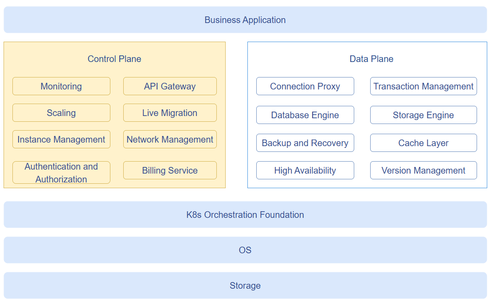
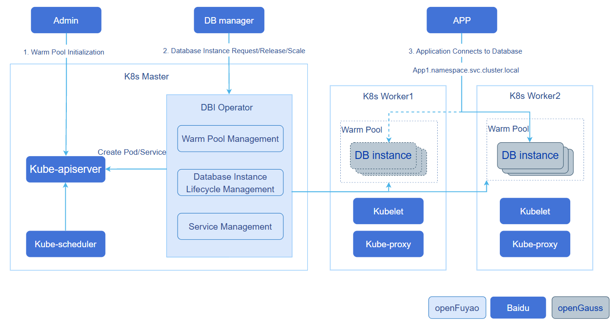

# serverlessdb-operator

## Feature Introduction

Traditional databases are designed for long-term steady-state workloads, whereas in Serverless scenarios, database compute instances have short lifecycles (minutes to tens of minutes), with bursty and unpredictable workloads. This requires database scaling to become a **runtime capability**: on-demand creation, automatic scaling, and idle release.

serverlessdb operator is a Serverless database control plane Operator designed for short-lifecycle, bursty workload scenarios. Based on the Kubernetes Operator extension mechanism, it maintains a pool of pre-warmed database compute instances and exposes a REST interface to support **on-demand allocation, release, and in-place vertical scaling** of database compute instances. It uses a Headless Service to ensure that the connection address remains unchanged after instance release/re-allocation.

**Figure 1** Serverless DB Capability Panorama



As shown in Figure 1, the Serverless DB capabilities are divided into two layers: control plane and data plane:

- **Control Plane**: Focuses on cost efficiency and user experience, primarily responsible for instance lifecycle management, fast resource scheduling and startup, instance traffic monitoring, access security, and operations (serverlessdb operator focuses on this layer).
- **Data Plane**: Focuses on data correctness and performance, primarily responsible for data storage and retrieval, connection transaction management, backup and recovery, etc. (implemented by the database engine, not within the scope of this Operator).

### Application Scenarios

- Upper-layer DB Manager or business services request database compute instances through the REST API from the Operator. After obtaining the connection address, business applications connect to the database via the Service domain name.
- When workloads change, call the scaling interface to adjust resources in place.
- After business is completed, release the instance; the connection address is retained for future reuse.

### Capability Scope

- Supports maintaining a specified number/specification of pre-warmed database compute instances through the `DBResourcePool` CR, with the Reconciler automatically reconciling to replenish.
- Supports millisecond-level instance allocation through the REST API (only label/status changes, allocated from the pre-warmed pool, no cold start required).
- Supports instance release: deletes the DBInstance CR and its Pod, while the Headless Service is retained for connection address reuse.
- Supports in-place vertical scaling based on the K8s `pods/resize` sub-resource, without Pod rebuild.
- Supports multi-tenant authentication and authorization: passes through the caller's Bearer Token to the K8s API Server for authentication, and verifies the tenant's RBAC permissions on the target namespace through `SelfSubjectRulesReview`.
- Supports HTTPS transport encryption for the REST API: the server certificate is pre-configured by the cluster administrator and signed with the cluster CA (the same trust system as the K8s API Server). Clients verify the server with the cluster CA and authenticate with the SA Token; the Operator itself does not participate in certificate issuance.
- Supports high-availability deployment based on K8s Lease leader election, with automatic failover to standby instances when the leader fails.
- Supports periodic cleanup of orphaned Headless Services that have no backing Pod and exceed the TTL.

### Highlight Features

- **Millisecond-level allocation**: Allocating instances only involves label/status changes, distributed from the pre-warmed pool in seconds, no cold start required.
- **Connection address persistence**: Each `app_ref` corresponds to a Headless Service. After an instance is released, the DNS address is retained and can be reused for re-allocation.
- **In-place vertical scaling**: Implements in-place vertical scaling based on the K8s `pods/resize` sub-resource without Pod rebuild, and automatically maintains the Pod's QoS class to pass K8s validation.

### Implementation Principle

**Figure 2** serverlessdb operator Interaction Flow Diagram



As shown in Figure 2, the core interaction flow of serverlessdb operator is as follows:

1. The cluster administrator deploys a database compute instance pre-warmed resource pool CR (`DBResourcePool`). The Operator initializes the database compute instances, creates the corresponding Pods, which are scheduled to appropriate nodes to run, forming the pre-warmed resource pool.
2. The DB Manager calls the Operator's REST interface based on application requirements and traffic monitoring results to allocate, release, and scale database compute instances.
3. When allocating a database compute instance, the Operator creates a Headless Service corresponding to the `app_ref`, associates it with the DBInstance through labels, and K8s reconciles the corresponding routing rules. Applications connect to the database through the Service domain name.

Two components run simultaneously within the Operator process:

1. **Controller Manager** (controller-runtime): Runs `DBResourcePoolReconciler`, reconciles resource pool and instance status, maintains pre-warmed instance count, syncs instance status, performs in-place scaling, and cleans up orphaned Services.
2. **Gin HTTP Server**: Exposes the REST API externally, completes authentication and authorization through `TokenCache`, and then calls `K8sInstanceService` to handle allocation/release/scaling requests.

**Instance allocation flow**: The Operator matches pre-warmed instances from the in-memory cache by PostgreSQL (PG) version and resource specification, completes allocation by patching the DBInstance and its Pod's labels (associating `app_ref`), and creating/reusing a Headless Service named after `app_ref`. In memory, the instance is marked as `Running`, and the status is asynchronously persisted by the Reconciler. The connection address `<app_ref>.<namespace>.svc.cluster.local:<pg_port>` is returned.

**Scaling flow**: The Operator writes the resize-spec annotation on the DBInstance and sets phase=`Scaling`. The Reconciler submits an in-place scaling request through the `pods/resize` sub-resource, and restores `Running` upon completion.

### Relationship with Related Features

- Depends on the Kubernetes ≥ 1.32 Pod in-place vertical scaling feature (`pods/resize` sub-resource).
- Depends on Kubernetes Lease (`coordination.k8s.io/leases`) for leader election high availability.

## Using serverlessdb operator

### Prerequisites

- Kubernetes uses the openFuyao community recommended version v1.34.3 (requires ≥ 1.32 to support Pod in-place vertical scaling).
- Helm 3 is installed.
- The database compute image (e.g., `postgres:17`) is prepared. If nodes cannot directly pull images, import images offline on each node in advance or configure `imagePullSecrets`:

  ```bash
  # Offline import image to node
  nerdctl load -i compute-v17.4.tar
  ```

### Background Information

Through the [Operation Steps](#operation-steps) below, you can achieve the **full process of deploying the Operator, creating a pre-warmed resource pool, and allocating/scaling/releasing database compute instances**, enabling business applications to connect to on-demand allocated database compute instances through a fixed Service domain name.

### Usage Restrictions

- The first container in the `DBResourcePool` Pod template should be named `compute`, and its resource configuration is used for resource pool matching (if this convention is violated, resource matching will degrade to the default value without error).
- PostgreSQL major versions only support `16` and `17`.
- In-place vertical scaling cannot change the Pod's QoS class (Burstable ↔ Guaranteed); the Operator automatically adjusts limits to maintain the original QoS class.
- The upper-layer service calling the REST API must hold RBAC permissions for the required resources in the target namespace (see step 4 of [Operation Steps](#operation-steps)).
- When REST API HTTPS is enabled, callers must access the REST API through the Service domain name, not the Pod IP directly (the server certificate SAN does not cover the Pod IP).

### Operation Steps

1. Build and push the image.

   1.1 Compile the binary and build the Docker image.

   ```bash
   # Local compilation
   go build -o bin/serverlessdb-operator ./cmd

   # Build single-architecture Docker image
   REGISTRY=<your-registry> TAG=1.0.0 ./build/build.sh

   # Build multi-architecture manifest (requires building and pushing each architecture image first)
   REGISTRY=<your-registry> TAG=1.0.0 ./build/build.sh manifest
   ```

   > **Note:**
   >
   >Supports `linux/amd64` and `linux/arm64` architectures. Multi-architecture manifest mode requires `REGISTRY` to be set.

2. Install the Operator via Helm.

   2.1 Install the Chart using Helm. The Chart includes CRD (`dbresourcepool` / `dbinstance`), Deployment, Service (in-cluster access entry for the REST API), ServiceAccount, and ClusterRole/ClusterRoleBinding.

   ```bash
   helm install serverlessdb-operator ./build/chart \
     -n serverlessdb --create-namespace \
     --set namespace=serverlessdb
   ```

   > **Note:**
   >
   >- The Chart pulls the image from `cr.openfuyao.cn/openfuyao/serverlessdb-operator/serverlessdb-operator:latest` by default. To use a custom image, override with `--set image.registry`, `--set image.repository`, `--set image.tag`.
   >- You can adjust ports, leader election parameters, resources, TTL, QPS, etc. in `build/chart/values.yaml`. Authentication uses the in-cluster ServiceAccount Token by default. For full parameter descriptions, see [Operator Configuration Parameters](#operator-configuration-parameters).

   2.2 (Optional) Enable REST API HTTPS.

   Whether the Operator enables HTTPS is determined by whether the certificate is configured, with no separate switch: **if `tls` is not configured in values, the REST API is served over HTTP; after configuring `tls`, HTTPS is enabled**. The server certificate is pre-signed by the cluster administrator with the cluster CA (the same trust system as the K8s API Server). Clients access with the cluster CA + SA Token, and the Operator does not participate in certificate issuance.

   2.2.1 The administrator signs the certificate and creates the Secret (kubeadm cluster example, `<ns>` is the Operator deployment namespace).

   ```bash
   NS=<ns>
   # 1. Generate the private key and CSR; the SAN covers the Service domain names
   openssl genrsa -out tls.key 2048
   openssl req -new -key tls.key -out tls.csr -subj "/CN=serverlessdb-operator.${NS}.svc" \
     -addext "subjectAltName=DNS:serverlessdb-operator,DNS:serverlessdb-operator.${NS},DNS:serverlessdb-operator.${NS}.svc,DNS:serverlessdb-operator.${NS}.svc.cluster.local"
   # 2. Sign with the cluster CA (/etc/kubernetes/pki is the default kubeadm path)
   openssl x509 -req -in tls.csr -CA /etc/kubernetes/pki/ca.crt -CAkey /etc/kubernetes/pki/ca.key \
     -CAcreateserial -out tls.crt -days 3650 \
     -extfile <(printf "subjectAltName=DNS:serverlessdb-operator,DNS:serverlessdb-operator.${NS},DNS:serverlessdb-operator.${NS}.svc,DNS:serverlessdb-operator.${NS}.svc.cluster.local")
   # 3. Create the Secret (must be completed before helm install/upgrade)
   kubectl create secret tls serverlessdb-operator-tls -n "${NS}" --cert=tls.crt --key=tls.key
   ```

   2.2.2 Configure `tls` in `values.yaml` and install/upgrade the Chart (`secretName` is customizable; certificate mount paths have default values).

   ```yaml
   tls:
     secretName: serverlessdb-operator-tls
   ```

   > **Note:**
   >
   >- After HTTPS is enabled, callers access the REST API through the Service domain name `https://serverlessdb-operator.<ns>.svc:8080`. **Do not access the Pod IP directly** (the certificate SAN does not cover the Pod IP).
   >- Callers verify the server certificate with the cluster CA (inside a Pod, `/var/run/secrets/kubernetes.io/serviceaccount/ca.crt` can be used directly), and authentication is still performed through `Authorization: Bearer <token>`.
   >- When the certificate expires or is rotated, the administrator updates the Secret and then runs `kubectl rollout restart deployment/serverlessdb-operator` to reload it. Removing the `tls` configuration from values reverts to HTTP.

   2.3 (Optional) If you need to authenticate the communication between the Operator and the API Server using client certificates, configure in `values.yaml`:

   ```yaml
   clientCert:
     enabled: true
     secretName: "operator-tls"
     certPath: /etc/serverlessdb/tls/tls.crt
     keyPath:  /etc/serverlessdb/tls/tls.key
     username: "serverlessdb-operator"   # Or group, used for binding ClusterRole
   ```

   2.4 Confirm the Operator Pod is in Running state.

   ```bash
   kubectl -n serverlessdb get pods -l app=serverlessdb-operator
   ```

3. Create a DBResourcePool resource pool.

   3.1 Deploy the `DBResourcePool` CR, defining the desired number of instances, PG version, and Pod template.

   ```yaml
   apiVersion: serverlessdb.openfuyao.cn/v1
   kind: DBResourcePool
   metadata:
     name: pool-small
     namespace: serverlessdb
   spec:
     replicas: 5              # Total number of instances maintained (warm + allocated)
     minAvailable: 2          # Minimum pre-warmed available instances
     pgVersion: 17            # PostgreSQL major version (16 | 17)
     controlPlaneUrl: "http://control-plane:8080"
     podTemplate:             # Complete Pod template, compute container's resources used for pool matching
       metadata:
         labels:
           app: compute
         annotations:
           compute.openfuyao.cn/priority: "0"
           prometheus.io/scrape: "true"
           prometheus.io/port: "3080"
       spec:
         hostNetwork: false
         dnsPolicy: ClusterFirst
         securityContext:
           fsGroup: 1000
           runAsUser: 1000
         containers:
         - name: compute               # First container should be named compute
           image: "cr.openfuyao.cn/openfuyao/compute/compute:v17.4"
           imagePullPolicy: IfNotPresent
           resizePolicy:                # In-place scaling policy, NotRequired means no container restart required
           - resourceName: cpu
             restartPolicy: NotRequired
           - resourceName: memory
             restartPolicy: NotRequired
           env:
           - name: MY_POD_NAME
             valueFrom:
               fieldRef:
                 fieldPath: metadata.name
           - name: NAMESPACE
             valueFrom:
               fieldRef:
                 fieldPath: metadata.namespace
           - name: COMPUTE_ID
             value: "$(NAMESPACE)_$(MY_POD_NAME)"
           args:
           - /var/db/postgres/compute
           - -C
           - postgresql://cloud_admin@localhost/postgres
           - -b
           - /usr/local/bin/postgres
           - --compute-id
           - $(COMPUTE_ID)
           - --dev
           ports:
           - name: pg
             containerPort: 5432
           resources:
             requests: { cpu: "1000m", memory: "1Gi" }
             limits:   { cpu: "2000m", memory: "2Gi" }
   ```

   > **Note:**
   >
   >- `replicas` is the total number of instances maintained (warm + allocated); `minAvailable` is the minimum pre-warmed available instances, below which the Reconciler automatically replenishes.
   >- The `compute` container's `resources` are used for resource pool matching when requesting instances. Set `resizePolicy` to `NotRequired` to support in-place scaling without container restart.
   >- `controlPlaneUrl` is injected as an environment variable into the compute container and init/heartbeat containers.
   >- The above example is a minimal viable template that allows pre-warmed instances to reach `WarmReady` without initContainers. In production environments, if you need to register Pods with the control plane, add a `register-pod` container in `spec.initContainers` and use it with `controlPlaneUrl`.

   3.2 Confirm the resource pool is ready and pre-warmed instances have reached the WarmReady state.

   ```bash
   kubectl -n serverlessdb get dbresourcepool pool-small
   ```

   Expected output (`Available` should gradually reach the `replicas` value):

   ```text
   NAME          TOTAL   WARM   AVAILABLE   ALLOCATED   PG-VERSION   AGE
   pool-small    5       5      5           0           17           2m
   ```

4. Grant RBAC permissions to the caller.

   The upper-layer DB Manager must hold permissions for the following resources in the target namespace for the Operator to complete operations using its Token:

   - `serverlessdb.openfuyao.cn` group: get/list/patch/delete of `dbinstances`, patch of `dbinstances/status`
   - Core API: get/patch of `pods`, get/create/delete of `services`

   Example Role and RoleBinding (bound to the ServiceAccount used by the caller):

   ```yaml
   apiVersion: rbac.authorization.k8s.io/v1
   kind: Role
   metadata:
     name: serverlessdb-tenant
     namespace: serverlessdb
   rules:
   - apiGroups: ["serverlessdb.openfuyao.cn"]
     resources: ["dbinstances"]
     verbs: ["get", "list", "patch", "delete"]
   - apiGroups: ["serverlessdb.openfuyao.cn"]
     resources: ["dbinstances/status"]
     verbs: ["patch"]
   - apiGroups: [""]
     resources: ["pods"]
     verbs: ["get", "patch"]
   - apiGroups: [""]
     resources: ["services"]
     verbs: ["get", "create", "delete"]
   ---
   apiVersion: rbac.authorization.k8s.io/v1
   kind: RoleBinding
   metadata:
     name: serverlessdb-tenant
     namespace: serverlessdb
   subjects:
   - kind: ServiceAccount
     name: <caller-serviceaccount>
     namespace: <caller-namespace>
   roleRef:
     kind: Role
     name: serverlessdb-tenant
     apiGroup: rbac.authorization.k8s.io
   ```

    4.1 Create the caller ServiceAccount and obtain the Bearer Token.

    ```bash
    # Create the caller ServiceAccount (if it does not exist)
    kubectl -n <caller-namespace> create serviceaccount <caller-serviceaccount>

    # Issue a Bearer Token through the TokenRequest API (default validity period is 1 hour)
    kubectl -n <caller-namespace> create token <caller-serviceaccount>
    ```

    > **Note:**
    >
    >- K8s ≥ 1.24 no longer automatically generates long-term Tokens for ServiceAccounts; use `kubectl create token` to issue through the TokenRequest API.
    >- The Token is valid for 1 hour by default. After expiration, calling the REST API will return `401`, and the Token must be re-issued.
    >- For a long-term Token, create a Secret of type `kubernetes.io/service-account-token` and annotate it with the corresponding ServiceAccount. The K8s control plane will automatically populate the long-term Token into the Secret.

5. Allocate an instance.

   5.1 Determine the REST API base address (`<operator-ns>` is the Operator deployment namespace, `serverlessdb` in this example):

   - HTTPS enabled (`tls` configured in values): `https://serverlessdb-operator.<operator-ns>.svc:8080`. Callers must hold the cluster CA certificate (inside a Pod, `/var/run/secrets/kubernetes.io/serviceaccount/ca.crt`).
   - HTTPS not enabled (default): `http://serverlessdb-operator.<operator-ns>.svc:8080`.

   5.2 The caller carries the Bearer Token and sends an instance allocation request to the Operator.

   ```http
   POST /api/v1/instances?namespace=serverlessdb
   Authorization: Bearer <token>

   {
     "app_ref": "app1",
     "pg_version": 17,
     "resources": { "cpu": "1000m", "memory": "1Gi" }
   }
   ```

   curl example when HTTPS is enabled:

   ```bash
   curl --cacert /var/run/secrets/kubernetes.io/serviceaccount/ca.crt \
     -X POST "https://serverlessdb-operator.serverlessdb.svc:8080/api/v1/instances?namespace=serverlessdb" \
     -H "Authorization: Bearer <token>" \
     -H "Content-Type: application/json" \
     -d '{"app_ref":"app1","pg_version":17,"resources":{"cpu":"1000m","memory":"1Gi"}}'
   ```

   Response `200`:

   ```json
   {
     "endpoint": "app1.serverlessdb.svc.cluster.local:5432",
     "pod_name": "pool-small-abc12",
     "pod_id": "4b295d49-7886-4dc7-a4b1-528886c5eb97"
   }
   ```

   5.3 The business application uses the returned `endpoint` to connect to the database.

   > **Note:**
   >
   >Allocating instances only involves label/status changes, distributed from the pre-warmed pool in seconds, no cold start required. For HTTP API error codes and their meanings, see [HTTP API Error Codes](#http-api-error-codes).

6. Vertical scaling.

   6.1 Call the PATCH interface to perform in-place vertical scaling on a running instance.

   ```http
   PATCH /api/v1/instances/app1?namespace=serverlessdb
   Authorization: Bearer <token>

   {
     "containers": [
       { "name": "compute", "resources": { "cpu": "2000m", "memory": "2Gi" } }
     ]
   }
   ```

   The Operator writes the resize-spec annotation on the DBInstance and sets phase=`Scaling`. The Reconciler submits an in-place scaling request through the `pods/resize` sub-resource, and restores `Running` upon completion.

   > **Note:**
   >
   >Scaling does not change the Pod's QoS class. If the adjustment would cause a Burstable → Guaranteed change, the Operator automatically raises the limit to maintain the original QoS class, avoiding rejection by K8s.

7. Release the instance.

   7.1 Call the DELETE interface to release the instance.

   ```http
   DELETE /api/v1/instances/app1?namespace=serverlessdb
   Authorization: Bearer <token>
   ```

   Response `204`. The DBInstance CR is deleted (the Pod is cascade-deleted via ownerRef), and the Headless Service is retained for connection address reuse.

   > **Note:**
   >
   >After release, re-allocating an instance with the same `app_ref` will reuse the same DNS connection address.

### Related Operations

**Query Resource Pool Status**

- Query all `DBResourcePool`.

  ```bash
  kubectl -n serverlessdb get dbresourcepool
  ```

  Example output:

  ```text
  NAME          TOTAL   WARM   AVAILABLE   ALLOCATED   PG-VERSION   AGE
  pool-small    5       3      3           2           17           10m
  ```

- Query resource pool details.

  ```bash
  kubectl -n serverlessdb get dbresourcepool pool-small -o yaml
  ```

- Adjust the resource pool scale online through the `/scale` sub-resource.

  ```bash
  kubectl -n serverlessdb scale dbresourcepool pool-small --replicas=10
  ```

**Query Instance Status**

- Query all `DBInstance`.

  ```bash
  kubectl -n serverlessdb get dbinstance
  ```

- Query allocated instances by `app_ref`.

  ```bash
  kubectl -n serverlessdb get dbinstance -l app-ref=app1
  ```

- Query instance details, view phase, podName, podIP, connection address, etc. For `.status.phase` values and their meanings, see [DBInstance Status Description](#dbinstance-status-description).

  ```bash
  kubectl -n serverlessdb get dbinstance -l app-ref=app1 -o yaml
  ```

  Example output:

  ```yaml
  apiVersion: serverlessdb.openfuyao.cn/v1
  kind: DBInstance
  metadata:
    name: pool-small-ins-0
    namespace: serverlessdb
    labels:
      dbresourcepool: pool-small
      app-ref: app1
  spec: {}
  status:
    phase: Running
    podName: pool-small-abc12
    podIP: 10.244.1.10
    podUID: 4b295d49-7886-4dc7-a4b1-528886c5eb97
    connectionString: app1.serverlessdb.svc.cluster.local:5432
    pgPort: 5432
    allocatedAt: "2026-07-20T10:00:00Z"
  ```

**View Operator Logs**

```bash
kubectl -n serverlessdb logs -l app=serverlessdb-operator --tail=100
```

**REST API Debugging (port-forward)**

The Operator's Gin HTTP Server binds to the Pod IP (not `0.0.0.0`). `kubectl port-forward` depends on `127.0.0.1` being reachable within the Pod, so direct forwarding will fail:

```text
E ... failed to connect to localhost:8080 inside namespace
dial tcp4 127.0.0.1:8080: connect: connection refused
```

During debugging, first obtain the Pod IP and send requests directly to the Pod IP:

```bash
# Get the Operator Pod IP
POD_IP=$(kubectl -n serverlessdb get pod -l app=serverlessdb-operator \
  -o jsonpath='{.items[0].status.podIP}')

# HTTPS not enabled (default): call directly over HTTP
curl http://${POD_IP}:8080/api/v1/instances?namespace=serverlessdb \
  -H "Authorization: Bearer <token>"

# HTTPS enabled: the certificate SAN covers only Service domain names, so verification fails when connecting to the Pod IP directly. Add -k to skip verification for debugging
curl -k https://${POD_IP}:8080/api/v1/instances?namespace=serverlessdb \
  -H "Authorization: Bearer <token>"
```

When HTTPS is enabled, calling through the Service domain name from a Pod inside the cluster is recommended (certificate verification passes, `--cacert` specifies the cluster CA):

```bash
curl --cacert /var/run/secrets/kubernetes.io/serviceaccount/ca.crt \
  "https://serverlessdb-operator.serverlessdb.svc:8080/api/v1/instances?namespace=serverlessdb" \
  -H "Authorization: Bearer <token>"
```

If you need to use `kubectl port-forward`, start a local proxy inside the Pod to forward `127.0.0.1` to the Pod IP:

```bash
# Start a local proxy inside the Operator Pod (example: 9090 -> PodIP:8080)
kubectl -n serverlessdb exec <pod> -- bash -c \
  'nohup socat TCP-LISTEN:9090,fork TCP:$(hostname -I | awk "{print \$1}"):8080 &'

# port-forward to the proxy port
kubectl -n serverlessdb port-forward <pod> 8080:9090
```

> **Note:**
>
>The above workaround is for debugging only. In production environments, the REST API should be exposed through a Service. When HTTPS is enabled, always access it via `https://serverlessdb-operator.<ns>.svc:8080`.

## Reference Information

### DBInstance Status Description

**Table 1** DBInstance Status Description

| `.status.phase` | Description |
|---|---|
| `WarmReady` | Pre-warmed and ready, pending allocation. |
| `Running` | Allocated to an `app_ref`, running. |
| `Scaling` | Vertical scaling in progress. |
| `WakingUp` | Pod is starting. |
| `Hibernated` | Hibernated. |
| `Failed` | Abnormal. |

### HTTP API Error Codes

**Table 2** HTTP API Error Codes

| HTTP | Description |
|---|---|
| 400 | Invalid request parameters / no matching resource pool. |
| 401 | Token authentication failed. |
| 403 | Token authorization failed (insufficient RBAC). |
| 404 | Instance does not exist / no available pre-warmed instances. |
| 409 | An instance is already allocated for this `app_ref`. |

### Operator Configuration Parameters

Operator startup parameters (see `internal/config/config.go`), adjustable through the `args` section of Helm `values.yaml`:

**Table 3** Operator Configuration Parameters

| Parameter | Default Value | Description |
|---|---|---|
| `--gin-port` | 8080 | REST API port. |
| `--metrics-port` | 8081 | Prometheus metrics port. |
| `--health-port` | 8082 | Health probe port (`/healthz`, `/readyz`). |
| `--log-file` | `/var/log/openFuyao/serverlessdb-operator/serverlessdb-operator.log` | Log file path. |
| `--leader-election` | true | Whether to enable leader election. |
| `--leader-election-id` | `serverlessdb-operator.openfuyao.cn` | Leader election Lease ID. |
| `--leader-election-namespace` | empty | Namespace for leader election Lease; injected by `namespace` in `values.yaml` during Helm deployment. |
| `--lease-duration` | 15s | Lease duration. |
| `--renew-deadline` | 10s | Renewal deadline. |
| `--retry-period` | 2s | Retry period. |
| `--service-ttl` | 30m | Orphan Service cleanup TTL, 0 means disabled. |
| `--token-cache-ttl` | 5m | Token client and authorization result cache duration. |
| `--tenant-client-qps` | 100 | Per-tenant K8s client QPS. |
| `--tenant-client-burst` | 200 | Per-tenant K8s client burst. |
| `--client-cert` / `--client-key` | empty | Client certificate authentication (optional). |
| `--tls-cert` / `--tls-key` | empty | REST API server certificate and private key paths. HTTPS is enabled only when both are configured; HTTP is used by default (injected via the `tls` section in values during Helm deployment). |
