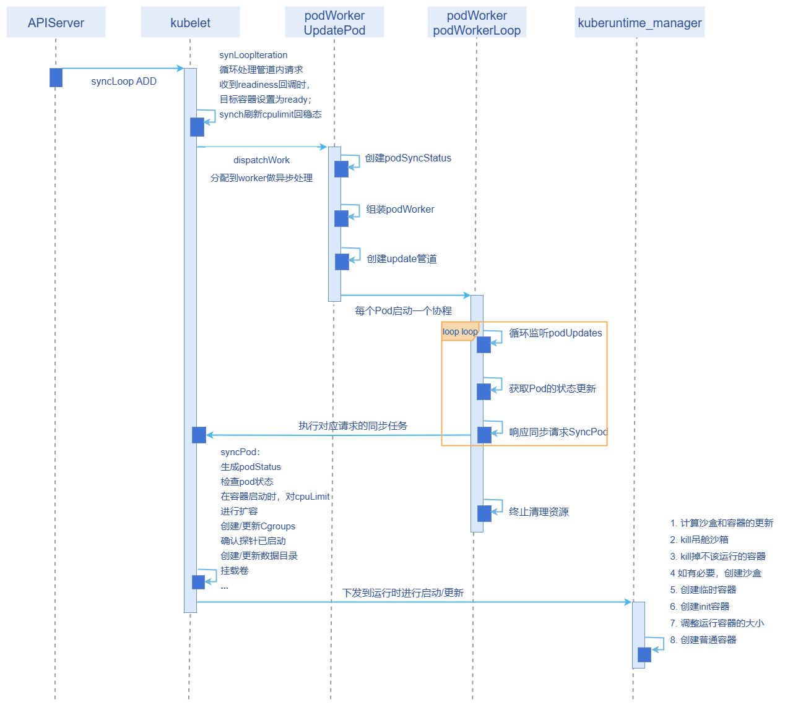

# 容器启动时CPU加速

## 特性介绍

服务启动阶段相较于稳态会更耗费CPU资源。本需求旨在保障稳态较少资源占用的前提下，又能增加启动速度，以满足业务的需求。

### 应用场景

• 开启特性开关，正确配置启动时的`resize.on.starting`，Pod启动时，以`ResizeLimit`为限制进行启动，启动后limit回归稳态的配置大小。

• 开启特性开关，正确配置启动时的`resize.on.starting`，容器启动后被异常杀死，容器重启时以`ResizeLimit`为限制进行启动，启动后limit回归稳态的配置大小。

• 开启特性开关，正确配置启动时的`resize.on.starting`，Pod启动后被异常杀死，Pod重启时容器以`ResizeLimit`为限制进行启动，启动后limit回归稳态的配置大小。

### 能力范围

支持启动时调整CPU的limit值来满足启动加速，不提供启动时调整内存limit的能力。

### 亮点特征

Java等程序启动阶段比较耗资源，启动完成后资源会下降。如果启动时配置的资源较小，启动耗时会比较长。本需求既能保证启动速度，又能减少稳态资源占用。

### 实现原理

#### 设计原则

- 默认保持社区原生能力，本特性开关默认关闭。
- 尽可能少地改动原生代码。
- 以最小存储代价记录请求访问的基本信息。

#### 新增参数

| 参数               | 缺省值   | 描述                 |
| ------------------ | -------- | -------------------- |
| resize.on.starting | 空字符串 | 服务启动时CPU的limit |

#### 流程梳理

**图1** 容器启动时CPU加速流程图



#### 实现方案

1. 首先校验配置值是否合法：需要大于稳态limit，不合法则不动态调整CPU值，并记录日志。
2. 在处理Pod的SyncPod方法中，根据annotation中的配置，对非terminated状态Pod中非ready容器的资源大小进行Patch，然后下发给运行时进行启动。
3. 启动成功后会根据探针结果刷新Pod状态，如果探针OK，容器刷新为ready状态，此时原生逻辑syncCh会刷新回稳态cpulimit。
4. 每次Pod重建和重启时，重复上述操作。

### 与相关特性的关系

InPlacePodVerticalScaling：启动调整能力依赖`InPlacePodVerticalScaling`特性开关，仅支持CPU上限在启动阶段调整。

## 创建Pod，检视Pod启动时CPU加速

### 前提条件

- 特性默认不开，是否开启由产品决定。

- 启动调整能力依赖`InPlacePodVerticalScaling`特性开关，仅支持CPU上限在启动阶段调整。

- 业务必须保证readiness探针成功时是已经就绪的，探针结果为是否调回资源到稳定态的唯一判断依据。

- Pod的QoS等级不能为Guaranteed。

### 背景信息

需要了解`kube-apiserver`和`kubelet`组件的`InPlacePodVerticalScaling`特性开启方式。

### 使用限制

- 启动时`ResizeLimit`不能小于稳态时的cpulimit，若小于则配置不生效，会记录日志并打印。
- 特性在升级时开启，会导致容器重启，导致断服，当前也没有升级开启的能力。
- 可能由于资源紧张，导致调度上来的Pod即使调整了cpulimit，但也不一定能完全实现加速。

### 操作步骤

1. 启动调整能力依赖`InPlacePodVerticalScaling`特性门控，请打开`kubelet`和`kube-apiserver`两个组件的`InPlacePodVerticalScaling`特性门控，参考链接：

   [kube-apiserver | Kubernetes](https://kubernetes.io/zh-cn/docs/reference/command-line-tools-reference/kube-apiserver/)

   [Feature Gates | Kubernetes](https://kubernetes.io/docs/reference/command-line-tools-reference/feature-gates/)

   实例：

   在kube-apiserver的配置文件的feature-gates中添加：`InPlacePodVerticalScaling=true`，执行命令`kubectl delete pod -n {namespace} {api-server pod name}`重启kube-apiserver。

   在kubelet的配置文件中的featureGate中添加：`InPlacePodVerticalScaling: true`，执行命令`systemctl restart kubelete`重启kubelet。预期成功返回`kubelete start success`。

2. 创建workload（deployment、statefulset等）时，在resource字段配置其稳态的CPU的request/limit，在Pod的metadata的annotations中配置每个容器启动时需要的CPU值。

   ```
   resize.on.starting: '[{"name":"container1", "cpu":"400m"},{"name":"container2", "cpu":"600m"}]'
   ```

   正确配置deploy示例参考如下：

   ```yaml
   apiVersion: apps/v1
   kind: Deployment
   metadata:
     name: my-pod
   spec:
     replicas: 1
     selector:
       matchLabels:
         app: my-pod
     template:
       metadata:
         labels:
           app: my-pod
         annotations:
           resize.on.starting: '[{"name":"my-container", "cpu":"4"}]'        # 开启resize特性，可配置多个容器
       spec:
         restartPolicy: Always
         containers:
           - name: my-container
             image: registry.k8s.io/e2e-test-images/nginx:1.15-2
             resources:
               limits:
                 cpu: 300m
             ports:
               - containerPort: 80
             readinessProbe:
               httpGet:
                 path: /
                 port: 80
               initialDelaySeconds: 1
               periodSeconds: 10
               timeoutSeconds: 1
               failureThreshold: 3
   ```

3. 自验：通过`crictl inspect containerID |grep cpuQuota`命令，分别查看容器创建时和稳态后耗费的CPU，启动时为`resize.on.starting`配置大小，稳态后为`cpuLimit`配置大小。
