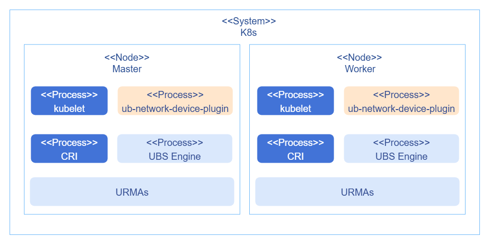
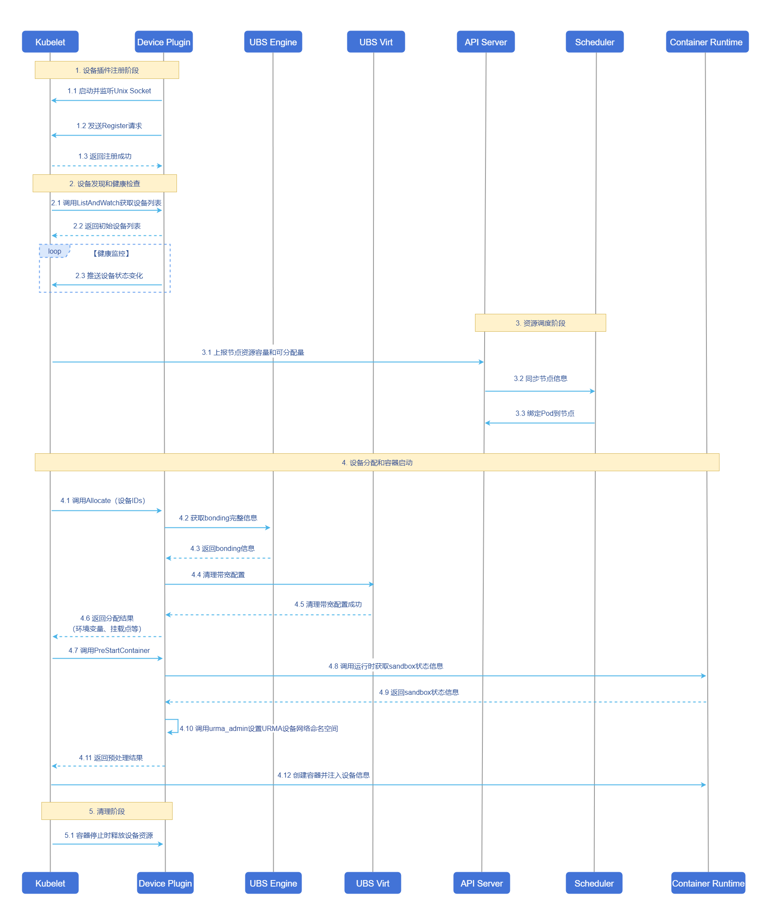

# 基于UB容器网络的设备插件

## 特性介绍

本特性旨在使能业务使用URMA设备进行通信，降低通信时延，提升业务性能。

### 应用场景

在UB环境中，业务需要使用URMA设备进行通信。Device Plugin负责管理和分配设备，与kubelet进行交互，并在分配之后，将设备的网络命名空间修改为容器的命名空间。

### 能力范围

- 支持URMA设备的管理与按需分配。
- 支持设置URMA设备的网络命名空间。

### 亮点特征

- 支持环境上URMA设备探活。
- 使能业务使用URMA设备进行通信，降低通信时延，提升业务性能。

### 实现原理

#### 部署视图

新增ub-network-device-plugin组件，以daemonset部署，与kubelet、容器运行时和ubs engine进行交互。

**图1** 部署视图



#### 设备发现与分配

设备插件的注入与设备管理部分，实现deviceplugin的标准接口即可。因为需要在插件的`PreStartContainer`接口中修改网络命名空间，所以在注册时，需要指定进行`PreStartContainer`。设备信息在接口中已传递，设备与Pod的对应关系在设备分配之后就会存储在当前节点的`/var/lib/kubelet/device-plugins/kubelet_internal_checkpoint`文件中，可根据对应的设备信息匹配对应的Pod信息，通过PodID信息获取网络命名空间，之后执行命名空间修改动作即可。Pod的生命周期结束之后，对应的网络命名空间会自动释放，URMA在监控到对应的网络命令空间消亡后，会自动清理逻辑设备，并释放EID到外部，保证下次网络设备的可正常分配。

#### 交互流程

**图2** 交互流程



#### 设置网络命名空间

获取网络命名空间，主要是获取Pod的Sandbox容器的进程ID信息，即pause进程的ID；在Pod启动流程中，先创建并启动Pod的Sandbox，然后再创建和启动容器，在启动容器之前，kubelet会调用`PreStartContainer`接口，此时pause已启动，可进行获取。流程如下：

1. 为了通过设备ID获取PodUID，需要将kubelet的deviceplugin目录以hostpath方式挂载到：`/var/lib/kubelet/device-plugins`，这也是deviceplugin默认要求挂载的内容；
2. 通过PodUID调用运行时获取对应的Sandbox的信息，再通过SandboxID获取Sandbox的状态信息，状态信息中有pid信息；需要以hostpath方式挂载容器运行时的通信sock文件，以containerd为例，默认为：`/run/containerd/containerd.sock`。

## 安装

### 前置条件

- 已安装K8s集群。
- 已具备UB能力。

### 开始安装

1. 编辑`ub-network-device-plugin.yaml`，`Image`填入：`openfuyao/ub-network-device-plugin:br_noncom_container_20260228`。

2. 执行如下命令部署device plugin。

   ```bash
   kubectl apply -f ub-network-device-plugin.yaml
   ```

## 使用URMA设备

在containers中按照如下示例配置resources，设备类型支持ub_net_device：

```yaml
...
spec:
  containers:
    resources:
      requests:
        cpu: "1"
        memory: "128Mi"
        unifiedbus.com/ub_net_device: "1"
      limits:
        cpu: "1"
        memory: "128Mi"
        unifiedbus.com/ub_net_device: "1"
...
```
