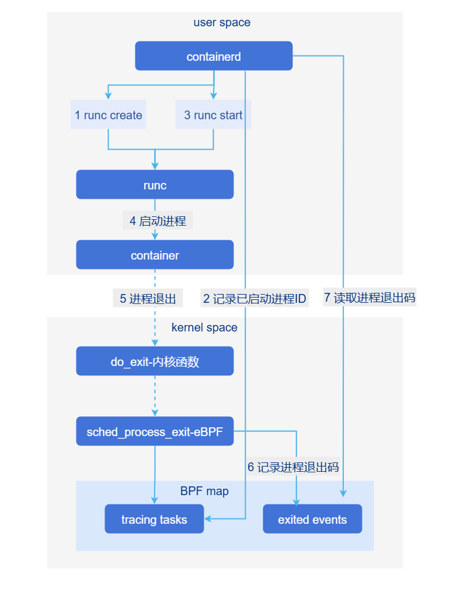

# 容器高密部署

## 特性介绍

工作节点上部署大量Pod时，主要的问题包括：

• `containerd`运行时会为每个Pod创建一个shim进程来做Pod管理和监控，Pod数量多时shim占用大量内存。

  shim与容器的关系是1:1，containerd容器的shim进程使用go语言编写，占用内存约20M。在1000Pod时，占用内存约20G。

• kubelet原生探针机制（exec/http）CPU占用比较高，Pod数量多时探测失败率也会升高。

  原生的探针机制通过CRI接口运行，容器数量特别多时，会有大量的并发调用，产生较高的系统底噪，让系统响应速度变慢。

• 大量容器会产生大量的cgroup，导致systemd管理性能和可靠性下降。

因此，希望针对上述问题进行优化和消减。

### 应用场景

• 正确配置轻量级探针，业务周期性更新目标文件，探针探测到文件更新，探针成功。

• 正确配置轻量级探针，容器启动失败，无法周期性更新目标文件，探针探测到文件更新时长超过配置，探针失败。

### 亮点特征

• 消除shim进程

  在containerd中实现shim功能，使用内核eBPF技术实现进程退出监控，降低容器底座内存占用。

• 构建轻量级kubelet探针

  使用文件检测等低成本方式替代消息交互/CRI交互方案实现kubelet探针，降低容器底座CPU占用。

### 实现原理

#### 设计原则

1. 默认保持社区原生能力，本特性开关默认关闭。
2. 尽可能少地改动原生代码。
3. 以最小存储代价记录请求访问的基本信息。

#### 新增参数

| 参数     | 缺省值   | 描述                                     |
| -------- | -------- | ---------------------------------------- |
| file     | 空字符串 | 轻量级探针file。                           |
| path     | 空字符串 | 目标文件的位置。                           |
| validity | 0        | 修改时间若在该值内，则探针成功，否则失败。 |

#### shimless实现方案

`containerd`拉起进程后，创建`pidfd`来跟踪进程的退出事件，借助`sched_process_exit` `eBPF`程序记录进程退出码。即使`containerd`重启过程中出现容器进程退出事件，因为内核`eBPF`程序不会退出，`containerd`启动后通过读取`eBPF`记录的退出码，就可以识别重启过程中的进程退出事件。主要流程如下：

• `containerd`启动时在内核中载入`eBPF`程序`sched_process_exit`。

• `containerd`通过`runc`启动容器、记录进程ID到`BPF map` `tracing_tasks`，并创建`pidfd`跟踪进程退出。

• 容器进程退出后，`sched_process_exit`程序负责将进程退出码记录到`BPF map`中的`exited_events`。

• `containerd`通过`pidfd`监控到进程退出事件后，从`BPF map`中的`exited_events`中读取进程退出码。

**图1** shimless实现流程图



基于新的容器退出感知机制，可以考虑将shim的相关能力使用ebpf内核能力来实现，将其他能力剥离到containerd中，从而达到消减shim的目的。

#### 轻量级探针工作原理

1. 容器进程定时更新文件`file.path`的时间戳。

2. `kubelet`轻量化探针根据用户配置的探测间隔定期地进行检查文件`file.path`的修改时间戳，如果文件修改时间距离当前时间未超过`file.validity`，则探测成功，否则探测失败。其余探针参数与其他原生探针含义和处理方式一致。

### 与相关特性的关系

无。

## 创建一个包含轻量级探针的shimless Pod

### 前提条件

- kernel版本>=v5.4，内核编译选项CONFIG_DEBUG_INFO_BTF=y。如果要使用cgroup v2，建议内核版本5.14以上。

  执行命令`grep BTF /boot/config-$(uname -r)`，输出：

  1. `CONFIG_DEBUG_INFO_BTF=y`表示支持；

  2. `# CONFIG_DEBUG_INFO_BTF is not set`表示不支持。

- 容器需正确创建探针文件，并持续周期性更新。
- 不允许系统运行过程中修改shimless配置，导致shim和shimless同时存在。

### 背景信息

需要了解`kube-apiserver`和`kubelet`组件的`InPlacePodVerticalScaling`特性开启方式。

### 使用限制

无。

### 操作步骤

#### shim进程消减

1. 确保containerd（替换）和containerd-shim-shimless-v2（新增）在正确的路径下，例如`/usr/local/bin/`。

2. 执行`vi /etc/containerd/config.toml`配置config。

   ```
   在[plugins."io.containerd.grpc.v1.cri".containerd.runtimes]下增加配置项：
   
     [plugins."io.containerd.grpc.v1.cri".containerd.runtimes.unified]
       base_runtime_spec = ""
       cni_conf_dir = ""
       cni_max_conf_num = 0
       container_annotations = []
       pod_annotations = []
       privileged_without_host_devices = false
       privileged_without_host_devices_all_devices_allowed = false
       runtime_engine = ""
       runtime_path = "/usr/local/bin/containerd-shim-shimless-v2"
       runtime_root = ""
       runtime_type = "io.containerd.runc.v2"
       sandbox_mode = "podsandbox"
       snapshotter = ""
   
       [plugins."io.containerd.grpc.v1.cri".containerd.runtimes.unified.options]
         BinaryName = ""
         CriuImagePath = ""
         CriuPath = ""
         CriuWorkPath = ""
         IoGid = 0
         IoUid = 0
         NoNewKeyring = false
         NoPivotRoot = false
         Root = ""
         ShimCgroup = ""
         SystemdCgroup = true
   ```
   
3. 修改containerd.service，在Service表下增加配置项：`LimitMEMLOCK=infinity`。

4. 执行`kubectl apply -f xxx.yaml`创建runtimeClass，`xxx.yaml`参考如下样例。

   ```
   kind: RuntimeClass
   apiVersion: node.k8s.io/v1
   metadata:
     name: unified
   handler: unified
   ```

5. 启动Pod，在Pod的spec中添加`runtimeClassName: unified`引入RuntimeClass，示例如下。

   ```
   apiVersion: apps/v1
   kind: Deployment
   metadata:
     name: shimless-pod
   spec:
     replicas: 10
     selector:
       matchLabels:
         app: shimless-pod
     template:
       metadata:
         labels:
           app: shimless-pod
       spec:
         restartPolicy: Always
         runtimeClassName: unified                                   # 在Pod的SPEC中引用RuntimeClass
         containers:
           - name: shimless-container
             image: registry.k8s.io/e2e-test-images/nginx:1.15-2
             resources:
               limits:
                 cpu: 300m
             ports:
               - containerPort: 80
             readinessProbe:
               httpGet:
                 path: /
                 port: 80
               initialDelaySeconds: 1
               periodSeconds: 1
               timeoutSeconds: 1
   ```

6. 验证：创建shimless Pod，在10个Pod正常创建后，用命令`ps -ef|grep shim`查看，发现shim进程数量没有增加。

#### 轻量级探针

1. 在业务Pod中挂载空卷，在该空卷中创建出目标文件。

2. 容器需要周期性更新目标文件，以表示容器存活。

3. 配置轻量级探针，注意path需和空卷下的路径保持一致，样例如下。

   ```
   apiVersion: v1 
   kind: Pod
   metadata:
     name: file-probe-success
   spec:
     nodeSelector:
       my-node: master
     containers:
     - name: container1
       image: registry.k8s.io/e2e-test-images/busybox:1.29-2
       command: ["/bin/sh", "-c"]
       args:
       - |
         mkdir -p /probe-dir;
         touch /probe-dir/probe;                 # 模拟业务周期性更新目标文件
         while true; do                          # 模拟业务周期性更新目标文件
           touch /probe-dir/probe;               # 模拟业务周期性更新目标文件
           sleep 20;                             # 模拟业务周期性更新目标文件
         done
       readinessProbe:
         file:                                   # 轻量级探针
           path: /probe-volume/probe             # 目标文件在空卷下的路径
           validity: 30                          # 可容忍的更新周期，若探测时距上次周期在30秒内，则探针成功，否则探针失败
         initialDelaySeconds: 5
         periodSeconds: 10
         timeoutSeconds: 1
         failureThreshold: 3
       livenessProbe:
         file:                                   # file探针
           path: /probe-volume/probe             # 目标路径
           validity: 10                          # 容忍更新时间差
         initialDelaySeconds: 5
         periodSeconds: 10
         timeoutSeconds: 1
         failureThreshold: 3
       volumeMounts:
       - name: probe-volume
         mountPath: /probe-dir
     volumes:
     - name: probe-volume                        # 空卷
       emptyDir: {}
   ```

4. 执行`kubectl apply -f deploy.yaml`创建Pod后，探针正常就绪。

### 相关操作

无。
