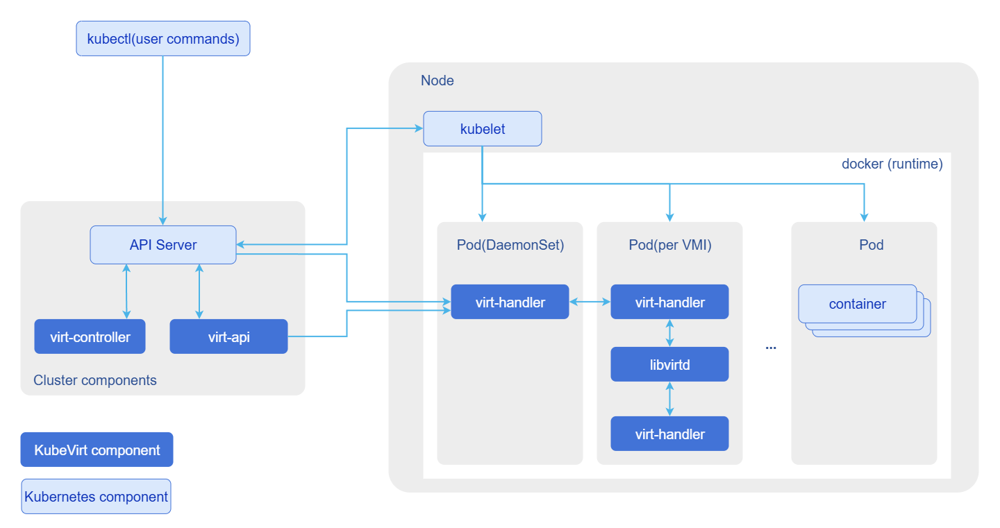
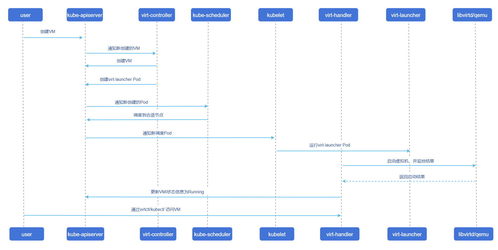
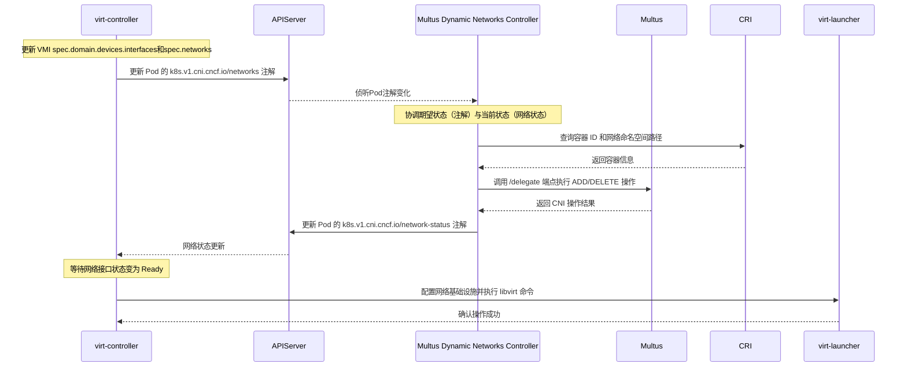

# KubeVirt

## 特性介绍

KubeVirt是由云原生计算基金会（CNCF）赞助的开源项目，也是红帽OpenShift虚拟化技术的核心底座。它旨在将传统虚拟机（VM）工作负载无缝集成到Kubernetes生态中。
通过KubeVirt，用户可以在同一个Kubernetes集群中同时管理容器化应用和传统虚拟机。虚拟机被封装在容器中运行，既保留了传统虚拟化的兼容性和隔离性，又能享受Kubernetes提供的编排、调度、网络策略及声明式API等云原生能力。这使得企业能够在统一的混合云平台上平滑迁移和运行遗留应用。

## 应用场景

- 边缘计算：在边缘计算场景中，往往同时存在新开发的云原生应用和难以容器化的传统服务。KubeVirt允许在边缘Kubernetes集群中统一运行这两类工作负载。例如：IoT边缘节点可以利用KubeVirt部署基于虚拟机的旧版操作系统服务，同时让该服务与容器化微服务共享底层的网络和存储资源，降低硬件成本并简化管理。
- 混合云与私有云：KubeVirt使Kubernetes成为统一的混合云控制平面。通过在裸金属服务器上部署集成了KubeVirt的Kubernetes集群，企业可以实现对虚拟机和容器的统一管理、调度和运维，打破虚拟化与容器化之间的孤岛。

## 能力范围

- 架构支持：支持通过声明式CRD（Custom Resource Definition）方式创建ARM64架构的虚拟机。
- 生命周期管理：提供完整的虚拟机基础生命周期管理能力，包括创建、删除、启动、停止及状态同步。
- 鲲鹏适配：支持在鲲鹏节点环境下运行虚拟化工作负载。
- 声明式部署与配置：支持通过 Helm Chart 进行声明式一键部署与全组件统一镜像参数化配置，支持openFuyao官方OCI制品仓库与传统Helm仓库。

## 亮点特征

- ARM64原生支持：在鲲鹏等ARM64服务器上提供稳定的虚拟化基础能力。
- 统一管控：将VM纳入K8s管理体系，实现“一次部署，全域管理”。
- 云原生特性继承：虚拟机可复用K8s的网络插件（CNI）、存储插件（CSI）及调度策略。
- Helm开箱即用与灵活配置：提供企业级Helm Chart，一键交付CRD、RBAC权限、Operator控制器及CR实例，支持通过 values.yaml 灵活定制软件仿真、副本数、镜像路径及热迁移等高级参数。

## 实现原理

KubeVirt通过扩展Kubernetes API来管理虚拟机，其核心组件部署在kubevirt命名空间中，如图1所示。

**图1** KubeVirt交互视图



### 核心组件说明

KubeVirt引入了一组新的CRD资源和核心控制器组件：

#### 新增CRD资源

- VirtualMachine(VM)：高阶资源对象，用于定义虚拟机的期望状态（如运行、停止）及配置变更。类似于K8s中的Deployment。
- VirtualMachineInstance(VMI)：代表实际运行的虚拟机实例。类似于K8s中的Pod，是调度和执行的基本单元。
- VirtualMachineInstanceReplicaSet：类似于Pod的ReplicaSet，用于批量管理和维持同构虚拟机实例的数量。

#### 核心运行组件

- virt-api：作为Kubernetes API的扩展入口。它注册CRD并通过Aggregator机制对外暴露虚拟机操作接口（如start，stop，migrate，console，vnc等），处理用户的REST请求。
- virt-controller：集群级控制器。侦听VM和VMI资源的变化，负责协调状态一致性。例如，当用户创建VM时，它会创建对应的VMI和virt-launcher Pod。
- virt-handler：以DaemonSet形式部署在每个计算节点上。负责节点级别的VMI生命周期操作（如启动、停止、监控），并提供本地REST接口供virt-api调用以执行控制台连接等操作。
- virt-launcher：运行在每个VMI对应的Pod内部。它是一个轻量级容器，内部包含libvirtd和qemu进程，负责实际启动和管理虚拟机。它还启动一个gRPC服务器，供virt-handler进行通信和控制。
- libvirtd/qemu：运行在virt-launcher Pod内。libvirt封装了Hypervisor的操作指令，并将其转化为对qemu的请求；qemu则依赖宿主机的KVM模块和硬件虚拟化特性来运行虚拟机。

### 创建与调度流程

**图2** 创建与调度流程



## 与相关特性的关系

- 特权模式要求：Kubernetes API Server必须启用`--allow-privileged=true`参数，以允许KubeVirt的特权DaemonSet（virt-handler）运行。
- 硬件要求：节点必须支持硬件虚拟化（Intel VT-x或AMD-V），并在BIOS中开启。对于ARM64架构，需支持相应的虚拟化扩展。

## 使用KubeVirt

### 前提条件

* Kubernetes版本：建议使用openFuyao社区推荐版本v1.34.3或兼容版本。
* Helm版本：建议使用v3.8.0及以上版本。
* 安装docker用于构建虚拟机镜像

### 背景信息

KubeVirt基于Kubernetes原生扩展能力，实现VM与容器统一接入K8s声明式管理API，VM可复用集群编排、调度、网络策略等能力，并支持虚机开关机、热迁移等功能；现需在鲲鹏服务器环境适配落地使用。

### 使用限制

使用支持虚拟化的硬件。

### 操作步骤

1. 基础环境准备

    1.1 安装依赖软件包。

    执行如下命令，在所有节点上安装KVM（Kernel-based Virtual Machine）相关依赖。
    
    ```
    yum install -y qemu-kvm libvirt virt-install bridge-utils
    ```
    
    1.2 验证虚拟化支持。
  
    执行如下命令，检查节点是否具备虚拟化条件，确保所有关键项显示PASS：
    
    ```
    virt-host-validate qemu
    ```

   预期输出示例：
    
    ```
   QEMU: Checking if device /dev/kvm exists                                   : PASS 
   QEMU: Checking if device /dev/vhost-net exists                             : PASS
   QEMU: Checking if device /dev/net/tun exists                               : PASS
   QEMU: Checking for cgroup 'cpu' controller support                         : PASS
   QEMU: Checking for cgroup 'cpuacct' controller support                     : PASS
   QEMU: Checking for cgroup 'cpuset' controller support                      : PASS
   QEMU: Checking for cgroup 'memory' controller support                      : PASS
   QEMU: Checking for cgroup 'devices' controller support                     : PASS
   QEMU: Checking for cgroup 'blkio' controller support                       : PASS
    ...
    ```

2. KubeVirt部署

    支持通过Helm Chart部署（推荐）以及原生YAML部署两种方式。

    2.1 方式一：使用Helm部署（推荐）。

    openFuyao提供了统一容器镜像与标准声明式Helm Chart，支持开箱即用与集中参数管理。

    2.1.1 部署方式

    - 选项 1：直接通过openFuyao公网OCI仓库一键安装（推荐）。

    无需下载本地Chart文件，通过Helm客户端直接在线部署：
    ```
    helm install kubevirt oci://cr.openfuyao.cn/charts/kubevirt \
      --version 0.0.0-of-dev-v1.7.1 \
      --namespace kubevirt \
      --create-namespace
    ```

    - 选项 2：通过openFuyao社区官方Helm仓库安装。

    ```
    # 添加openFuyao社区开发仓库
    helm repo add openfuyao-dev https://helm.openfuyao.cn/_dev
    helm repo update

    # 安装KubeVirt
    helm install kubevirt openfuyao-dev/kubevirt \
      --version 0.0.0-of-dev-v1.7.1 \
      --namespace kubevirt \
      --create-namespace
    ```

    - 选项 3：拉取Chart到本地自定义参数安装。

    若需离线部署或在内网环境中修改配置后安装：
    
    ```
    # 拉取并解压Chart
    helm pull oci://cr.openfuyao.cn/charts/kubevirt --version 0.0.0-of-dev-v1.7.1 --untar

    # 修改 ./kubevirt/values.yaml 后执行本地安装
    helm install kubevirt ./kubevirt -n kubevirt --create-namespace
    ```

    2.1.2 自定义参数配置。

    在通过Helm部署时，可通过`--set key=value`或自定义`values.yaml`文件对核心组件及运行参数进行灵活配置。

    **表1** Helm核心配置参数说明

    | 参数名 | 类型 | 默认值 | 说明 |
    | :--- | :--- | :--- | :--- |
    | `image.repository` | string | `cr.openfuyao.cn/openfuyao/kubevirt` | KubeVirt全组件统一容器镜像仓库路径 |
    | `image.tag` | string | `of-dev-v1.7.1` | 镜像版本Tag |
    | `image.pullPolicy` | string | `IfNotPresent` | 镜像拉取策略（`IfNotPresent` / `Always`） |
    | `global.imagePullSecrets` | list | `[]` | 私有镜像仓库凭据Secret 列表 |
    | `operator.replicaCount` | int | `2` | `virt-operator`高可用副本数 |
    | `operator.resources` | object | `requests: { cpu: 10m, memory: 450Mi }` | Operator控制器最小资源请求 |
    | `kubevirt.create` | bool | `true` | 是否在安装Chart时自动创建`KubeVirt`CR实例 |
    | `kubevirt.useEmulation` | bool | `true` | 是否开启QEMU软件仿真（环境无KVM硬件虚拟化支持时必须设为`true`） |
    | `kubevirt.featureGates` | list | `[LiveMigration, Snapshot, HotplugVolumes, DataVolumes, Sidecars, GPU, VGPU]` | 启用的KubeVirt特性门控列表 |
    | `kubevirt.configuration.migrations` | object | `{}` | 虚拟机热迁移高级策略参数（如自动收敛、超时时间与并发度） |

    典型场景配置示例：

    - 场景 1：无硬件虚拟化节点（开启QEMU软件仿真，开发/测试推荐）。
    ```
    helm install kubevirt oci://cr.openfuyao.cn/charts/kubevirt \
      --version 0.0.0-of-dev-v1.7.1 \
      -n kubevirt --create-namespace \
      --set kubevirt.useEmulation=true
    ```

    - 场景 2：物理机生产环境（全硬件加速，开启热迁移自动收敛与并发调优）。
    ```
    helm install kubevirt oci://cr.openfuyao.cn/charts/kubevirt \
      --version 0.0.0-of-dev-v1.7.1 \
      -n kubevirt --create-namespace \
      --set kubevirt.useEmulation=false \
      --set kubevirt.configuration.migrations.allowAutoConverge=true \
      --set kubevirt.configuration.migrations.parallelMigrationsPerCluster=5
    ```

    - 场景 3：离线环境与私有Harbor仓库替换。
    ```
    helm install kubevirt oci://cr.openfuyao.cn/charts/kubevirt \
      --version 0.0.0-of-dev-v1.7.1 \
      -n kubevirt --create-namespace \
      --set image.repository="harbor.mycompany.local/openfuyao/kubevirt" \
      --set image.tag="v1.7.1"
    ```

    2.2 方式二：使用原生YAML部署。

    执行如下命令，下载virt-operator配置文件并应用：
    ```
    # 下载KubeVirt 1.7.1版本官方Operator部署文件
    wget https://github.com/kubevirt/kubevirt/releases/download/v1.7.1/kubevirt-operator.yaml
    # 在Kubernetes集群中部署KubeVirt Operator
    kubectl apply -f kubevirt-operator.yaml
    ```

    创建kubevirt-cr.yaml文件，定义KubeVirt实例：
    
    ```yaml
    # KubeVirt自定义资源定义（CRD）配置文件
    # 用于在Kubernetes集群中部署和配置KubeVirt虚拟化组件
    apiVersion: kubevirt.io/v1
    kind: KubeVirt
    metadata:
      name: kubevirt
      namespace: kubevirt
    spec:
      certificateRotateStrategy: {}
      configuration:
        developerConfiguration:
          useEmulation: false
          featureGates: []
      customizeComponents: {}
      imagePullPolicy: IfNotPresent
      workloadUpdateStrategy: {}
    
    ```

    执行如下命令，创建应用配置：

    ```
    kubectl apply -f kubevirt-cr.yaml   
    ```

    2.3 验证部署状态。

    执行如下命令，验证各层级组件与调谐状态：

    - 检查 Helm Release 状态（若使用 Helm 部署）：
    
    ```
    helm list -n kubevirt
    ```
    
    预期输出中`STATUS`为`deployed`。

    - 检查KubeVirt自定义资源调谐状态：
    
    ```
    kubectl get kubevirt -n kubevirt
    ```

    预期输出中`PHASE`为`Deployed`，表示组件及证书初始化就绪。

    - 检查控制面与守护进程Pod状态：
    
    ```
    kubectl get pods -n kubevirt -o wide
    ```

    当virt-operator、virt-api、virt-controller及各节点virt-handler状态均为`Running`且探针`Ready`时，表示部署正常。

    - 检查CRD注册情况：
    
    ```
    kubectl get crd | grep kubevirt.io | wc -l
    ```

    预期输出为`17`，表明虚拟化CRD已全量注册。

    2.4 安装virtctl客户端。

    virtctl是管理KubeVirt虚拟机的专用命令行工具，执行如下命令安装virtctl：
    
    ```
    # 下载ARM64版本
    wget https://github.com/kubevirt/kubevirt/releases/download/v1.7.1/virtctl-v1.7.1-linux-arm64
    
    # 重命名并移动至系统路径
    mv virtctl-v1.7.1-linux-arm64 /usr/local/bin/virtctl
    chmod +x /usr/local/bin/virtctl
    
    # 验证版本
    virtctl version
    ```

    输出版本信息且Platform显示为Linux/arm64，表示部署成功。

    2.5 卸载与清理（可选）。

    若需从集群中卸载KubeVirt，需按顺序执行关闭虚拟机、移除KubeVirt CR及卸载控制器组件等操作。

    >  **说明：**<br />
    > 卸载前请确保所有业务虚拟机已正常关机并退出，删除虚拟机为不可逆操作，请谨慎核对后再执行。

    执行如下命令进行卸载清理：

    1. 关闭并清理运行中的虚拟机：
    
    ```
    # 关闭正在运行的虚拟机并确认退出
    virtctl stop <vm-name>

    # 确认虚拟机停止后，删除虚拟机资源
    kubectl delete vm <vm-name>
    ```

    2. 移除KubeVirt自定义资源（CR）（Helm与YAML部署均需执行此步）：
    
    ```
    kubectl delete kubevirt kubevirt -n kubevirt
    ```

    删除KubeVirt CR后，KubeVirt Operator会自动回收并清理其拉起的核心组件（virt-api、virt-controller、virt-handler等）。

    3. 卸载控制器组件：

    - 若使用Helm部署，卸载Helm Release：
    
    ```
    helm uninstall kubevirt -n kubevirt
    ```

    - 若使用原生YAML部署，删除Operator：
    
    ```
    kubectl delete -f kubevirt-operator.yaml
    ```

    4. 清理残余Webhook与CRD（如需彻底清理集群环境）：

    ```
    kubectl delete validatingwebhookconfiguration virt-operator-validator virt-api-validator --ignore-not-found=true
    kubectl delete mutatingwebhookconfiguration virt-api-mutator --ignore-not-found=true
    kubectl get crd -o name | grep kubevirt | xargs -r kubectl delete
    ```
3. 制作KubeVirt镜像。

    3.1 执行如下命令，准备磁盘文件。
    
    ```
    wget https://dl-cdn.openeuler.openatom.cn/openEuler-22.03-LTS-SP3/virtual_machine_img/aarch64/openEuler-22.03-LTS-SP3-aarch64.qcow2.xz
    xz -d openEuler-22.03-LTS-SP3-aarch64.qcow2.xz
    ```

    3.2 编写Dockerfile。

    创建Dockerfile将qcow2镜像打包进容器：
    
    ```
    FROM openeuler/openeuler:22.03
    ADD openEuler-22.03-LTS-SP3-aarch64.qcow2 /disk/disk.qcow2
    RUN chmod 644 /disk/disk.qcow2     
    ```

   >  **说明：**<br />
   >  此处路径需与4.1中oe-vm.yaml定义中的path保持一致。
   
    3.3 构建并导出镜像。

    执行如下命令，构建并导出镜像。
    
    ```
    # 构建镜像
    docker build -t openeuler2203-sp3:v1 .
    
    # 导出镜像为tar包
    docker save -o openeuler.tar openeuler2203-sp3:v1
    ```

    3.4 导入镜像到容器运行时。

    执行如下命令，将镜像导入Kubernetes使用的容器运行时（此处以containerd为例）：
    
    ```
    ctr -n k8s.io image import openeuler.tar
    ```

4. 创建并运行openEuler虚拟机。

    4.1. 准备虚拟机定义文件（oe-vm.yaml）。
    
    ```
    apiVersion: kubevirt.io/v1
    kind: VirtualMachine
    metadata:
      name: openeuler-vm
    spec:
      running: false  # 初始状态为停止，创建后手动启动
      template:
        metadata:
          labels:
            kubevirt.io/domain: openeuler
        spec:
          domain:
            devices:
              disks:
                - name: rootfs
                  disk:
                    bus: virtio
                - name: cloudinit
                  disk:
                    bus: virtio
              interfaces:
                - name: default
                  bridge: {}
            resources:
              requests:
                memory: 1Gi
              limits:
                memory: 1Gi
          networks:
            - name: default
              pod: {}
          volumes:
            - name: rootfs
              containerDisk:
                image: openeuler2203-sp3:v1
                path: /disk/disk.qcow2  # 必须与 Dockerfile 中的路径一致
            - name: cloudinit
              cloudInitNoCloud:
                userData: |-
                  password: openEuler12#$
                  chpasswd: { expire: False }
                  ssh_pwauth: True
                  packages:
                    - nginx
                  runcmd:
                    - systemctl enable nginx
                    - systemctl start nginx
    ```
    
    4.2 创建并启动虚拟机。

    执行如下命令，创建并启动虚拟机。
    
    ```
    # 创建虚拟机资源
    kubectl apply -f oe-vm.yaml
    
    # 查看状态（此时应为 Stopped）
    kubectl get vms
    
    # 启动虚拟机
    virtctl start openeuler-vm
    
    # 再次查看状态，等待变为 Running
    kubectl get vms
    
    ```
    
    4.3 连接虚拟机。
    虚拟机支持`virtctl console（串口）`、`SSH`两种登录方式。
    openEuler镜像默认登录账号：`root`，默认密码：`openEuler12#$`
    
    - 方式一：执行如下命令，使用virtctl console（串口连接）方式连接虚拟机。
    
    ```
    virtctl console openeuler-vm
    ```
    
    显示以下结果，表示成功连接虚拟机：
    
    ```
    [root@master ~]# virtctl console openeuler
    Successfully connected to openeuler console. Press Ctrl+] or Ctrl+5 to exit console.
        
    openeuler login: root
    Password:
    Last login: Thu Mar  5 09:02:51 from 76.3.165.18 
        
    Welcome to 5.10.0-182.0.0.95.oe2203sp3.aarch64
    
    System information as of time:  Thu Mar  5 08:23:47 AM UTC 2026
    
    System load:    0.00
    Processes:      93
    Memory used:    10.2%    
    Swap used:      0.0%
    Usage On:       4%
    IP address:     172.27.205.169
    Users online:   1        
    ```
    
    - 方式二：使用SSH连接。

    执行如下命令，获取虚拟机IP地址：
    
    ```
    kubectl get vmi openeuler-vm -o jsonpath='{.status.interfaces[0].ipAddress}'
    ```
    
    显示以下结果，表示成功连接虚拟机。
    
    ```
    ......
    Welcome to 5.10.0-182.0.0.95.oe2203sp3.aarch64
    
    System information as of time:  Thu Mar  5 08:23:47 AM UTC 2026
    
    System load:    0.00
    Processes:      93
    Memory used:    10.2%    
    Swap used:      0.0%
    Usage On:       4%
    IP address:     172.27.205.169
    Users online:   1        
    ```
    
    4.4 停止虚拟机。

    执行如下命令，停止虚拟机。
    
    ```
    virtctl stop openeuler-vm
    ```

## 使用高级虚拟化管理能力

KubeVirt在鲲鹏节点上运行，支持ARM64虚拟化的高级虚拟化管理特性，包含：网卡热插拔、支持macvlan、支持SR-IOV硬件直通及热迁移、虚机热迁移等。

### 网卡热插拔能力

#### 背景介绍

为运行中的虚拟机添加网卡，从正在运行的虚拟机中删除网卡。

具体的实现就是给运行的Pod增加和删除网卡，通过增加注解`k8s.v1.cni.cncf.io/networks`，控制器侦听Pod变化后，获取容器信息（容器ID和Net NS），最后调用CNI接口为容器增加网卡，具体流程如下：



kubevirt社区网络热插拔用户指导请参见[KubeVirt网络热插拔用户指导](https://kubevirt.io/user-guide/network/hotplug_interfaces)。

#### 前提条件

部署`Multus-cni thick plugin`和`Multus Dynamic Networks Controller`

```shell
wget https://github.com/k8snetworkplumbingwg/multus-cni/blob/master/deployments/multus-daemonset-thick.yml
kubectl apply -f multus-daemonset-thick.yml
# 其中使用的镜像为 ghcr.io/k8snetworkplumbingwg/multus-cni:snapshot-thick

wget https://github.com/k8snetworkplumbingwg/multus-dynamic-networks-controller/blob/main/manifests/dynamic-networks-controller.yaml
# 该yaml中镜像为 ghcr.io/k8snetworkplumbingwg/multus-dynamic-networks-controller:latest-amd64
# 修改镜像为 ghcr.io/k8snetworkplumbingwg/multus-dynamic-networks-controller:latest
kubectl apply -f dynamic-networks-controller.yaml
```

#### 使用限制

- 目前仅支持对使用`virtio`模型并通过`bridge`绑定或`SR-IOV`绑定连接的接口进行热插拔。
- 目前仅支持对通过`bridge`绑定连接的接口进行热拔除。

#### 操作步骤

1. 集群中新建一个`NetworkAttachmentDefinition`。
   
   ```yaml
   apiVersion: k8s.cni.cncf.io/v1
   kind: NetworkAttachmentDefinition
   metadata:
     name: new-fancy-net
   spec:
       config: '{
         "cniVersion": "0.3.1",
         "type": "bridge",
         "mtu": 1300,
         "name":"new-fancy-net"
       }'
   ```

2. 部署VM，启动VM到running状态。
  
   ```yaml
   # 原始VM
   apiVersion: kubevirt.io/v1
   kind: VirtualMachine
   metadata:
     name: vm-hotplug
   spec:
     running: false  # 初始状态为停止，创建后手动启动
     template:
       metadata:
         labels:
           kubevirt.io/domain: openeuler
       spec:
         domain:
           devices:
             disks:
               - name: rootfs
                 disk:
                   bus: virtio
               - name: cloudinit
                 disk:
                   bus: virtio
             interfaces:
               - name: default
                 masquerade: {}
           resources:
             requests:
               memory: 1Gi
             limits:
               memory: 1Gi
         networks:
           - name: default
             pod: {}
         volumes:
           - name: rootfs
             containerDisk:
               image: openeuler2203-sp3-test:v5
               path: /disk/disk.qcow2  # 必须与 Dockerfile 中的路径一致
           - name: cloudinit
             cloudInitNoCloud:
               userData: |-
                 password: openEuler12#$
                 chpasswd: { expire: False }
                 ssh_pwauth: True
                 packages:
                   - nginx
                 runcmd:
                   - systemctl enable nginx
                   - systemctl start nginx
   ```

3. 添加网卡。

   `kubectl edit vm vm-hotplug`添加网卡，更新VM的`spec.domain.devices.interfaces` 和 `spec.networks`如下：
   
   ```yaml
       spec:
         domain:
           devices:
             disks:
               - name: rootfs
                 disk:
                   bus: virtio
               - name: cloudinit
                 disk:
                   bus: virtio
             interfaces:
               - name: default
                 masquerade: {}
                 # new interface
               - name: dyniface1
                 bridge: {}
           resources:
             requests:
               memory: 1Gi
             limits:
               memory: 1Gi
         networks:
           - name: default
             pod: {}
             # new network
           - name: dyniface1
             multus:
               networkName: new-fancy-net
   ```

   检查VM的网络接口是否添加成功：
   - `virt-launcher`Pod中的annotations更新，出现新网卡的配置。
   - `vmi`的`.status.interfaces`中出现新网卡。
   - 虚机中出现新网卡。

4. 删除网卡。

   `kubectl edit vm vm-hotplug`删除网卡，更新VM的`spec.domain.devices.interfaces`对应网卡状态为**absent**。
   ```yaml
       spec:
         domain:
           devices:
             disks:
               - name: rootfs
                 disk:
                   bus: virtio
               - name: cloudinit
                 disk:
                   bus: virtio
             interfaces:
               - name: default
                 masquerade: {}
                 # set the interface state to absent 
               - name: dyniface1
                 bridge: {}
                 state: absent
           resources:
             requests:
               memory: 1Gi
             limits:
               memory: 1Gi
         networks:
           - name: default
             pod: {}
           - name: dyniface1
             multus:
             networkName: new-fancy-net
   ```
   检查VM的网络接口是否删除成功：
   - `virt-launcher`Pod中的annotations更新，网卡删除。
   - `vmi`的`.status.interfaces`中网卡删除。
   - 虚机中网卡删除。

### macvlan

#### 背景介绍

Macvlan是一种高效的Linux网络虚拟化技术，允许在一个物理网络接口（即“父接口”）上创建多个虚拟网络接口（即“子接口”）。每个子接口都被分配一个独立的MAC地址，并可以像普通网卡一样配置IP地址进行通信。这些虚拟设备，在外部看来就是多个独立的物理设备。这种机制的核心优势在于性能。它绕过了传统的Linux网桥，数据包可以直接通过物理网卡收发，减少了网络栈的处理环节，从而降低了延迟，提高了吞吐量。在KubeVirt环境中，它主要用于让虚拟机直接接入宿主机的底层（Underlay）网络，以获得接近于物理机的网络性能。

macvtap CNI包含一个设备插件，用于将macvtap接口暴露给Pod，Multus这样的元插件会获取由设备插件分配的接口名称，并负责调用CNI插件时将该名称作为deviceID传递。

#### 使用限制

macvtap类型网络接口不支持热插拔能力。

#### 前提条件

创建macvtap CNI配置。

```yaml
# 虚拟设备数量理论上限100万，推荐配置200以内
kind: ConfigMap
apiVersion: v1
metadata:
  name: macvtap-deviceplugin-config
data:
  DP_MACVTAP_CONF: |
    [ {
        "name" : "dataplane",
        "lowerDevice" : "enp1s0f0np0",
        "mode": "bridge",
        "capacity" : 20
    } ]
```

部署`macvtap CNI`。

```shell
wget https://github.com/kubevirt/macvtap-cni/blob/main/manifests/macvtap.yaml
kubectl apply -f macvtap.yaml
# 其中使用的镜像为 quay.io/kubevirt/macvtap-cni:latest
```

#### 操作步骤

1. 集群中新建一个`NetworkAttachmentDefinition`。
   
   ```yaml
   kind: NetworkAttachmentDefinition
   apiVersion: k8s.cni.cncf.io/v1
   metadata:
     name: macvtapnetwork
     annotations:
       k8s.v1.cni.cncf.io/resourceName: macvtap.network.kubevirt.io/dataplane
   spec:
     config: '{
         "cniVersion": "0.3.1",
         "name": "macvtapnetwork",
         "type": "macvtap",
         "mtu": 1500
       }'
   ```

2. 更新kubevirt，新增network.binding配置。

   ```yaml
     spec:
       certificateRotateStrategy: {}
       configuration:
         developerConfiguration:
           useEmulation: false
         network:  #新增network.binding配置
           binding:
             macvtap:
               domainAttachmentType: tap
       customizeComponents: {}
       imagePullPolicy: IfNotPresent
       imageRegistry: ttl.sh/openfuyao
       imageTag: v17
       workloadUpdateStrategy: {}
   ```

3. VM中配置macvtap接口，新增VM的`spec.domain.devices.interfaces`和`spec.networks`。
   
   ```yaml
       spec:
         domain:
           devices:
             disks:
               - name: rootfs
                 disk:
                   bus: virtio
               - name: cloudinit
                 disk:
                   bus: virtio
             interfaces:
               - name: default
                 masquerade: {}
               - name: macvtap-net    # 新增：macvtap 接口定义
                 binding:             # 新增
                   name: macvtap      # 新增
           resources:
             requests:
               memory: 1Gi
             limits:
               memory: 1Gi
         networks:
           - name: default
             pod: {}
           - name: macvtap-net        # 新增：macvtap 网络定义
             multus:                  # 新增：指定使用 Multus
               networkName: macvtapnetwork # 新增：对应 NetworkAttachmentDefinition 名称
         volumes:

   ```

   启动VM到running状态，进入VM中查看，有macvtap类型网卡。

   ```shell
   virtctl start <vm-name>
   virtctl console <vm-name>
   ip a
   ```

### SR-IOV

#### 背景介绍

SR-IOV（Single Root I/O Virtualization），是一种让单个物理PCIe设备（比如网卡）在虚拟化环境中“分身”成多个独立设备的硬件规范。

核心在于两种新类型：

- 物理功能（Physical Function，PF）：PF是具备完整PCIe能力的实体功能，负责向宿主机提供硬件业务能力，同时用于创建、管理对应一组VF；支持SR‑IOV的PCIe硬件至少包含1个PF。
- 虚拟功能（Virtual Function，VF）：VF为轻量化PCIe逻辑设备，由PF派生生成；单个VF同一时刻仅可挂载至一台虚拟机，单台虚拟机可配置多个VF。虚拟机操作系统可将VF识别为标准物理硬件，例如SR‑IOV网卡拆分的VF，在客户机内呈现为原生网卡。

当虚拟机直接使用一个VF时，数据可以不经过宿主机复杂的软件模拟层（如Linux网桥、Open vSwitch），直接在虚拟机和物理网卡之间交换。这种绕过操作系统内核直接通信的方式，极大地降低了网络延迟，并减少了CPU的额外开销，实现了近乎物理机的性能。

#### 使用限制

本特性需要Linux内核支持VFIO，BIOS中需打开SMMU，在grub里配置`iommu.passthrough=1`，启用passthrough模式。

#### 前提条件

部署`SR-IOV Network Operator`属危险操作，会重启所有SR-IOV设备的节点。

```shell
# 安装Operator-SDK
export ARCH=$(case $(uname -m) in x86_64) echo -n amd64 ;; aarch64) echo -n arm64 ;; *) echo -n $(uname -m) ;; esac)
export OS=$(uname | awk '{print tolower($0)}')
export OPERATOR_SDK_DL_URL=https://github.com/operator-framework/operator-sdk/releases/download/v1.42.2
curl -LO ${OPERATOR_SDK_DL_URL}/operator-sdk_${OS}_${ARCH}
chmod +x operator-sdk_${OS}_${ARCH} && mv operator-sdk_${OS}_${ARCH} /usr/local/bin/operator-sdk

# 安装operator，按如下步骤从源码生成manifests
# 也可直接获取yaml文件 https://gitcode.com/openFuyao/kubevirt/tree/of-dev%2Fv1.7.1/examples/sriov
git clone https://github.com/k8snetworkplumbingwg/sriov-network-operator.git
cd sriov-network-operator
make deploy-setup-k8s

# 需要SR-IOV的节点打标签
kubectl label node node node-role.kubernetes.io/worker=
```

#### 操作步骤

1. 创建SriovNetworkNodePolicy。
   ```yaml
   apiVersion: sriovnetwork.openshift.io/v1
   kind: SriovNetworkNodePolicy
   metadata:
     name: policy-mellanox
     namespace: sriov-network-operator
   spec:
     nodeSelector:
       node-role.kubernetes.io/worker: ""
     resourceName: intel_sriov_vfio
     priority: 99
     mtu: 1500
     numVfs: 8  # 查询可分配的VF数量 cat /sys/class/net/<接口名>/device/sriov_totalvfs
     nicSelector:
       vendor: "15b3"      # 在sriovnetworknodestates资源中查看上报的vendor
       deviceID: "1015"    # 在sriovnetworknodestates资源中查看deviceID
       rootDevices:
       - "0000:01:00.0"    # 只使用第一个端口 enp1s0f0np0
     deviceType: vfio-pci  # kubevirt使用vfio-pci类型
     isRdma: false
   ```

2. 创建SriovNetwork。

   ```yaml
   apiVersion: sriovnetwork.openshift.io/v1
   kind: SriovNetwork
   metadata:
     name: kubevirt-vfio-network
     namespace: sriov-network-operator  # 使用你的实际命名空间
   spec:
     networkNamespace: default  # 根据你的虚拟机部署命名空间调整
     resourceName: intel_sriov_vfio
     ipam: ""
   ```

3. VM中配置sriov接口，新增VM的`spec.domain.devices.interfaces` 和 `spec.networks`。

   ```yaml
   apiVersion: kubevirt.io/v1
   kind: VirtualMachine
   metadata:
     name: vm-sriov
   spec:
     running: false  # 初始状态为停止，创建后手动启动
     template:
       metadata:
         labels:
           kubevirt.io/domain: openeuler
       spec:
         domain:
           devices:
             disks:
               - name: rootfs
                 disk:
                   bus: virtio
               - name: cloudinit
                 disk:
                   bus: virtio
             interfaces:
               - name: default
                 masquerade: {}
               - name: sriov-net
                 sriov: {}
           resources:
             requests:
               memory: 1Gi
             limits:
               memory: 1Gi
         networks:
           - name: default
             pod: {}
           - multus:
               networkName: kubevirt-vfio-network  # 与SriovNetwork名字一致
             name: sriov-net
         volumes:
           - name: rootfs
             containerDisk:
               image: openeuler2203-sp3-test:v5
               path: /disk/disk.qcow2  # 必须与 Dockerfile 中的路径一致
           - name: cloudinit
             cloudInitNoCloud:
               userData: |-
                 password: openEuler12#$
                 chpasswd: { expire: False }
                 ssh_pwauth: True
                 packages:
                   - nginx
                 runcmd:
                   - systemctl enable nginx
                   - systemctl start nginx
   ```

  启动VM到running状态，进入VM中查看有sriov类型功能完备的真实物理网卡接口。

   ```shell
   virtctl start <vm-name>
   virtctl console <vm-name>
   ip a
   ```

   - 它有自己的固件版本。
   - 它直接加载了厂商的`mlx5_core`驱动。
   - 它的硬件卸载功能（如TC offload）已可用。
   - 它的物理链路已正常连接 (Link up)。

### SR-IOV实时迁移

#### 背景介绍

配置SR‑IOV直通网卡的虚拟机支持在线热迁移。因VF采用硬件直通模式，虚拟机迁移至目标节点后无法自动重新挂载对应VF资源，需人工介入配置，迁移过程中将产生短时业务中断。为保障迁移后网络快速恢复，虚拟机需预先配置固定静态IP地址与静态MAC地址，避免迁移后网络参数变更导致业务异常。

#### 使用限制

本特性需要Linux内核支持VFIO，BIOS中需打开SMMU，在grub里配置`iommu.passthrough=1`，启用passthrough模式。

#### 前提条件

无

#### 操作步骤

1. 打开特性门控`SRIOVLiveMigration`。
  
  ```yaml
   # kubectl edit -n kubevirt kubevirt
     spec:
       certificateRotateStrategy: {}
       configuration:
         developerConfiguration:
           featureGates:
             - SRIOVLiveMigration  #添加SRIOVLiveMigration
           useEmulation: false
         migrations:
           unsafeMigrationOverride: true
         network:
           binding:
             macvtap:
               domainAttachmentType: tap

   ```
   
2. 原始VM中配置sriov接口，写入静态的MAC地址和IP地址。
   
   ```yaml
   apiVersion: kubevirt.io/v1
   kind: VirtualMachine
   metadata:
     name: vm-sriov-ip-mac
   spec:
     running: false  # 初始状态为停止，创建后手动启动
     template:
       metadata:
         labels:
           kubevirt.io/domain: openeuler
       spec:
         domain:
           devices:
             disks:
               - name: rootfs
                 disk:
                   bus: virtio
               - name: cloudinit
                 disk:
                   bus: virtio
             interfaces:
               - name: default
                 masquerade: {}
               - name: sriov-net
                 macAddress: "02:00:00:00:00:01"   # 指定静态mac地址
                 sriov: {}
           resources:
             requests:
               memory: 1Gi
             limits:
               memory: 1Gi
         networks:
           - name: default
             pod: {}
           - multus:
               networkName: kubevirt-vfio-network
             name: sriov-net
         volumes:
           - name: rootfs
             containerDisk:
               image: openeuler2203-sp3-test:v5
               path: /disk/disk.qcow2  # 必须与Dockerfile中的路径一致
           - name: cloudinit
             cloudInitNoCloud:
               userData: |-
                 password: openEuler12#$
                 chpasswd: { expire: False }
                 ssh_pwauth: True
                 packages:
                   - nginx
                 runcmd:
                   - systemctl enable nginx
                   - systemctl start nginx
               networkData: |
                 version: 2
                 ethernets:
                   sriov-net:
                     match:
                       macaddress: "02:00:00:00:00:01"
                     set-name: sriov-net
                     addresses:
                     - 76.3.165.23/32  # 指定静态ip
                     dhcp4: no
   ```

   进入VM中查看sriov设备上指定了MAC地址和IP地址。

   ```shell
   virtctl console <vm-name>
   ip a
   ```

3. 部署`VirtualMachineInstanceMigration`执行热迁移。
   
   ```yaml
   apiVersion: kubevirt.io/v1
   kind: VirtualMachineInstanceMigration
   metadata:
     name: migration-sriov
   spec:
     vmiName: vm-sriov-ip-mac
   ```

4. 等待迁移完成。

   确认VM迁移到另一个节点，进入迁移后的VM中，设备仍保持配置的MAC地址和IP地址。
   
   ```shell
   kubectl get vm <vm-name>
   virtctl console <vm-name>
   ip a
   ```

### 虚拟机热迁移

#### 背景介绍

目前最新kubevirt官方已声明支持ARM64虚机热迁移，以及虚机暂停/恢复，快照等能力。

#### 使用限制

无

#### 前提条件

无

#### 操作步骤

1. 部署原始VM。
   
   ```yaml
   apiVersion: kubevirt.io/v1
   kind: VirtualMachine
   metadata:
     name: vm-migrate
   spec:
     running: false  # 初始状态为停止，创建后手动启动
     template:
       metadata:
         labels:
           kubevirt.io/domain: openeuler
       spec:
         domain:
           devices:
             disks:
               - name: rootfs
                 disk:
                   bus: virtio
               - name: cloudinit
                 disk:
                   bus: virtio
             interfaces:
               - name: default
                 masquerade: {}
           resources:
             requests:
               memory: 1Gi
             limits:
               memory: 1Gi
         networks:
           - name: default
             pod: {}
         volumes:
           - name: rootfs
             containerDisk:
               image: openeuler2203-sp3-test:v5
               path: /disk/disk.qcow2  # 必须与 Dockerfile 中的路径一致
           - name: cloudinit
             cloudInitNoCloud:
               userData: |-
                 password: openEuler12#$
                 chpasswd: { expire: False }
                 ssh_pwauth: True
                 packages:
                   - nginx
                 runcmd:
                   - systemctl enable nginx
                   - systemctl start nginx
   ```

   启动VM到running状态。
   
   ```shell
   virtctl start <vm-name>
   ```

2. 部署`VirtualMachineInstanceMigration`执行热迁移。
   
   ```yaml
   apiVersion: kubevirt.io/v1
   kind: VirtualMachineInstanceMigration
   metadata:
     name: migration-job
   spec:
     vmiName: vm-migrate
   ```

3. 等待迁移完成。

   确认VM迁移到另一个节点，查看`VirtualMachineInstance`，其中`.status.migrationState`中包含了迁移的信息。

### 使用界面操作管理虚机能力

#### 背景介绍

当前openFuyao容器平台的管理面支持对自定义资源的管理，通过kubevirt能力管理的虚机，在自定义资源页面显示virtualmachines.kubevirt.io资源，支持基础生命周期的管理操作。

#### 操作限制

无

#### 前提条件

已部署openFuyao容器平台的管理面。

#### 注意事项

可通过页面权限管理设置VM的操作权限，避免未授权用户操作他人的VM：请参见[RBAC管理](https://gitcode.com/openFuyao/docs/blob/master/docs/zh/management_plane_operations/permission_management/rbac_management.md)。

#### 操作步骤

1. 登录openFuyao管理面：请参见[注册和登录](https://gitcode.com/openFuyao/docs/blob/master/docs/zh/management_plane_operations/registration_and_login.md)。
2. 虚机生命周期管理操作。
    - 创建虚机：
      1. 在openFuyao平台左侧导航栏“资源管理”中选择“自定义资源”，进入“自定义资源”界面。
      2. 在自定义资源列表界面查找virtualmachines.kubevirt.io资源，进入“实例”页签。
      3. 单击右上角的创建，在yaml模板中填写虚机的配置信息。
    - 删除虚机：
      1. 在“实例”页签中，选择要删除的虚机，单击删除按钮。
      2. 确认删除操作。
    - 开机/关机/重启虚机：
      1. 在“实例”页签中，选择要操作的虚机，单击开机/关机/重启按钮。
      2. 界面弹出“开机/关机/重启成功”时，表示开机/关机/重启操作成功，界面弹出“开机/关机/重启未成功”时，表示操作失败，请进一步根据提示或者日志进行分析。
