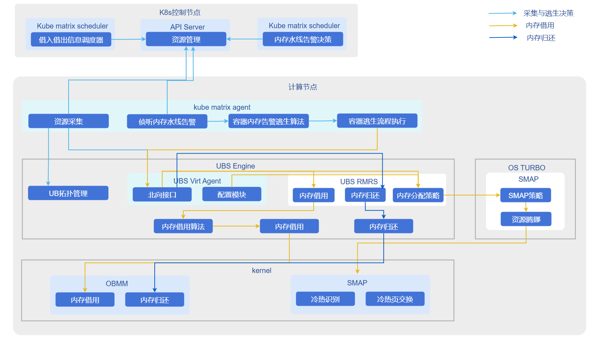

# 内存借用

## 特性介绍

基于UB内存池化机制，裸机容器场景节点或numa的内存使用率达到预设定的值，触发内存借用，将一部分内存压力分担到借过来的内存上。

## 应用场景

高内存密度计算场景：适用于单节点部署大量Pod或容器的场景，通过内存超分和借用机制，提升节点内存利用率，降低硬件成本。

## 能力范围

- 架构支持：支持操作系统openEuler 24.03 LTS 及以上版本，Kubernetes v1.31.1及以上版本，架构ARM64。
- 内存管理：
  - 支持节点级和NUMA级内存水线监控与告警。
  - 支持容器内存无感借用，最大支持25%的远端内存超分比例。
- 规格限制：
  - 内存无感借用仅支持4K标准页场景。
  - 内存共享仅适用于裸机容器场景，不支持虚机容器场景。
  - kube-matrix-agent单实例可管理最多150个Pod、300个容器、300个进程。

## 亮点特征

- 内存无感借用：应用无需修改代码即可享受内存池化带来的红利，如冷热数据自动交换，性能损耗极低（单个容器性能下降<5%）。
- 灵活的调度策略：支持绑定NUMA和不绑定NUMA两种场景，分别提供NUMA级和节点级水线告警，适应不同业务需求。
- 插件化部署：通过Helm Chart快速部署，与现有K8s生态无缝集成。

## 实现原理

### 内存无感借用

**图1** 容器内存无感借用



1. 监控与触发：kube-matrix-agent实时监控节点/NUMA内存使用率。当超过预设水线（如92%）时，触发借用流程。
2. 接口调用：Agent调用UBSE接口申请远端内存。
3. 冷热交换：UBSE使能容器进程的冷热页交换，将冷数据迁移至远端内存，热数据保留在本地。
4. 逃生策略：支持配置watermark-escape-strategy标签，区分NUMA级或节点级告警策略；支持配置remote-mem-allocation-ratio控制超分比例。

### 与相关特性的关系

- 依赖UBS Engine：本方案强依赖于底层ubs-engine及其内存池化组件，需预先安装。
- 硬件约束：依赖UB芯片互联技术实现高带宽远端内存访问；仅支持4K页表，需在Grub中配置numa_remote=nofallback禁止应用直接申请远端内存。

## 使用容器内存借用

### 前提条件

* **操作系统：** openEuler 24.03 LTS SP3或更高版本
* **CPU架构：** ARM64
* **内存：** 大于等于64GB
* **磁盘：** SSD，IOPS 500MB/s
* **芯片互联：** UB
* **用户权限：** 安装与管理需root权限
* **软件要求：**
    1. Kubernetes v1.31.1及以上版本。
    2. 参考 [ubs-engine](https://gitcode.com/openeuler/ubs-engine) 安装ubs-engine及其依赖组件。
    3. 参考 [Helm 安装文档](https://helm.sh/docs/intro/install/) 安装Helm。 

### 背景信息

在高性能计算或高密度部署场景中，本地内存可能成为瓶颈。通过部署UBS K8S Enable相关组件，可以利用UB内存池化技术，实现跨节点内存借用，突破单机内存限制，同时保持容器化应用的云原生特性。

### 使用限制

- 场景限制：仅适用于裸机容器场景，不适用于虚拟机容器场景。
- 页大小限制：只支持4K标准页场景。
- 配置要求：需修改`/etc/default/grub`新增`numa_remote=nofallback`参数，防止应用直接申请远端内存导致异常。
- 超分比例：节点内存超分比例最大为25%。

### 操作步骤

1. 构建指导。  
    
    1.1 拉取源码。  
    
    ```shell
    git clone https://gitcode.com/openFuyao/ubs-k8s-enable.git
    ```
    
    1.2 安装依赖。  
    
    构建前请确保宿主机已安装以下工具：
    
    ```shell
    docker
    helm
    ```
    Dockerfile使用了BuildKit特性，执行`docker build`前请确保已启用BuildKit。

    1.3 执行构建镜像。  
    
    ```shell
    # 版本号示例，可按实际发布版本调整
    export VERSION=1.0.0
    export DOCKER_BUILDKIT=1
    
    # 构建 matrixagent 镜像
    docker build -f build/matrixagent.dockerfile -t cr.openfuyao.cn/openfuyao/matrixagent:${VERSION} .
    
    # 构建 matrixcontroller 镜像
    docker build -f build/matrixcontroller.dockerfile -t cr.openfuyao.cn/openfuyao/matrixcontroller:${VERSION} .
    ```

    1.4 导出镜像包。

    ```shell
    mkdir -p output

    docker save cr.openfuyao.cn/openfuyao/matrixagent:${VERSION} | gzip -c > output/ubs-k8s.matrixagent.image.${VERSION}.aarch64.tgz
    docker save cr.openfuyao.cn/openfuyao/matrixcontroller:${VERSION} | gzip -c > output/ubs-k8s.matrixcontroller.image.${VERSION}.aarch64.tgz
    ```

    1.5 打包Helm Chart。

    ```shell
    helm package charts/matrixagent --destination output
    helm package charts/matrixcontroller --destination output
    mv output/matrixagent-*.tgz output/ubs-k8s.matrixagent.chart.${VERSION}.aarch64.tgz
    mv output/matrixcontroller-*.tgz output/ubs-k8s.matrixcontroller.chart.${VERSION}.aarch64.tgz
    ```
    构建产物如下：
    ```
        └── output
        ├── ubs-k8s.matrixagent.image.${VERSION}.aarch64.tgz
        ├── ubs-k8s.matrixagent.chart.${VERSION}.aarch64.tgz
        ├── ubs-k8s.matrixcontroller.image.${VERSION}.aarch64.tgz
        ├── ubs-k8s.matrixcontroller.chart.${VERSION}.aarch64.tgz
    ```

2. 部署步骤。  
    执行如下命令，设置版本变量：
    
    ```bash
    export VERSION=1.0.0
    export OCI_VERSION=0.0.0-latest
    ```

    2.1 获取部署文件。  
    可根据实际场景选择以下任一种方式获取部署所需镜像和Helm Chart。

    - 方式一：使用离线发布件。

    准备以下文件：

    * `ubs-k8s.matrixagent.image.${VERSION}.aarch64.tgz`
    * `ubs-k8s.matrixagent.chart.${VERSION}.aarch64.tgz`
    * `ubs-k8s.matrixcontroller.image.${VERSION}.aarch64.tgz`
    * `ubs-k8s.matrixcontroller.chart.${VERSION}.aarch64.tgz`

    - 方式二：从镜像仓和OCI仓获取。

    拉取镜像：

    ```bash
    docker pull cr.openfuyao.cn/openfuyao/matrixcontroller:latest
    docker pull cr.openfuyao.cn/openfuyao/matrixagent:latest
    ```

    拉取Helm Chart：

    ```bash
    helm pull oci://cr.openfuyao.cn/charts/matrixagent --version ${OCI_VERSION}
    helm pull oci://cr.openfuyao.cn/charts/matrixcontroller --version ${OCI_VERSION}
    ```

   2.2 导入离线镜像。  

    ```bash
    gunzip -c ubs-k8s.matrixagent.image.${VERSION}.aarch64.tgz | ctr -n k8s.io images import -
    gunzip -c ubs-k8s.matrixcontroller.image.${VERSION}.aarch64.tgz | ctr -n k8s.io images import -
    ```
    >  **说明：**<br />
    >  如果使用“方式二”直接从镜像仓拉取镜像，可跳过此步骤。
    
    2.3 部署服务。   
    可根据实际场景选择以下任一种方式获取部署服务。
    - 使用离线Chart部署。

    ```bash
    helm install matrixagent ubs-k8s.matrixagent.chart.${VERSION}.aarch64.tgz -n kube-system \
      --set images.matrixagent.tag=${VERSION}
    helm install matrixcontroller ubs-k8s.matrixcontroller.chart.${VERSION}.aarch64.tgz -n kube-system \
      --set images.matrixcontroller.tag=${VERSION}
    ```
    - 使用OCI Chart部署。

    ```bash
    helm install matrixagent oci://cr.openfuyao.cn/charts/matrixagent --version ${OCI_VERSION} -n kube-system \
      --set images.matrixagent.tag=latest
    helm install matrixcontroller oci://cr.openfuyao.cn/charts/matrixcontroller --version ${OCI_VERSION} -n kube-system \
      --set images.matrixcontroller.tag=latest
    ```
    2.4 验证结果。  
    执行以下命令，查看Pod状态。

    ```bash
    kubectl get pods -A
    ```

    预期结果如下：
    * 每个节点应有对应的`matrixagent`相关Pod，且状态为`Running`。
    * 控制节点应有`matrixcontroller`相关Pod，且状态为`Running`。
3. 使能容器内存借用demo。  
    **前置条件**  
    完成matrix-agent和matrix-controller的安装。  
    3.1 配置节点标签。  
    在K8s的master节点通过命令行配置worker节点的标签，标识节点是否支持绑定NUMA，用于逃生策略决策时区别是NUMA级水线告警还是节点级水线告警。如果未配置该标签，则不支持水线触发容器内存借用。
    
    ```shell
      kubectl label nodes <node-name> watermark-escape-strategy=<strategy> 
      # <strategy> 替换为NUMA或者node， <node-name> 替换为需要借用的节点名
    ```

    3.2 使能超分节点和内存超分比。   
    在K8s的master节点通过命令行配置节点标签，节点内存超分比例最大25%。
    
    ```shell
    kubectl label nodes <node-name> remote-mem-allocation-ratio=25 
    # 约束：值为(0,25]之间的整数，<node-name> 替换为需要借用的节点名
    ```

    通过Pod的yaml文件为容器配置内存超分。
    
    ```shell
    apiVersion: v1
    kind: Pod
    metadata:
      name: annotation-demo
      labels:
         remote-mem-allocation-ratio:  25 #设置容器进程最大使用远端内存比例，同时标识该Pod相关进程使用远端内存；如果未配置该标签或者配置异常值，则该Pod不支持内存借用，推荐值25
    # 约束：值为(0,200]之间的整数
    ```

    3.3 配置水线的configMap。  
    生成配置水线的configMap的yaml。

    ```yaml
    apiVersion: v1
    kind: ConfigMap
    metadata:
      name: watermark-config
      namespace: kube-system
    data:
      returnLine : "80" # 内存归还水线
      firstLine : "85" # 第一水位线，用于容器热迁移逃生，暂不交付容器热迁移
      secondLine: "92" # 第二水位线，用于容器内存借用逃生
    # 约束：水线值为(0,100]之间的整数，2条水线之间的差值不能小于5
    ```

    在K8s的master节点通过命令行配置configMap。
    
    ```shell
    kubectl apply -f <yaml-name>
    # <yaml-name> 替换为上一步创建yaml的文件名
    ```

    3.4 部署测试Pod和容器。  
    执行命令`vi numa-stress.yaml`编辑文件内容。
    按需修改文件内容（下例仅做示例，只需要注意labels和resources字段即可，满足这两个配置的任意pod都可使用容器内存借用）。
    
    ```yaml
    apiVersion: v1
    kind: Pod
    metadata:
      ......
      labels:
        remote-mem-allocation-ratio: "25"
        # 设置容器进程最大使用远端内存比例，同时标识该Pod相关进程使用远端内存，如果不设置比例默认和节点超分比例保持一致；如果未配置该标签或者配置异常值，则Pod不支持远端内存
    spec:
      containers:
        - name: xxxx
          ......
          resources:
            requests:
              cpu: "2"
              memory: "8Gi"
              # 内存规格按需修改，在不绑定NUMA场景，Pod的QoS必须为burstable(即资源的requests < limits)。
            limits:
              cpu: "2"
              memory: "10Gi"
              # 内存规格按需修改，在不绑定NUMA场景，Pod的QoS必须为burstable(即资源的requests < limits)。
          ......
    ```

    3.5 创建Pod。
    
    ```shell
    kubectl apply -f numa-stress.yaml
    ```

    查看Pod创建情况，Pod创建成功时，状态变更为Running。
    
    ```shell
    kubectl get pod -A
    ```

    3.6 进入Pod加压。

    在Pod内执行加压命令，只要通过应用使得容器内内存压力上涨，令逃生水线达到watermark-config中设置的secondLine即可。
    
    - 观察内存借用结果。

    ssh到Pod所在节点，执行如下命令，查看numastat看冷热交换情况。

    ```shell
    numastat -cvm
    ```

    如下所示，多出来的Node 4为借用过来的2048M的远端内存，MemUsed为1743表示已经使用的内存大小为1743M。

    ```
    $ numastat -cvm
    Per-node system memory usage (in MBs):
                     Node 0 Node 1 Node 4  Total
                     ------ ------ ------ ------
    MemTotal          64254  63967   2048 130269
    MemFree            2605  60793    305  63704
    MemUsed           61649   3174   1743  66565
    ......
    ```

    - 触发内存归还。  
     执行如下命令，删除Pod或者撤去内存压力，触发内存归还。
     
     ```shell
     kubectl delete pod -n kube-system xxxx
     ```