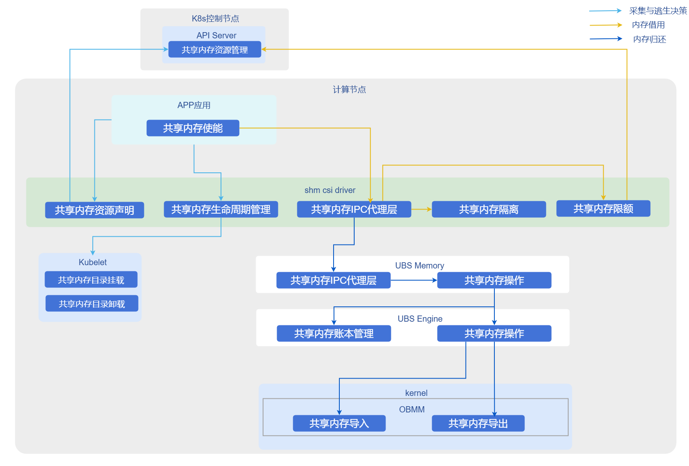

# 内存共享

## 特性介绍

UBS-Core的内存池化组件，支持通过内存池化能力将内存块在UBS Server集群内导入导出，实现在裸机上跨节点以及多进程间的内存共享，同时通过目录隔离和代理层保障资源的安全性与QoS。

## 应用场景

跨节点大数据处理：适用于需要跨节点共享大内存数据集的场景（如内存数据库、大数据分析），通过内存共享能力避免数据复制，提升处理效率。

## 能力范围

- 架构支持：支持操作系统openEuler 24.03 LTS及以上版本，Kubernetes v1.31.1及以上版本，架构ARM64。
- 内存管理：
  - 支持跨节点、多进程内存共享，单节点共享内存上限512GB，单个共享内存块范围128M-512G。
- 生命周期管理：自动感知容器消亡并清理借用的远端内存或导入的共享内存。
- 规格限制：
  - 内存共享仅适用于裸机容器场景，不支持虚机容器场景。

## 亮点特征

插件化部署：通过Helm Chart快速部署，与现有K8s生态无缝集成。

## 实现原理

**图1** 容器内存共享



1. 资源声明：用户通过Custom Resource（ShareMemory）声明共享内存大小和名称。
2. CSI挂载：shm-csi-driver侦听资源创建，通过CSI协议将共享内存块挂载到指定Pod的目录中。
3. 代理与隔离：新增代理层拦截共享内存操作，实施QoS限制；通过目录隔离确保不同租户/应用间的数据安全。
4. 生命周期联动：侦听Pod事件，Pod删除时自动卸载共享内存并清理后端资源。

### 与相关特性的关系

- 依赖UBS Engine：本方案强依赖于底层ubs-engine及其内存池化组件，需预先安装。
- Kubernetes版本依赖：基于K8s v1.31.1+的CSI插件机制和CRD扩展能力实现。
- 硬件约束：依赖UB芯片互联技术实现高带宽远端内存访问；

## 使用容器内存共享

### 前提条件

* **操作系统：** openEuler 24.03 LTS SP3或更高版本
* **CPU 架构：** ARM64
* **内存：** 大于等于64GB
* **磁盘：** SSD，IOPS 500MB/s
* **芯片互联：** UB
* **用户权限：** 安装与管理需root权限
* **软件要求：**
    1. Kubernetes v1.31.1 及以上版本
    2. 参考 [ubs-engine](https://gitcode.com/openeuler/ubs-engine) 安装ubs-engine及其依赖组件
    3. 参考 [Helm 安装文档](https://helm.sh/docs/intro/install/) 安装Helm。 

### 背景信息

在高性能计算或高密度部署场景中，本地内存可能成为瓶颈。通过部署UBS K8S Enable相关组件，可以利用UB内存池化技术，实现跨节点内存共享，突破单机内存限制，同时保持容器化应用的云原生特性。

### 使用限制

场景限制：仅适用于裸机容器场景，不适用于虚拟机容器场景。

### 操作步骤

1. 构建指导。

    1.1 拉取源码。
    
    ```shell
    git clone https://gitcode.com/openFuyao/ubs-k8s-enable.git
    ```

    1.2 安装依赖。  
    构建前请确保宿主机已安装以下工具：

    ```shell
    docker
    helm
    ```

    Dockerfile使用了BuildKit特性，执行`docker build`前请确保已启用BuildKit。

    1.3 执行构建镜像。

    ```shell
    # 版本号示例，可按实际发布版本调整
    export VERSION=1.0.0
    export DOCKER_BUILDKIT=1
    
    # 构建 matrixshm 镜像
    docker build -f build/matrixshm.dockerfile -t cr.openfuyao.cn/openfuyao/matrixshm:${VERSION} .
    ```

    1.4 导出镜像包。

    ```shell
    mkdir -p output

    docker save cr.openfuyao.cn/openfuyao/matrixshm:${VERSION} | gzip -c > output/ubs-k8s.matrixshm.image.${VERSION}.aarch64.tgz
    ```

    1.5 打包Helm Chart。

    ```shell
    helm package charts/matrixshm --destination output

    mv output/matrixshm-*.tgz output/ubs-k8s.matrixshm.chart.${VERSION}.aarch64.tgz
    ```

    构建产物如下：

    ```
        └── output
        ├── ubs-k8s.matrixshm.image.${VERSION}.aarch64.tgz
        └── ubs-k8s.matrixshm.chart.${VERSION}.aarch64.tgz
    ```

2. 部署步骤。 
    执行如下命令，设置版本变量：
    ```bash
    export VERSION=1.0.0
    export OCI_VERSION=0.0.0-latest
    ```

    2.1 获取部署文件。  
    可根据实际场景选择以下任意一种方式获取部署所需镜像和Helm Chart。

    - 方式一：使用离线发布件。  
    准备以下文件：
    * `ubs-k8s.matrixshm.image.${VERSION}.aarch64.tgz`
    * `ubs-k8s.matrixshm.chart.${VERSION}.aarch64.tgz`

    - 方式二：从镜像仓和OCI仓获取。

    拉取镜像：

    ```bash
    docker pull cr.openfuyao.cn/openfuyao/matrixshm:latest
    ```

    拉取Helm Chart：

    ```bash
    helm pull oci://cr.openfuyao.cn/charts/matrixshm --version ${OCI_VERSION}
    ```

    2.2 导入离线镜像。

    ```bash
    gunzip -c ubs-k8s.matrixshm.image.${VERSION}.aarch64.tgz | ctr -n k8s.io images import -
   ```

    >  **说明：**<br />
    >  如果使用“方式二”直接从镜像仓拉取镜像，可跳过此步骤。
    
    2.3 部署服务。  
    可根据实际场景选择以下任一种方式获取部署服务。
    - 使用离线Chart部署。

    ```bash
    helm install matrixshm ubs-k8s.matrixshm.chart.${VERSION}.aarch64.tgz -n kube-system \
      --set images.shmcsidriver.tag=${VERSION}
    ```
    - 使用OCI Chart部署。

    ```bash
   helm install matrixshm oci://cr.openfuyao.cn/charts/matrixshm --version ${OCI_VERSION} -n kube-system \
      --set images.shmcsidriver.tag=latest
    ```
    2.4 验证结果。  
    执行以下命令：

    ```bash
    kubectl get pods -A
    ```

    预期结果如下：

    * 每个节点应有对应的`matrixagent`、`matrixshm` 相关Pod，且状态为`Running`
    * 控制节点应有`matrixcontroller`相关Pod，且状态为`Running`
3. 使能容器内存共享demo。  
    
    3.1 前置条件。  
    完成shm-csi-driver的安装。  
    
    3.2 开发简单的测试二进制。    
    使用容器内存共享需要用户通过自己开发的应用调用对外提供的sdk。  
    SDK头文件参考：[ubs_mem.h](https://atomgit.com/openeuler/ubs-mem/blob/master/src/app_lib/include/ubs_mem.h)  
    
    3.3 验证步骤。

    将以下配置写入到`cr.yaml`，按照需要修改对应配置。  
    
    ```
    apiVersion: resource.ubsvirt.huawei.com/v1
    kind: ShareMemory
    metadata:
      name: testshm # 共享内存名字，用户自定义
      namespace: kube-system
    spec:
      storage: 5120Mi  # 共享内存总量
    ```

    将以下配置写入到`pod.yaml`，按需修改对应配置（此处需要将用户自己开发的应用集成在image中或者挂载到Pod内）。

    ```
    apiVersion: v1
    kind: Pod
    metadata:
      ......
    spec:
      securityContext:
        supplementalGroups:
          - 1024 # ubsmd group id
          - 4177 # shm csi driver group id
      ......
      volumes:
        - name: ubs-mem # ubsm so文件路径，使用共享内存依赖
          hostPath:
            path: /usr/local/ubs_mem/
            type: Directory
        - name: boundscheck-volume # libboundscheck, libobmm, libnuma, libhcom的so可以直接做到image中，省去挂载配置
          hostPath:
            path: /usr/lib64/libboundscheck.so
            type: File
        - name: libobmm-1-0-1
          hostPath:
            path: /usr/lib64/libobmm.so.1.0.1
            type: File
        - name: libobmm-1
          hostPath:
            path: /usr/lib64/libobmm.so.1
            type: File
        - name: libnuma-1-0-0
          hostPath:
            path: /usr/lib64/libnuma.so.1.0.0
            type: File
        - name: libnuma-1
          hostPath:
            path: /usr/lib64/libnuma.so.1
            type: File
        - name: libhcom-so-0-0-1
          hostPath:
            path: /usr/lib64/libhcom.so.0.0.1
            type: File
        - name: libhcom-so-0
          hostPath:
            path: /usr/lib64/libhcom.so.0
            type: File
        - name: mxm-agent-ipc-server # ubsm socket文件
          hostPath:
            path: /run/memory/
            type: Directory
        - name: shared-memory # 共享内存文件挂载依赖配置
          csi:
            driver: shm-csi-driver
            volumeAttributes:
              type: shareMem
              identity: testshm # 共享内存名字，对应cr中的name
        ......
      containers:
        - name: xxxxxxx
          ......
          env:
            - name: LD_LIBRARY_PATH
              value: "/usr/lib64/:/host/usr/local/ubs_mem/lib/:......"
          volumeMounts:
            - name: ubs-mem
              mountPath: /host/usr/local/ubs_mem/
            - name: boundscheck-volume
              mountPath: /usr/lib64/libboundscheck.so
            - name: libobmm-1-0-1
              mountPath: /usr/lib64/libobmm.so.1.0.1
            - name: libobmm-1
              mountPath: /usr/lib64/libobmm.so.1
            - name: libnuma-1-0-0
              mountPath: /usr/lib64/libnuma.so.1.0.0
            - name: libnuma-1
              mountPath: /usr/lib64/libnuma.so.1
            - name: libhcom-so-0-0-1
              mountPath: /usr/lib64/libhcom.so.0.0.1
            - name: libhcom-so-0
              mountPath: /usr/lib64/libhcom.so.0
            - name: mxm-agent-ipc-server
              mountPath: /run/matrix/memory/
            - name: shared-memory
              mountPath: /dev
              mountPropagation: "HostToContainer"
            ......
    ```

    3.4 在master节点部署yaml。

    ```shell
    kubectl apply -f cr.yaml
    kubectl apply -f pod.yaml
    ```

    3.5 使用内存共享。
    用户在容器内执行自己开发的应用，即可在容器内使能共享内存。