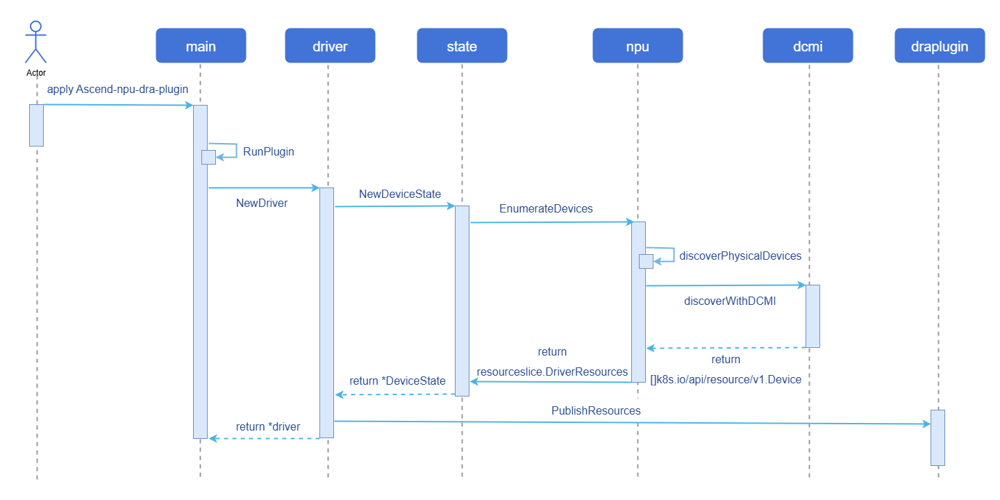

# npu-dra-plugin

## 特性介绍

传统的Device Plugin基于“可计数”接口申请设备，无法感知设备内部特性。DRA（Dynamic Resource Allocation，动态资源分配）为Kubernetes提供了更灵活的资源调度机制。npu-dra-plugin在Kubernetes原生DRA架构基础上完成昇腾NPU设备适配，支持基于设备属性、算力规格等元信息进行调度决策，实现精细化的异构计算资源调度。

### 应用场景

- **AI大模型推理/训练**：通过整卡分配或软切分，为vLLM、MindIE等AI框架提供NPU算力，支持大语言模型高效推理。
- **多租户算力共享**：通过软切分将一张物理NPU按算力配额共享给多个业务Pod，提升资源利用率，降低成本。
- **精细化资源调度**：基于设备属性（NUMA亲和性、芯片型号等）通过CEL表达式筛选设备，满足高性能计算场景的调度约束。
- **异构芯片混合调度**：同一集群中910B、910C、310P多型号NPU共存，通过DeviceClass统一管理，按业务需求匹配最合适的设备。

### 能力范围

- 支持昇腾910B、910C、310P芯片的设备发现和上报。
- 支持通过`DeviceClass/CEL`进行设备筛选。
- 支持利用`ResourceClaim/ResourceClaimTemplate`进行资源申请，实现业务`Pod`与`ResourceSlice`的绑定。
- 支持通过`CDI`将设备注入容器。
- 支持**整卡分配（full）**：将一张完整NPU分配给业务Pod使用。
- 支持**硬切分（hard）**：基于固定模板将整卡切分为多个vNPU实例，按`aiCore`+`aiCPU`精确匹配模板。
- 支持**软切分（soft）**：基于vCANN-RT运行时劫持库实现NPU设备的软件虚拟化，按`memCapacity`+`coreCapacity`灵活配额共享物理NPU，支持弹性（elastic）、固定份额（fixed-share）、尽力而为（best-effort）三种调度策略。
- 三种切分模式支持的芯片型号：**910B、310P、910C**。其中910C必须设置为单die模式（参见[前提条件](#前提条件)）。
- 支持通过`ConfigMap`配置各NPU卡的切分模式（full/hard/soft），同时支持节点label配置节点级默认模式。
- 支持通过`Helm Chart`一键部署。

### 亮点特征

- 支持整卡分配、硬切分、软切分三种资源分配模式，覆盖从独占到共享的全场景需求。
- 通过结构化`draConfig`实现卡级切分模式配置，同一节点不同卡可配置不同模式。

### 实现原理

**图1** 设备发现及上报实现原理图



#### 核心组件

`npu-dra-plugin`以DaemonSet方式部署在每个NPU节点上，核心组件包括：

- **DRA Kubelet Plugin**：DRA驱动插件主体，负责设备发现、资源上报、ResourceClaim分配、CDI注入等全流程。通过DCMI接口或sysfs发现NPU设备，将设备信息上报为ResourceSlice。
- **draConfig ConfigMap**：结构化配置，定义每个节点上各NPU卡的切分模式（full/hard/soft）和调度策略，驱动启动时读取。
- **vnpu-template-config ConfigMap**：硬切分芯片模板配置，定义各芯片型号支持的vNPU模板（aiCore/aiCPU/memoryMi），驱动根据申请值精确匹配。
- **vCANN-RT Installer**（可选）：软切分前置依赖，以DaemonSet方式部署，将vCANN-RT劫持库安装到宿主机`/opt/xpu/`目录，支持自动修复。

### 与相关特性的关系

- 依赖昇腾`NPU`设备接口（DCMI/sysfs）。
- 依赖Kubernetes DRA特性（v1.34+，需启用`DynamicResourceAllocation`和`DRAConsumableCapacity`特性门控）。

## 安装

### 前提条件

- **Kubernetes版本**：使用openFuyao社区推荐版本v1.34.3，且已启用DRA功能（`DynamicResourceAllocation=true`）及`DRAConsumableCapacity=true`特性门控。
- **容器运行时**：containerd需使用v1.7.0以上版本，推荐使用openFuyao社区默认版本v2.1.1。
- **NPU硬件与驱动**：集群节点已安装昇腾NPU硬件，并部署了对应版本的昇腾NPU驱动。推荐驱动版本不低于25.5.x。910B驱动安装请参考：[昇腾910B驱动安装指南](https://support.huawei.com/enterprise/zh/doc/EDOC1100468900/cb91d9dc?idPath=23710424|251366513|254884019|261408772|261457531)。
- **ascend-docker-runtime**：硬切分依赖`ascend-docker-runtime`（用于创建vNPU设备并挂载到容器）。使用硬切分前，需确保节点已安装并配置`ascend-docker-runtime`，可通过`which ascend-docker-runtime`或`ls /usr/local/Ascend/Ascend-Docker-Runtime/ascend-docker-runtime`确认。若未安装，请参考昇腾官方文档完成安装配置。
- **昇腾910C额外要求**（910B和310P无此要求）：

  部署前需在910C节点上完成以下配置，所有操作需在部署DRA插件前**手动执行**：

    1. **确认驱动版本**：通过`npu-smi info`查询，驱动版本需为**26.0.RC1**及以上。

        ```bash
        npu-smi info
        # 检查输出中的 Version 字段，需为 26.0.RC1 及以上
        ```

    2. **设置单die模式**：910C支持单die和双die两种工作模式，DRA插件仅支持单die模式。需通过`npu-smi`工具设置为单die模式。

       具体操作请参考昇腾官方文档[设置单die模式](https://support.huawei.com/enterprise/zh/doc/EDOC1100568418/da866a1e)。

    3. **开启配置恢复使能（持久化）**：确保节点重启后910C的切分模式配置不丢失（重启OS后继承重启前的配置）。

        ```bash
        # 开启多Die通容器策略的持久化使能（参考[设置多Die通容器策略的持久化使能状态](https://support.huawei.com/enterprise/zh/doc/EDOC1100568418/eb901923)）
        npu-smi set -t multi-die-policy-cfg-recover -d 1
  
        # 查询当前持久化使能状态
        npu-smi info -t multi-die-policy-cfg-recover
        # 预期输出：Multi die policy config recover mode : Enable
        ```


### 使用限制

**表1** 各芯片支持的切分模式

| 芯片型号 | 整卡分配（full） | 硬切分（hard） | 软切分（soft） |
|---------|:---------------:|:--------------:|:--------------:|
| 910B | 支持 | 支持 | 支持 |
| 310P | 支持 | 支持 | 支持 |
| 910C（单die） | 支持 | 支持 | 支持 |
| 910C（双die） | 不支持 | 不支持 | 不支持 |

>  **说明：**
>
> 910C必须设置为单die模式，具体配置要求参见[前提条件](#前提条件)。虽然910C双die模式下设备可正常上报和分配，但容器内无法正常使用设备。
>
> - 使用软切分功能时，需先安装vCANN-RT劫持库。可通过`vcannrtInstaller`安装器自动安装（安装到`/opt/xpu/`），或在环境已预装的情况下在ConfigMap中配置实际路径。
> - 硬切分Pod需配置`runtimeClassName: ascend`。
> - 软切分每个物理NPU最多支持63个vNPU实例（由`--share-count`参数控制，有效范围1-63）。

### 三种资源分配模式

`npu-dra-plugin`支持三种NPU资源分配模式，通过`draConfig`配置或节点label指定：

**表2** 资源分配模式说明

| 模式 | vnpuMode值 | 说明 | 资源申请方式 | DeviceClass |
|------|-----------|------|-------------|-------------|
| 整卡分配 | full | 将一张完整NPU独占分配给业务Pod | 无需指定capacity | full.npu.huawei.com |
| 硬切分 | hard | 基于固定模板将整卡切分为vNPU实例，按aiCore+aiCPU精确匹配 | aiCore + aiCPU | hard.npu.huawei.com |
| 软切分 | soft | 基于vCANN-RT劫持库实现软件虚拟化，按内存+算力配额共享 | memCapacity + coreCapacity | elastic.npu.huawei.com / fixed.npu.huawei.com / best-effort.npu.huawei.com |


### 安装npu-dra-plugin

`npu-dra-plugin`提供Helm Chart，支持一键部署所有组件（Namespace、RBAC、ConfigMap、DaemonSet、DeviceClass、vCANN-RT安装器）。

>  **注意：**
>
> 驱动启动时读取ConfigMap或节点label决定每张卡的切分模式，若未配置则默认为`full`（整卡模式），硬切分和软切分功能不会生效。可通过以下两种方式之一配置，优先级：**ConfigMap卡级配置 > 节点label > 默认full**。修改配置后需重启驱动Pod使新配置生效。

#### 操作步骤

1. 拉取Chart并配置values.yaml。

   1.1 拉取Helm Chart并查看集群节点名称。

     ```bash
     # 从OCI仓拉取Chart
     helm pull oci://cr.openfuyao.cn/charts/npu-dra-driver --version 0.0.0-latest
     tar xzf npu-dra-driver-*.tgz

     # 查看集群节点名称（后续配置nodes时需要用到）
     kubectl get nodes
     ```

   1.2 修改`values.yaml`中的配置（镜像地址、节点NPU切分模式等）。

     ```bash
     vi npu-dra-driver/values.yaml
     ```

     Helm Chart主要可配置项：

    ```yaml
    # 镜像仓库基础配置
    basic:
      swr_addr: "cr.openfuyao.cn/openfuyao"
      namespace: npu-dra-driver

    # NPU驱动路径配置
    npu:
      driverHostPath: /usr/local/Ascend
      npuSmiHostPath: /usr/local/sbin/npu-smi

    # DRA Plugin配置
    npuDraPlugin:
      shareCount: 16
      chipCapabilitiesConfigMap: vnpu-template-config
      draProfileConfigMap: dra-profile-config
      # 软切分挂载项（仅使用软切分时需要）
      softShareMounts:
      - hostPath: /opt/xpu/bin/enpu-monitor
        containerPath: /opt/enpu/vcann-rt/tools/enpu-monitor
        options: [ro, rbind]
      - hostPath: /opt/xpu/bin/systemd-detect-virt
        containerPath: /usr/bin/systemd-detect-virt
        options: [ro, rbind]
      # 节点NPU切分配置, key为K8s节点名（通过 kubectl get nodes 获取）
      # 默认为空, 需要使用硬切分或软切分时由用户按需配置
      # 首次部署直接生效; 后续修改后需重启驱动Pod: kubectl delete pod -n npu-dra-driver -l app=npu-dra-plugin
      # nodes:
      #   <节点名称>:
      #   - physicalId: 0          # NPU物理ID，可通过`npu-smi info -m`命令查看
      #     vnpuMode: full
      #   - physicalId: 1
      #     vnpuMode: hard
      #   - physicalId: 2
      #     vnpuMode: soft
      #     schedulingPolicy: elastic

    # vCANN-RT劫持库安装器配置（仅在使用软切分时需要）
    vcannrtInstaller:
      enabled: true   # 设为 false 时不部署vCANN-RT安装器
      image:
        swr_addr: "cr.openfuyao.cn/openfuyao/vnpu"
        # 镜像名称，必须与NPU硬件型号匹配，以910B为例
        # 可选值：acl-client-update-910b、acl-client-update-910c、acl-client-update-310p
        name: acl-client-update-910b
        version: "latest"

    # 芯片模板配置（硬切分模板）
    chipCapabilities: |
      chips:
        - chipName: 310P3
          totalAiCore: 8
          totalAiCpu: 7
          totalMemoryMi: 21525
          templates:
            - { name: vir01, aiCore: 1, aiCpu: 1, memoryMi: 3072 }
            - { name: vir02, aiCore: 2, aiCpu: 2, memoryMi: 6144 }
            - { name: vir02_1c, aiCore: 2, aiCpu: 1, memoryMi: 6144 }
            - { name: vir04, aiCore: 4, aiCpu: 4, memoryMi: 12288 }
            - { name: vir04_3c, aiCore: 4, aiCpu: 3, memoryMi: 12288 }
        - chipName: 910B4
          totalAiCore: 20
          totalAiCpu: 6
          totalMemoryMi: 32768
          templates:
            - { name: vir05_1c_8g, aiCore: 5, aiCpu: 1, memoryMi: 8192 }
            - { name: vir10_3c_16g, aiCore: 10, aiCpu: 3, memoryMi: 16384 }
            - { name: vir10_4c_16g_m, aiCore: 10, aiCpu: 4, memoryMi: 16384 }
            - { name: vir10_3c_16g_nm, aiCore: 10, aiCpu: 3, memoryMi: 16384 }
        - chipName: Ascend910C
          totalAiCore: 20
          totalAiCpu: 6
          totalMemoryMi: 32768
          templates:
            - { name: vir05_1c_16g, aiCore: 5, aiCpu: 1, memoryMi: 16384 }
            - { name: vir10_3c_32g, aiCore: 10, aiCpu: 3, memoryMi: 32768 }

    # DeviceClass定义
    deviceClass:
      enabled: true
    ```

     **配置说明：**

     - `chipCapabilities`配置硬切分支持的芯片规格和vNPU模板，驱动根据申请的`aiCore`+`aiCPU`精确匹配模板。不同芯片型号和驱动版本的模板可能存在差异，请根据实际环境通过`npu-smi info -t vnpu-template`查询并以实际为准，按需修改此配置。下方表4为常用模板参考。
     - **是否安装vCANN-RT劫持库**：通过`vcannrtInstaller.enabled`控制。仅在使用软切分（`vnpuMode=soft`）时需要设为`true`。
     - **如果环境已预装劫持库**：将`vcannrtInstaller.enabled`设为`false`跳过安装器部署，同时需在`softShareMounts`中修改`hostPath`为环境中实际的劫持库文件路径。
     - vCANN-RT劫持库的详细配置方式参见[vCANN-RT劫持库配置](#vcann-rt劫持库配置)。

2. （可选）通过节点label配置切分模式。

若不想修改`values.yaml`或不清楚节点名，可保持`nodes`为空，部署前给节点打label，驱动会读取节点label作为该节点所有NPU的默认切分模式。

执行如下命令，查看节点名称并打标签：

```bash
# 查看节点名称
kubectl get nodes

# 给节点打切分模式标签（full/hard/soft）
kubectl label node <节点名称> vnpu-mode=soft

# 若使用软切分，还需指定调度策略（可选，默认elastic）
kubectl label node <节点名称> schedulingPolicy=elastic
```

label可选值：
- `vnpu-mode`：`full`（默认）/ `hard` / `soft`
- `schedulingPolicy`：`elastic`（默认）/ `fixed-share` / `best-effort`（仅`vnpu-mode=soft`时生效）

>  **说明：**
>
> - 节点label为**节点级**配置，该节点上所有未在ConfigMap中配置的NPU卡都会使用该模式。
> - 若同一张卡在ConfigMap和节点label中都有配置，**ConfigMap优先级更高**。
> - 修改label或ConfigMap后，需重启驱动Pod使配置生效：
>   ```bash
>   kubectl delete pod -n npu-dra-driver -l app=npu-dra-plugin
>   ```

3. 部署。

   执行如下命令，通过Helm Chart方式部署npu-dra-plugin：

   ```bash
   helm install npu-dra-driver oci://cr.openfuyao.cn/charts/npu-dra-driver --version 0.0.0-latest -f npu-dra-driver/values.yaml
   ```

4. 验证部署结果。

   4.1 检查Pod状态。

     ```bash
     kubectl get pods -n npu-dra-driver
     ```

   预期返回：每个NPU节点上均有`npu-dra-plugin`Pod且状态为`Running`。若部署了vCANN-RT安装器，还会有`vcannrt-installer`Pod。

   4.2 检查ResourceSlice是否正常上报设备。

     ```bash
     kubectl get resourceslices
     ```

     预期返回：以`<节点名>-npu.huawei.com-`开头的ResourceSlice。

   4.3 检查设备切分模式是否正确。

     ```bash
     kubectl get resourceslices -o yaml | grep vnpuMode
     ```

   预期返回：各设备的`vnpuMode`（full/hard/soft），与ConfigMap或label配置一致。

   4.4 检查DeviceClass是否创建。

     ```bash
     kubectl get deviceclasses
     ```

     预期返回：`full.npu.huawei.com`、`hard.npu.huawei.com`、`elastic.npu.huawei.com`、`fixed.npu.huawei.com`、`best-effort.npu.huawei.com`五个DeviceClass。

#### vCANN-RT劫持库配置

vCANN-RT劫持库是软切分功能的前置依赖，整卡分配和硬切分无需安装。用户可选择以下两种方式之一：

- **方式A（推荐）**：设置`vcannrtInstaller.enabled: true`，Helm自动部署安装器DaemonSet，将vCANN-RT运行时文件安装到宿主机`/opt/xpu/`目录，并持续自动修复。`softShareMounts`保持默认路径即可，**无需修改**。

  软切分容器通过`softShareMounts`挂载以下宿主机文件到容器内：

  **表3** softShareMounts文件说明

  | hostPath（宿主机路径）                    | containerPath（容器内路径） | 实际文件类型                  | 说明 |
  |------------------------------------|---|-------------------------|---|
  | `/opt/xpu/bin/enpu-monitor`        | `/opt/enpu/vcann-rt/tools/enpu-monitor` |    实体文件                 | NPU监控工具，由其他组件预装 |
  | `/opt/xpu/bin/systemd-detect-virt` | `/usr/bin/systemd-detect-virt` | 实体文件                    | 容器检测脚本，由安装器安装 |

- **方式B**：若环境已通过其他方式安装了vCANN-RT劫持库，将`vcannrtInstaller.enabled`设为`false`跳过安装器部署，但**必须修改`values.yaml`中`softShareMounts`的`hostPath`**，指向环境中实际的劫持库文件路径。

  例如，环境中劫持库安装在`/usr/local/enpu/`目录：

  ```yaml
  softShareMounts:
  - hostPath: /usr/local/enpu/bin/enpu-monitor             # 修改为实际路径
    containerPath: /opt/enpu/vcann-rt/tools/enpu-monitor
    options: [ro, rbind]
  - hostPath: /usr/local/enpu/bin/systemd-detect-virt     # 修改为实际路径
    containerPath: /usr/bin/systemd-detect-virt
    options: [ro, rbind]
  ```

>  **说明：**
>
> - `hostPath`为宿主机上劫持库文件的实际路径，`containerPath`为挂载到业务容器内的路径（保持默认，请勿修改）。
> - 确保所有`softShareMounts`中列出的文件在宿主机上实际存在，否则软切分Pod将因挂载失败而无法启动。
> - 可通过以下命令检查宿主机上劫持库文件是否齐全（路径替换为实际安装路径）：
>   ```bash
>   ls -l /opt/xpu/bin/enpu-monitor /opt/xpu/bin/systemd-detect-virt
>   ```

## 使用NPU资源
### 背景信息

通过DRA技术，Kubernetes能够以声明式方式管理昇腾NPU设备的分配与使用。业务Pod通过ResourceClaim申请NPU资源后，驱动自动完成设备发现、上报、分配和CDI注入，最终可以在容器内查看和使用NPU设备。

### 使用整卡分配

将NPU配置为`vnpuMode: full`后，使用`full.npu.huawei.com` DeviceClass申请整卡资源。

```yaml
apiVersion: resource.k8s.io/v1
kind: ResourceClaimTemplate
metadata:
  name: npu-full
  namespace: default
spec:
  spec:
    devices:
      requests:
      - name: npu
        exactly:
          deviceClassName: full.npu.huawei.com
---
apiVersion: v1
kind: Pod
metadata:
  name: npu-full-demo
  namespace: default
spec:
  resourceClaims:
  - name: npu
    resourceClaimTemplateName: npu-full
  containers:
  - name: demo
    image: docker.io/library/ubuntu:22.04
    imagePullPolicy: IfNotPresent
    command: ["sleep", "infinity"]
    resources:
      claims:
      - name: npu
    env:
    - name: LD_LIBRARY_PATH
      value: "/usr/local/Ascend/driver/lib64:/usr/local/Ascend/driver/lib64/common:/usr/local/Ascend/driver/lib64/driver:/usr/local/Ascend/ascend-toolkit/latest/lib64:/usr/local/Ascend/ascend-toolkit/latest/runtime/lib64"
    volumeMounts:
    - name: ascend-driver
      mountPath: /usr/local/Ascend
      readOnly: true
    - name: npu-smi-command
      mountPath: /usr/local/bin/npu-smi
      readOnly: true
  volumes:
  - name: ascend-driver
    hostPath:
      path: /usr/local/Ascend
      type: Directory
  - name: npu-smi-command
    hostPath:
      path: /usr/local/bin/npu-smi
      type: File
```

### 使用硬切分

将NPU配置为`vnpuMode: hard`后，使用`hard.npu.huawei.com` DeviceClass，通过`aiCore`+`aiCPU`精确匹配vNPU模板。

>  **注意：**
>
> - 硬切分Pod需配置`runtimeClassName: ascend`。使用硬切分前，需确保节点已安装`ascend-docker-runtime`，可通过`which ascend-docker-runtime`或`ls /usr/local/Ascend/Ascend-Docker-Runtime/ascend-docker-runtime`确认。若未安装，请参考昇腾官方文档完成安装配置。
>
> - 硬切分Pod需配置`securityContext.capabilities.add: ["SYS_ADMIN"]`权限。`SYS_ADMIN`是Linux高危capability，赋予容器较大的系统操作权限。请仅在硬切分场景下按需授予，并遵循以下安全建议：
>  - 限制该权限仅用于硬切分业务Pod，不要授予非硬切分Pod。
>  - 结合Pod Security Standards（Restricted级别）和准入控制策略，防止滥用。
>  - 尽量以非root用户运行容器内进程，减少提权风险。

```yaml
apiVersion: resource.k8s.io/v1
kind: ResourceClaimTemplate
metadata:
  name: npu-hard-vnpu
  namespace: default
spec:
  spec:
    devices:
      requests:
      - name: npu
        exactly:
          deviceClassName: hard.npu.huawei.com
          capacity:
            requests:
              aiCore: 5
              aiCPU: 1
---
apiVersion: v1
kind: Pod
metadata:
  name: npu-hard-demo
  namespace: default
spec:
  runtimeClassName: ascend
  resourceClaims:
  - name: npu
    resourceClaimTemplateName: npu-hard-vnpu
  containers:
  - name: demo
    image: docker.io/library/ubuntu:22.04
    imagePullPolicy: IfNotPresent
    command: ["sleep", "infinity"]
    resources:
      claims:
      - name: npu
    env:
    - name: LD_LIBRARY_PATH
      value: "/usr/local/Ascend/driver/lib64:/usr/local/Ascend/driver/lib64/common:/usr/local/Ascend/driver/lib64/driver:/usr/local/Ascend/ascend-toolkit/latest/lib64:/usr/local/Ascend/ascend-toolkit/latest/runtime/lib64"
    volumeMounts:
    - name: ascend-driver
      mountPath: /usr/local/Ascend
      readOnly: true
    - name: npu-smi-command
      mountPath: /usr/local/bin/npu-smi
      readOnly: true
  volumes:
  - name: ascend-driver
    hostPath:
      path: /usr/local/Ascend
      type: Directory
  - name: npu-smi-command
    hostPath:
      path: /usr/local/bin/npu-smi
      type: File
```

`aiCore`和`aiCPU`的取值必须与`vnpu-template-config` ConfigMap中定义的模板匹配：

**表4** 硬切分模板映射表

| 芯片型号 | 模板名称 | aiCore | aiCPU | memoryMi |
|---------|---------|--------|-------|----------|
| 310P3 | vir01 | 1 | 1 | 3072 |
| 310P3 | vir02 | 2 | 2 | 6144 |
| 310P3 | vir02_1c | 2 | 1 | 6144 |
| 310P3 | vir04 | 4 | 4 | 12288 |
| 310P3 | vir04_3c | 4 | 3 | 12288 |
| 910B4 | vir05_1c_8g | 5 | 1 | 8192 |
| 910B4 | vir10_3c_16g | 10 | 3 | 16384 |
| 910B4 | vir10_4c_16g_m | 10 | 4 | 16384 |
| 910B4 | vir10_3c_16g_nm | 10 | 3 | 16384 |
| Ascend910C | vir05_1c_16g | 5 | 1 | 16384 |
| Ascend910C | vir10_3c_32g | 10 | 3 | 32768 |

>  **说明：**
>
> - `aiCore`为必填项，`aiCPU`为可选项。当`aiCPU`未指定或为0时，按`aiCore`匹配第一个满足条件的模板。
> - 示例中`aiCore=5, aiCPU=1`对应910B4的`vir05_1c_8g`模板；若使用310P3，可设为`aiCore=1, aiCPU=1`（对应`vir01`）；若使用910C（单die），可设为`aiCore=5, aiCPU=1`（对应`vir05_1c_16g`）。
> - 910C必须设置为单die模式（参见[前提条件](#前提条件)）。
> - 使用硬切分必须要安装`ascend-docker-runtime`，否则无法创建vNPU设备
### 使用软切分

将NPU配置为`vnpuMode: soft`后，使用`elastic.npu.huawei.com`（或`fixed.npu.huawei.com`、`best-effort.npu.huawei.com`）DeviceClass，通过`memCapacity`+`coreCapacity`指定内存和算力配额。

```yaml
apiVersion: resource.k8s.io/v1
kind: ResourceClaimTemplate
metadata:
  name: npu-soft-vnpu
  namespace: default
spec:
  spec:
    devices:
      requests:
      - name: npu
        exactly:
          deviceClassName: elastic.npu.huawei.com
          capacity:
            requests:
              memCapacity: 4Gi
              coreCapacity: 50
---
apiVersion: v1
kind: Pod
metadata:
  name: npu-soft-demo
  namespace: default
spec:
  resourceClaims:
  - name: npu
    resourceClaimTemplateName: npu-soft-vnpu
  containers:
  - name: demo
    image: docker.io/library/ubuntu:22.04
    imagePullPolicy: IfNotPresent
    command: ["sleep", "infinity"]
    resources:
      claims:
      - name: npu
    env:
    - name: LD_LIBRARY_PATH
      value: "/usr/local/Ascend/driver/lib64/driver:/usr/local/Ascend/driver/lib64/common:/usr/local/Ascend/ascend-toolkit/latest/aarch64-linux/lib64:/usr/local/Ascend/ascend-toolkit/latest/runtime/lib64"
    volumeMounts:
    - name: npu-libs-driver
      mountPath: /usr/local/Ascend/driver/lib64/driver
    - name: npu-libs-common
      mountPath: /usr/local/Ascend/driver/lib64/common
    - name: ascend-toolkit
      mountPath: /usr/local/Ascend/ascend-toolkit
      readOnly: true
    - name: npu-smi
      mountPath: /usr/local/sbin/npu-smi
  volumes:
  - name: npu-libs-driver
    hostPath: { path: /usr/local/Ascend/driver/lib64/driver, type: DirectoryOrCreate }
  - name: npu-libs-common
    hostPath: { path: /usr/local/Ascend/driver/lib64/common, type: DirectoryOrCreate }
  - name: ascend-toolkit
    hostPath: { path: /usr/local/Ascend/ascend-toolkit, type: Directory }
  - name: npu-smi
    hostPath: { path: /usr/local/sbin/npu-smi, type: File }
```

>  **说明：**
>
> - `memCapacity`：HBM内存配额，支持范围为`1Mi`到物理NPU总内存，步长`1Mi`。
> - `coreCapacity`：AI Core计算配额，范围为1-100（百分比），步长1。
> - 软切分三种调度策略说明：
>
>   **表5** 软切分调度策略对比
>
>   | 策略 | DeviceClass | 典型场景 | 资源保证程度 | 适用负载类型 |
>   |------|------------|---------|-------------|-------------|
>   | `elastic`（弹性） | elastic.npu.huawei.com | 负载波动大、峰值错峰 | 共享空闲算力，无固定保证 | 推理服务、在线推理 |
>   | `fixed-share`（固定份额） | fixed.npu.huawei.com | 需要稳定算力保证、多租户隔离 | 固定配额，互不影响 | 训练任务、批处理 |
>   | `best-effort`（尽力而为） | best-effort.npu.huawei.com | 低优先级、可被抢占 | 尽力分配，无保证 | 开发测试、离线分析 |

### 使用CEL表达式筛选设备

`ResourceClaimTemplate`和`ResourceClaim`都可以使用CEL表达式进行设备筛选。以下示例按NUMA亲和性选择设备：

```yaml
apiVersion: resource.k8s.io/v1
kind: ResourceClaim
metadata:
  name: npu-numa-claim
  namespace: default
spec:
  devices:
    requests:
    - name: npu
      exactly:
        deviceClassName: full.npu.huawei.com
        count: 1
        selectors:
        - cel:
            expression: |-
              device.attributes["npu.huawei.com"].numaNode == 1
---
apiVersion: v1
kind: Pod
metadata:
  name: npu-numa-demo
  namespace: default
spec:
  resourceClaims:
  - name: npu
    resourceClaimName: npu-numa-claim
  containers:
  - name: demo
    image: docker.io/library/ubuntu:22.04
    imagePullPolicy: IfNotPresent
    command: ["sleep", "infinity"]
    resources:
      claims:
      - name: npu
    env:
    - name: LD_LIBRARY_PATH
      value: "/usr/local/Ascend/driver/lib64:/usr/local/Ascend/driver/lib64/common:/usr/local/Ascend/driver/lib64/driver:/usr/local/Ascend/ascend-toolkit/latest/lib64:/usr/local/Ascend/ascend-toolkit/latest/runtime/lib64"
    volumeMounts:
    - name: ascend-driver
      mountPath: /usr/local/Ascend
      readOnly: true
    - name: npu-smi-command
      mountPath: /usr/local/bin/npu-smi
      readOnly: true
  volumes:
  - name: ascend-driver
    hostPath:
      path: /usr/local/Ascend
      type: Directory
  - name: npu-smi-command
    hostPath:
      path: /usr/local/bin/npu-smi
      type: File
```

### 使用拓扑属性进行亲和调度

`npu-dra-plugin`根据节点上`npu-smi info -t topo`返回的实际互联关系，在`ResourceSlice`中发布PCIe和NPU拓扑属性。拓扑亲和调度可与CEL设备筛选配合使用：通过`selectors[].cel`筛选满足芯片型号、NUMA等条件的候选设备，再通过`constraints.matchAttribute`要求同一请求所分配的设备具有相同的拓扑属性值。

分组过程不依赖服务器或NPU型号。HCCS（Huawei Cache Coherence System，华为缓存一致性系统）为硬件直连链路；HCCS_SW为通过HCCS Switch（HCCS交换设备）的连接。两类连接均计入HCCS环，同一连通分组使用相同ID，ID从0开始编号。

以下示例申请8张位于同一HCCS环的整卡NPU：

```yaml
apiVersion: resource.k8s.io/v1
kind: ResourceClaim
metadata:
  name: npu-same-hccs-ring
  namespace: default
spec:
  devices:
    requests:
    - name: npu
      exactly:
        deviceClassName: full.npu.huawei.com
        allocationMode: ExactCount
        count: 8
        selectors:
        - cel:
            expression: device.attributes["npu.huawei.com"].chipName == "910B4"
    constraints:
    - requests: ["npu"]
      matchAttribute: "npu.huawei.com/topoHccsRingID"
```

以下展示Pod引用该`ResourceClaim`时需要增加或替换的配置；容器镜像、命令、NPU驱动和`npu-smi`挂载等其余配置与前文CEL示例保持一致：

```yaml
spec:
  resourceClaims:
  - name: npu
    resourceClaimName: npu-same-hccs-ring
  containers:
  - name: demo
    # 镜像、命令、环境变量和挂载配置与前文CEL示例一致。
    resources:
      claims:
      - name: npu
```

如果还要求8张NPU位于同一个NUMA节点，可在同一个`constraints`列表中增加：

```yaml
- requests: ["npu"]
  matchAttribute: "npu.huawei.com/numaNode"
```

如果还要求容器分配的独占CPU所在NUMA和NPU卡所在NUMA保持一致，可在同一个`constraints`列表中增加：
```yaml
- requests: ["cpu","npu"]
  matchAttribute: "resource.kubernetes.io/numaNode"
```

>  **说明：**
>
> - 当硬件拓扑中不存在对应的HCCS或SIO互联时，驱动不会发布`topoHccsRingID`或`topoSioID`。只有确认`ResourceSlice`中存在对应属性后，才能使用该属性作为`matchAttribute`约束。
> - 旧属性`busId`不再发布，请使用`resource.kubernetes.io/pciBusID`。如果存量`ResourceClaim`的CEL选择器引用了`busId`，升级到不再发布该属性的驱动后，后续新分配或重新分配将无法匹配设备，Claim可能保持Pending，引用它的Pod无法调度。已分配的Claim不会自动转换为新属性；升级前应基于`resource.kubernetes.io/pciBusID`创建新的`ResourceClaim`或新的`ResourceClaimTemplate`版本，并将业务Pod切换到新Claim。

## 相关操作

### 查询DRA相关CR信息

- 查询所有`ResourceSlice`。执行如下命令：

  ```bash
  kubectl get resourceslices
  ```

- 查询对应`ResourceSlice`的详细信息。执行如下命令：

  ```bash
  kubectl get resourceslices <resourceslice_name> -o yaml
  ```

  此时可以查看所有发现设备信息，这些信息可用于CEL表达式进行设备筛选，示例如下。

  ```yaml
  apiVersion: resource.k8s.io/v1
  kind: ResourceSlice
  metadata:
    creationTimestamp: "2026-02-27T01:55:37Z"
    generateName: master-npu.huawei.com-
    generation: 1
    name: master-npu.huawei.com-9gv8l
    ownerReferences:
    - apiVersion: v1
      controller: true
      kind: Node
      name: master
      uid: 6ef76e72-da36-44e3-b9c3-93f44684a859
    resourceVersion: "2225369"
    uid: 0c1b399e-4fa8-4279-93f8-b92a1faeff6f
  spec:
    devices:
    - allowMultipleAllocations: true
      attributes:
        vnpuMode:
          string: soft
        schedulingPolicy:
          string: elastic
        physicalID:
          int: 0
        chipID:
          int: 0
        chipName:
          string: 910B4
        type:
          string: 910B
        numaNode:
          int: 6
        resource.kubernetes.io/pciBusID:
          string: "0000:81:00.0"
        resource.kubernetes.io/pcieRoot:
          string: pci0000:80
        resource.kubernetes.io/numaNode:
          int: 6
        topoHccsRingID:
          int: 0
        topoSioID:
          int: 0
        memoryTotal:
          int: 32768
        vdieID:
          string: 00000000-00000001-00000002-00000003-00000004
      capacity:
        coreCapacity:
          requestPolicy:
            default: "100"
            validRange:
              max: "100"
              min: "1"
              step: "1"
          value: "100"
        memCapacity:
          requestPolicy:
            default: 32Gi
            validRange:
              max: 32Gi
              min: 1Mi
              step: 1Mi
          value: 32Gi
        shareCount:
          requestPolicy:
            default: "1"
            validValues:
            - "1"
          value: "16"
      name: npu-0
    driver: npu.huawei.com
    nodeName: master
    pool:
      generation: 1
      name: master
      resourceSliceCount: 1
  ```

  **表6** ResourceSlice设备属性说明

  | 属性 | 说明 | 数据来源 |
  |------|------|----------|
  | `vnpuMode` | 设备切分模式（full/hard/soft）。 | `draConfig`中的NPU切分配置。 |
  | `schedulingPolicy` | 调度策略（仅soft模式有值：elastic/fixed-share/best-effort）。 | `draConfig`中的调度策略配置。 |
  | `physicalID` | 物理NPU ID。 | DCMI设备发现；DCMI不可用时使用`npu-smi info`回退。 |
  | `chipID` | 芯片ID。 | DCMI设备发现；DCMI不可用时使用`npu-smi info`回退。 |
  | `chipName` | 芯片型号（如910B4、310P3、Ascend910C）。 | DCMI设备发现；DCMI不可用时使用`npu-smi info`回退。 |
  | `type` | 芯片系列（如910B、910C、310P）。 | DCMI设备发现和PCI设备信息；DCMI不可用时使用`npu-smi info`回退。 |
  | `numaNode` | NUMA节点ID；无法获取时不发布。 | 基于NPU PCI总线地址读取节点sysfs。 |
  | `resource.kubernetes.io/pciBusID` | PCI总线地址。 | DCMI设备发现；DCMI不可用时使用`npu-smi info`回退。 |
  | `resource.kubernetes.io/pcieRoot` | PCIe Root标识。 | 基于NPU PCI总线地址读取节点sysfs中的PCIe层级。 |
  | `resource.kubernetes.io/numaNode` | NUMA节点ID；无法获取时不发布。 | 基于NPU PCI总线地址读取节点sysfs。 |
  | `topoHccsRingID` | HCCS环ID；`HCCS`和`HCCS_SW`连接均参与分组，无HCCS互联时不发布。 | `npu-smi info -t topo`输出。 |
  | `topoSioID` | SIO互联分组ID；无SIO互联时不发布。 | `npu-smi info -t topo`输出。 |
  | `memoryTotal` | NPU总内存（Mi）。 | DCMI设备发现；DCMI不可用时使用`npu-smi info`回退。 |
  | `vdieID` | 虚拟die ID（芯片唯一标识）。 | DCMI设备发现；设备未提供时由插件生成。 |
  | `coreCapacity` | AI Core计算配额（仅soft模式，1-100）。 | 插件定义的soft切分容量范围。 |
  | `memCapacity` | HBM内存容量（仅soft模式）。 | 物理NPU内存容量，经插件转换为soft切分容量。 |
  | `shareCount` | 最大共享实例数（仅soft模式）。 | 插件`SHARE_COUNT`配置。 |

- 查询所有`DeviceClass`。执行如下命令：

  ```bash
  kubectl get deviceclasses
  ```

- 查询所有`ResourceClaim`。执行如下命令：

  ```bash
  kubectl get resourceclaims -n <namespace>
  ```

## FAQ

### Pod一直Pending，状态为`cannot allocate all claims`怎么办？

1. 检查ResourceSlice中设备的切分模式是否正确：

   ```bash
   kubectl get resourceslices -o yaml | grep vnpuMode
   ```

2. 检查ResourceClaim状态是否为`allocated`：

   ```bash
   kubectl get resourceclaims -n <namespace>
   ```

3. 如果Claim为`pending`，可能是容量不足。检查已分配的容量是否超过物理上限：
   - 软切分：多个Pod的`memCapacity`总和不能超过NPU总内存，`coreCapacity`总和不能超过100。
   - 硬切分：多个Pod的`aiCore`总和不能超过芯片总AiCore数。

### 硬切分Pod创建失败，提示`no hard vNPU template matches`怎么办？

1. 检查`aiCore`和`aiCPU`取值是否与`vnpu-template-config` ConfigMap中定义的模板匹配。可通过`kubectl get cm vnpu-template-config -n npu-dra-driver -o jsonpath='{.data.capabilities\.yaml}'`查看可用模板。

2. 确认已安装`ascend-docker-runtime`，硬切分依赖它创建vNPU设备：

   ```bash
   which ascend-docker-runtime
   # 或
   ls /usr/local/Ascend/Ascend-Docker-Runtime/ascend-docker-runtime
   ```

3. 确认Pod配置了`runtimeClassName: ascend`。

### 软切分Pod启动失败，提示`libboundscheck.so: no such file or directory`怎么办？

1. 检查`softShareMounts`中`hostPath`对应的劫持库文件是否在宿主机上实际存在（默认路径为`/opt/xpu/`，若使用方式B自定义路径请替换为实际路径）：

   ```bash
   ls -l /opt/xpu/lib/libboundscheck.so /opt/xpu/bin/npu-monitor
   ```

2. 如果文件不存在，部署vCANN-RT劫持库安装器（参见[安装](#安装)中`vcannrtInstaller.enabled`配置），或手动补齐文件。

### K8s 1.34多模式共存调度失败怎么办？

K8s 1.34存在已知调度器bug（[PR #133706](https://github.com/kubernetes/kubernetes/pull/133706)），同一节点配置多种切分模式（如npu-0=soft、npu-1=hard）时，可能导致Pod调度失败。规避方案：
- 将`physicalID=0`的NPU配置为与业务Pod相同的切分模式。
- 或升级kube-scheduler到包含PR #133706修复的版本。
