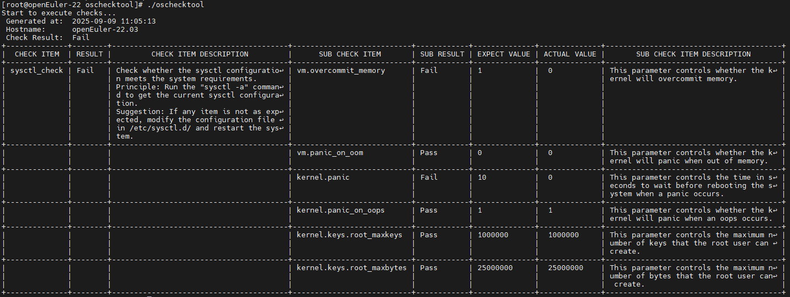
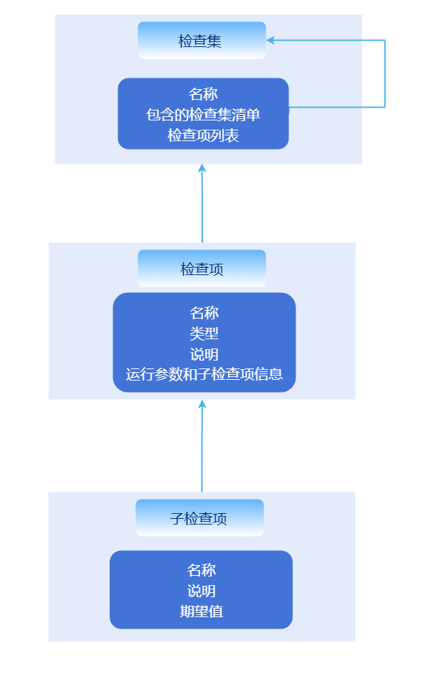

# OS一致性检查工具开发指南

## 特性介绍

容器场景下，各种工作负载对OS运行环境的依赖变少，但容器平台自身却因为负责内容更多而对OS运行环境有了更多依赖，oschecktool提供了一个单机检查工具，在openFuyao场景下检查特定运行环境是否满足容器平台的环境诉求，以减少各种因环境依赖造成的部署失败或功能失效的场景的出现。

## 约束与限制

- 只支持Linux系统的检查，不支持Windows版本。
- 该工具只对环境依赖进行初步分析，分析结果无法替代实际的兼容性测试。
- 检查工具需要各组件提供具体的检查项，才能进行对应的检查。
- 因为检查过程中需要读取一些系统文件，检查工具需要以root权限运行。

## 环境准备

### 环境要求

作为单机工具，可以在通用Linux环境下运行。

### 搭建环境

直接从如下链接下载最新版本，并使用tar解压即可：

[X86_64版本下载](https://openfuyao.obs.cn-north-4.myhuaweicloud.com/openFuyao/node-checker/releases/download/latest/oschecktool.tar.gz_linux_amd64)  
[ARM64版本下载](https://openfuyao.obs.cn-north-4.myhuaweicloud.com/openFuyao/node-checker/releases/download/latest/oschecktool.tar.gz_linux_arm64)

### 检验环境是否搭建成功

使用oschecktool工具时，只需要在oschecktool目录下执行`./oschecktool`即可。如下：  
**图1** oschecktool默认运行效果  


当能够运行预置检查项时，说明环境搭建成功。

## 使用场景：扩展检查工具检查项

### 使用场景概述

oschecktool自身只提供了一些基础的检查项，用户可以根据自己的场景扩展检查项，以满足自己的检查需求。

### 检查项组织结构说明

检查工具本身为单机工具，运行在待检查节点，直接输出检查结果，并无上下文依赖。主要依赖检查项来进行具体检查逻辑。

检查项位于工具conf目录下，其中：

- check-items目录下为所有检查项的配置文件。
- check-sets目录下为所有检查集的配置文件。

检查项组织结构如下：

**图2** 检查项组织结构  
  
检查集本身支持嵌套，以满足openFuyao内各组件的嵌套关联。

### 开发流程

1. **创建检查项配置文件**

    检查项配置文件目录：./conf/check-items/

    格式说明：

    ```yaml
    name: sysctl-check
    kind: kv-checker
    doc: |
    通过sysctl -a命令检查sysctl是否符合kubernetes运行要求
    spec:
    ...
    ```

    其中：

    - `name`：检查项名称，检查项的唯一标识，检查集通过`name`字段应用检查项，同时结果中也会包含`name`字段。
    - `kind`：检查项类型，根据`kind`字段区分不同的检查项类型。
    - `doc`：检查项说明，对检查项进行详细说明，报告中也会包含`doc`字段，可在这个字段中详细说明原理。
    - `spec`：各检查项的具体参数，不同`kind`的检查项有不同的`spec`结构。

    当前支持的检查项`kind`字段包括：

    - `kv-checker`：将特定来源的数据解析为简单的key-value对，并对特定的key检查是否符合预期，也可简化为`kv`。
    - `command-checker`：使用命令作为子检查项，并直接检查命令的命令行输出结果，也可以简化为`command`。
    - `ping-checker`：使用icmp协议检查目标主机是否可达，也可以简化为`ping`。
    - `kernel-module-checker`：检查内核模块的加载情况和加载参数，也可以简化为`kernel-module`。

    **command-checker类型检查项**

    此检查项执行一个命令并检查输出内容（stdout、stderr合并），`spec`字段格式定义样例如下：

    ```yaml
    spec:
    - name: echo command exist  #【必选】 名称
      command: which echo && echo "Exist" || echo "Not Exist"
      type: string
      expect: "Exist"
      doc: 检查{name}命令是否存在，配置过程依赖echo命令  
    ```

    `spec`各字段说明：

    - `spec[].name`：【必选】检查项名称。
    - `spec[].command`：【必选】执行的命令和参数，该字段内容将会作为`sh -c`的参数得到运行。
    - `spec[].doc`：【可选】输出到报告中用作说明。
    - `spec[].type` & `spec[].expect`：【可选】，同`kv-checker`。如果不配置这两个字段，则使用`spec[].command`字段所配置命令的返回值作为判断，0为成功，非0失败。如果配置了这两个字段，则使用`spec[].expect`字段配置内容检查命令輸出。

    其中，`spec[].type`指定`spec[].expect`的类型，`spec[].expect`为期望结果，`spec[].type`支持如下类型：  
    - `string`：字符串类型，直接比较字符串是否相等。
    - `regex`：正则类型，使用正则表达式检查字符串是否匹配。
    - `int`：整数类型，检查上述输出与expect的数值是否一致。
    - `version-range`：版本类型，检查上述输出与expect的版本范围是否一致，版本号使用点分数值形式表示，如1.1.1，expect的为一个区间，如`(1.2.3, 1.5)`，表示版本号大于1.2.3小于1.5，`[1.2.3, ]`表示版本号大于等于1.2.3。
    - `int-range`：整数范围类型，检查上述输出与expect的整数范围是否一致，expect的为一个区间，如`(1, 10]`，表示整数大于1小于等于10。

    **kv-checker类型检查项**

    此检查项将命令的输出或特定文件内容解析为key-value对，然后检查特定的key是否符合预期，`spec`字段格式定义样例如下：

    ```yaml
    spec:
      source:  #指定数据源，支持command、file，其中的每行数据都被splitter分割为key、value
        file:
        - /etc/sysctl.conf
        command:
        - sysctl -a
    
      kvParser: #可选，指定如何从source中解析出key和value，如果不指定，则默认使用空字符进行拆分。如果拆分失败，则跳过该行
        reSplitter: = # 使用此字段值作为正则表达式拆分key、value    
      subItems: #子检查项
      - name: kernel.threads-max
        key: kernel.threads-max  #如果指定了key，则使用key匹配， 否则直接使用name，key本身支持正则表达式进行通配
        type: int-range  #整型值范围
        expect: "[409600,)"
        doc: 最下线程数<409600，可能导致系统无法正常运行
    ```

    其中：

    - `spec.source.file`：【可选】，指定要读取的文件路径，多个文件的内容将会被合并。
    - `spec.source.command`：【可选】，指定命令的输出作为后续的数据源，多个命令的输出将会被合并，如果指定了`spec.source.file`，此参数将被忽略。
    - `spec.kvParser`：【可选】，指定如何从source中解析出key和value，如果不指定，则默认使用空字符进行拆分。如果拆分失败，则跳过该行。
    - `spec.kvParser.reGroup`：【可选】，使用此字段值作为正则表达式来匹配每一行，要求正则表达式中有两个或以上的非命名分组，如果有两个以上的匹配分组，则将最后一个分组值作为value，其他分组值使用-连接作为key。
    - `spec.kvParser.reSplitter`：【可选】，指定key和value的分隔符，分隔符作为正则表达式。如果有多个匹配值则以第一个匹配值分割，如果指定了`spec.kvParser.reGroup`，则此参数无效。
    - `spec.kvParser.reIgnore`：【可选】，匹配的行将被忽略，不进行解析。
    - `spec.subItems[]`：具体的待检查内容，其中，`key`与前述解析的key进行匹配，`expect`与前述解析的value进行匹配，如果`key`为空，则使用`name`作为key，其他字段与`command-checker`同名字段含义相同。

    **ping-checker类型检查项**

    此检查项使用ICMP协议检查目标主机是否可达，默认检查5次，每次检查超时时间为5秒，成功三次或以上即为检查成功，否则为失败，支持IPv4和IPv6，`spec`字段格式样例如下：

    ```yaml
    spec:
      targets: 
      - 192.168.1.1@hostname
    ```

    其中：

    - `spec.targets[]`：检查的目标主机列表，格式为`ip@节点名`，如果不指定节点名，则默认使用ip作为节点名，节点名主要是为了在报告中显示。

    **kernel-module-checker类型检查项**

    此检查项解析`/proc/modules`和`/sys/module`目录，检查指定的内核模块是否加载，以及加载参数是否符合预期。`spec`字段格式样例如下：

    ```yaml
    spec:
    - name: ip_vs
      doc: 检查ip_vs模块是否正常加载
      detail:
      - name: parameters/conn_tab_bits
        expect: "[0, )"
        type: int-range
    - name: not_exist_module
      doc: 测试不存在的模块，应该检查不通过
        
    - name: nf_conntrack
      doc: 测试存在的模块，但加载参数不符合要求
      detail:
      - name: parameters/expect_hashsize
        expect: "(, 0)"
        type: int-range
    ```

    其中：

    - `spec[].name`：【必选】内核模块名。
    - `spec[].doc`：【可选】输出到报告中用作说明。
    - `spec[].detail[]`：【可选】模块参数检查项，每个参数检查项为一个key-value对，key为参数路径（以`/sys/module/<模块名>`为基础路径的相对路径值），`expect`为期望的值，`type`为值的类型， `expect`、`type`与前述其他检查项同名字段相同。

    **扩展参数**

    因为一些参数需要在运行时才能确定，所以oschecktool支持在检查项中指定一些扩展参数，并在命令中通过-p参数进行绑定赋值。样例如下：

    ```yaml
    name: ping_check
    kind: ping
    doc: 模拟检测目标Ip是否可以联通，具体目标通过-p 参数输入
    params:
    - name: ping-addr
      desc: 检查目标Ip是否可以联通
      multi: true
    spec:
      targets: '{{ping-addr}}'

    ```

    其中：

    - `params[].name`：【必选】参数名，合法字符范围：`A-Za-z0-9_-`。
    - `params[].desc`：【可选】说明。
    - `params[].multi`：【可选】是否为多值参数，默认false，多值将会设置为字符串数组，单值则为字符串。

    `spec`中可以使用`{{param.name}}`来引用参数值，但只支持将某个yaml字段完整设置为参数值。

2. **定义检查集**

    检查集用于将多个检查项组织起来，方便选择执行。检查集归档目录为`<工具目录>/conf/check-sets`，检查集格式定义样例如下：

    ```yaml
    name: default
    desc: default check set
    include: 
    - other_check_set
    items:
    - sysctl_check
    ```

    其中：

    - `name`：【必选】检查集名。
    - `desc`：【可选】说明。
    - `include`：【可选】引入其他检查集，引入的检查集将合并到当前检查集中，引用的是其他检查集的`name`字段。
    - `items`：【可选】检查项列表，引用的是检查项的name字段。

3. **验证检查项**

    运行oschecktool，使用`-s`选项指定自己新增的检查集: `<工具目录>/oschecktool -s <检查集名>`，也可以不指定`-s`，则默认运行所有检查项。  
    如果检查项结果为Error，则可以根据`<工具目录>/log`下的日志进行定位分析。
