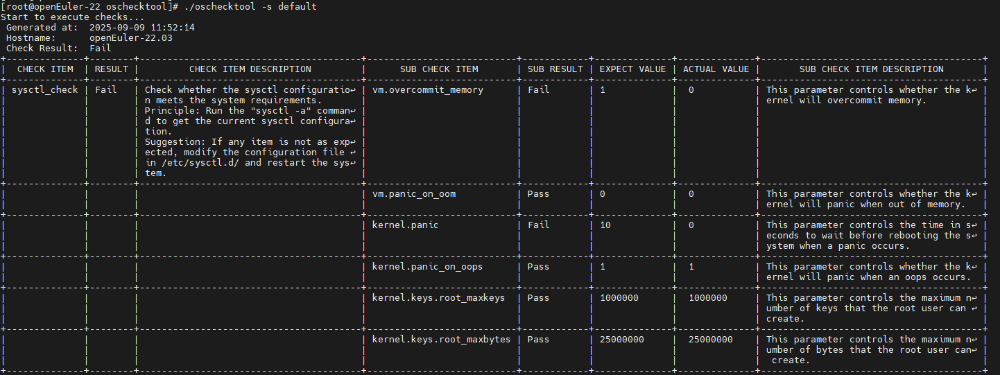

# OS一致性检查工具

## 特性介绍

容器场景下，各种负载对OS运行环境的依赖得到很大减少，但容器平台自身反而因负责内容更多而对OS运行环境有了更多依赖，oschecktool提供了一个单机检查工具，在openFuyao场景下检查特定运行环境是否满足容器平台的环境诉求，以减少各种因环境依赖造成的部署失败或功能失效的场景。

### 应用场景

- 在非官方支持的发布版上部署openFuyao系统前，您可以使用OS一致性检查工具检查当前环境是否符合openFuyao运行所需，并根据生成的检查报告修改环境配置，以避免在部署或运行过程中出现各种简单错误。
- 在部署或使用openFuyao系统时如遇到未知问题，您可以使用本工具进行检查，初步识别问题所在，提高解决效率。

### 能力范围

提供一个用于检查OS运行环境是否符合特定应用运行要求的工具框架及默认检查能力，具体支持如下能力：

- 环境检查能力。
  - 内核模块加载及加载参数检查能力。
  - 命令检查能力，能够运行某命令通过命令输出检查环境是否满足要求。
  - 简单配置文件检查能力（可以按行解析为kv配置信息）。
  - ICMP网络连通性探测能力。
- 支持生成检查报告。
  - 提供csv、yaml、plain形式检查报告。
  - 检查报告中可以生成具体的不通过原因，方便您在该环境进行环境调整。
- 支持以独立进程插件形式对此检查工具进行扩展。
  - 可以源码形式或独立进程方式对此检查工具进行扩展，以满足复杂检查要求。
  - 可以以简单脚本形式快速扩展检查工具。
- 具体检查内容可以以配置文件形式指定。
  具体检查内容可以以独立配置文件形式进行指定，以此满足openFuyao各组件指定自己的运行环境诉求。

检查工具以单机工具方式运行，检查过程除基本的运行资源消耗外，对运行环境无影响。

### 亮点特征

汇总所有组件的检查逻辑，避免每个组件各自实现导致重复开发和维护。同时也便于您统一检查环境。

### 基本概念

- 检查项：检查工具检查的具体项目，检查项包括检查子项，当所有子项结果为成功时，整个检查项结果为成功，否则为失败。检查项是检查的基本组织单位。检查项也是工具扩展的基本单位。
- 检查集：检查集是检查项的集合，检查集可以包含多个检查项。检查集也可以包含其他检查集，如此检查集中将包含其引用的所有其他检查集的检查项。

### 与相关特性的关系

检查工具只实现了检查的框架和基础能力，具体的检查项需要各组件根据自己的运行环境诉求，提供具体的检查项。

## 安装

直接从如下链接下载最新版本，并使用tar解压即可：

[X86_64版本下载](https://openfuyao.obs.cn-north-4.myhuaweicloud.com/openFuyao/node-checker/releases/download/latest/oschecktool_linux_amd64.tar.gz)

[ARM64版本下载](https://openfuyao.obs.cn-north-4.myhuaweicloud.com/openFuyao/node-checker/releases/download/latest/oschecktool_linux_arm64.tar.gz)

## 使用OS一致性检查工具

### 前提条件

工具单机运行，无需组网。工具运行环境需要基本的`/bin/sh`命令。

### 使用限制

- 只支持Linux系统的检查，不支持Windows版本。
- 该工具只对环境依赖进行初步分析，分析结果无法替代实际的兼容性测试。
- 检查工具需要各组件提供具体的检查项，才能针对该组件的使用约束进行检查。
- 检查工具需要以root权限运行，因为检查过程中需要读取一些系统文件。

### 操作步骤

1. 根据实际场景，选择需要检查的检查集，检查集可以通过`-h`命令获取，如下：

   ```
    [root@openEuler-22 oschecktool]# ./oschecktool -h
    This tool is used to check whether the OS configuration is consistent with a specific check set.
    Usage: ./oschecktool [-s check-set] [-o yaml|csv|plain] [-r report-path] [-p key1=value1[,value2,...]] [-h]
            -h: Print help information
            -o: Specify the report output path. The report file will be generated under this path: CheckReport-{NodeName}-{Time}.format.
            -p: Specify the parameters, format: key1=value1[,value2,...],This parameter can be bound multiple times.
                    No optional parameters.
            -s: Specify the check set to use, if not specified, all check items in the conf/CheckItem directory will be used.
                    Optional check sets:
                            default: default check set
            -t: Specify the output format: yaml, csv, plain, if not specified, plain will be used.

    ```

    可以根据`Optional check sets`看到待选择的检查集。

2. 运行检查工具，如下：
   
   **图1:** 检查工具运行效果
   
   

3. 您可以根据检查结果进行环境调整。

### 相关操作

无。
