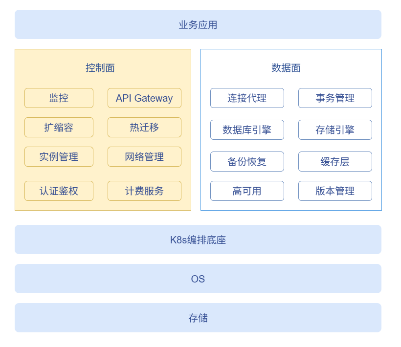
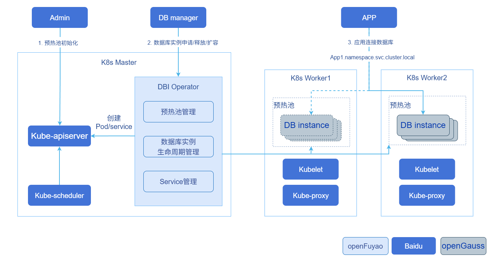

# serverlessdb-operator

## 特性介绍

传统数据库基于长期稳态负载设计，而Serverless场景下数据库计算实例生命周期短（几分钟到几十分钟）、负载突发且不可预测，需要数据库扩缩容转变为一种**运行时能力**：按需创建、自动扩展、空闲释放。

serverlessdb operator是面向短生命周期、突发负载场景的Serverless数据库管控面Operator。基于Kubernetes Operator扩展机制，维护预热数据库计算实例资源池，对外提供REST接口支持数据库计算实例的**按需申请、释放与原地垂直扩缩容**，并通过Headless Service保证连接地址在实例释放/重新申请后保持不变。

**图1** Serverless DB能力全景图



如图1所示，Serverless DB能力划分为控制面与数据面两层：

- **控制面**：关注成本效率和用户体验，主要负责实例生命周期管理、资源快速调度与启动、实例流量监控、访问安全和运维等能力（serverlessdb operator聚焦于此层）。
- **数据面**：关注数据正确与性能，主要负责数据的存储和读取、连接事务管理、备份恢复等能力（由数据库引擎实现，不在本Operator范围内）。

### 应用场景

- 上层DB Manager或业务服务通过REST API向Operator申请数据库计算实例，获得连接地址后业务应用通过Service域名连接数据库。
- 负载变化时调用扩缩容接口原地调整资源。
- 业务结束后释放实例，连接地址保留以便后续复用。

### 能力范围

- 支持通过`DBResourcePool` CR维护指定数量/规格的预热数据库计算实例，Reconciler自动调谐补齐。
- 支持通过REST API毫秒级申请实例（仅做label/status变更，从预热池中分配，无需冷启动）。
- 支持实例释放，删除DBInstance CR及其Pod，Headless Service保留以复用连接地址。
- 支持基于K8s `pods/resize`子资源的原地垂直扩缩容，无需重建Pod。
- 支持多租户认证鉴权：透传调用方Bearer Token至K8s API Server认证，并通过`SelfSubjectRulesReview`校验租户对目标namespace的RBAC权限。
- 支持REST API HTTPS传输加密：服务端证书由集群管理员使用集群CA签发并预配置（与K8s API Server同一信任体系），客户端凭集群CA校验服务端、凭SA Token完成认证，Operator自身不参与证书签发。
- 支持基于K8s Lease选主的高可用部署，主故障自动切换备实例。
- 支持定期清理无backing Pod且超过TTL的孤儿Headless Service。

### 亮点特征

- **毫秒级申请**：申请实例仅做label/status变更，从预热池中秒级分配，无需冷启动。
- **连接地址不变**：每个`app_ref`对应一个Headless Service，实例释放后DNS地址保留，重新申请可复用。
- **原地垂直扩缩容**：基于K8s `pods/resize`子资源实现原地垂直扩缩容，无需重建Pod，并自动维持Pod的QoS类不变以通过K8s校验。

### 实现原理

**图2** serverlessdb operator交互流程图



如图2所示，serverlessdb operator的核心交互流程如下：

1. 集群管理员下发数据库计算实例预热资源池CR（`DBResourcePool`），由Operator进行数据库计算实例的初始化，创建对应的Pod，这些Pod会调度到适当节点运行，组成预热资源池。
2. DB Manager根据应用需求和流量监控结果，调用Operator提供的REST接口，进行数据库计算实例的申请、释放和扩缩容。
3. 在申请数据库计算实例时，Operator创建与`app_ref`对应的Headless Service，与DBInstance通过label关联，K8s会调谐对应的路由规则，应用通过Service域名与数据库进行连接。

Operator进程内同时运行两个组件：

1. **Controller Manager**（controller-runtime）：运行`DBResourcePoolReconciler`，调谐资源池与实例状态，维护预热实例数量、同步实例状态、执行原地扩缩容、清理孤儿Service。
2. **Gin HTTP Server**：对外暴露REST API，通过`TokenCache`完成认证鉴权后调用`K8sInstanceService`处理申请/释放/扩缩容请求。

**申请实例流程**：Operator从内存缓存中按PostgreSQL（PG）版本与资源规格匹配预热实例，通过patch DBInstance及对应Pod的label（关联`app_ref`）、创建/复用以`app_ref`命名的Headless Service完成分配，内存中即将实例置为`Running`，status由Reconciler异步落库，返回`<app_ref>.<namespace>.svc.cluster.local:<pg_port>`连接地址。

**扩缩容流程**：Operator在DBInstance上写入resize-spec注解并置phase=`Scaling`，Reconciler通过`pods/resize`子资源提交原地扩缩容请求，完成后恢复`Running`。

### 与相关特性的关系

- 依赖Kubernetes ≥ 1.32的Pod原地垂直扩缩容特性（`pods/resize`子资源）。
- 依赖Kubernetes Lease（`coordination.k8s.io/leases`）实现选主高可用。

## 使用serverlessdb operator

### 前提条件

- Kubernetes使用openFuyao社区推荐版本v1.34.3（需 ≥ 1.32以支持Pod原地垂直扩缩容）。
- 已安装Helm 3。
- 已准备数据库计算镜像（如`postgres:17`）。若节点无法直接拉取镜像，需提前在各节点离线导入镜像或配置`imagePullSecrets`：

  ```bash
  # 离线导入镜像到节点
  nerdctl load -i compute-v17.4.tar
  ```

### 背景信息

通过下方[操作步骤](#操作步骤)，可以实现**部署Operator、创建预热资源池、申请/扩缩容/释放数据库计算实例的全流程**，使业务应用通过固定的Service域名连接到按需分配的数据库计算实例。

### 使用限制

- `DBResourcePool`中Pod模板的第一个容器应命名为`compute`，其资源配置用于资源池匹配（违反该约定时资源匹配将退化为缺省值，不报错）。
- PostgreSQL主版本仅支持`16`和`17`。
- 原地垂直扩缩容不能改变Pod的QoS类（Burstable ↔ Guaranteed），Operator会自动调整limit以维持原QoS类。
- 调用REST API的上层服务需持有目标namespace下所需资源的RBAC权限（详见[操作步骤](#操作步骤)第4步）。
- 启用REST API HTTPS后，须通过Service域名访问REST API，不要直连Pod IP（服务端证书SAN未覆盖Pod IP）。

### 操作步骤

1. 构建并推送镜像。

   1.1 编译二进制并构建Docker镜像。

   ```bash
   # 本地编译
   go build -o bin/serverlessdb-operator ./cmd

   # 构建单架构Docker镜像
   REGISTRY=<your-registry> TAG=1.0.0 ./build/build.sh

   # 构建多架构manifest（需先分别构建并push各架构镜像）
   REGISTRY=<your-registry> TAG=1.0.0 ./build/build.sh manifest
   ```

   > **说明：**
   >
   >支持`linux/amd64`与`linux/arm64`架构。多架构manifest模式要求`REGISTRY`必须设置。

2. 通过Helm安装Operator。

   2.1 使用Helm安装Chart，Chart包含CRD（`dbresourcepool` / `dbinstance`）、Deployment、Service（REST API集群内访问入口）、ServiceAccount、ClusterRole/ClusterRoleBinding。

   ```bash
   helm install serverlessdb-operator ./build/chart \
     -n serverlessdb --create-namespace \
     --set namespace=serverlessdb
   ```

   > **说明：**
   >
   >- Chart默认从`cr.openfuyao.cn/openfuyao/serverlessdb-operator/serverlessdb-operator:latest`拉取镜像。如需使用自定义镜像，通过`--set image.registry`、`--set image.repository`、`--set image.tag`覆盖。
   >- 可在`build/chart/values.yaml`中调整端口、选主参数、资源、TTL、QPS等。默认使用集群内ServiceAccount Token认证。完整参数说明见[Operator配置参数](#operator配置参数)。

   2.2 （可选）启用REST API HTTPS。

   Operator是否启用HTTPS由是否配置证书决定，无需单独开关：**values中不配置`tls`即为HTTP；配置`tls`后即启用HTTPS**。服务端证书由集群管理员预先使用集群CA签发（与K8s API Server同一信任体系），客户端凭集群CA + SA Token访问，Operator不参与证书签发。

   2.2.1 管理员签发证书并创建Secret（kubeadm集群示例，`<ns>`为Operator部署namespace）。

   ```bash
   NS=<ns>
   # 1. 生成私钥与CSR，SAN覆盖Service域名
   openssl genrsa -out tls.key 2048
   openssl req -new -key tls.key -out tls.csr -subj "/CN=serverlessdb-operator.${NS}.svc" \
     -addext "subjectAltName=DNS:serverlessdb-operator,DNS:serverlessdb-operator.${NS},DNS:serverlessdb-operator.${NS}.svc,DNS:serverlessdb-operator.${NS}.svc.cluster.local"
   # 2. 用集群CA签发（/etc/kubernetes/pki为kubeadm默认路径）
   openssl x509 -req -in tls.csr -CA /etc/kubernetes/pki/ca.crt -CAkey /etc/kubernetes/pki/ca.key \
     -CAcreateserial -out tls.crt -days 3650 \
     -extfile <(printf "subjectAltName=DNS:serverlessdb-operator,DNS:serverlessdb-operator.${NS},DNS:serverlessdb-operator.${NS}.svc,DNS:serverlessdb-operator.${NS}.svc.cluster.local")
   # 3. 创建Secret（必须先于helm install/upgrade完成）
   kubectl create secret tls serverlessdb-operator-tls -n "${NS}" --cert=tls.crt --key=tls.key
   ```

   2.2.2 在`values.yaml`中配置`tls`后安装/升级Chart（`secretName`可自定义，证书挂载路径有默认值）。

   ```yaml
   tls:
     secretName: serverlessdb-operator-tls
   ```

   > **说明：**
   >
   >- 启用HTTPS后，调用方通过Service域名`https://serverlessdb-operator.<ns>.svc:8080`访问REST API，**不要直连Pod IP**（证书SAN未覆盖Pod IP）。
   >- 调用方凭集群CA校验服务端证书（Pod内可直接使用`/var/run/secrets/kubernetes.io/serviceaccount/ca.crt`），认证仍通过`Authorization: Bearer <token>`完成。
   >- 证书过期/轮转时，管理员更新Secret后执行`kubectl rollout restart deployment/serverlessdb-operator`重新加载；移除values中的`tls`配置即回退HTTP。

   2.3 （可选）若需以客户端证书方式认证Operator与API Server的通信，在`values.yaml`中配置：

   ```yaml
   clientCert:
     enabled: true
     secretName: "operator-tls"
     certPath: /etc/serverlessdb/tls/tls.crt
     keyPath:  /etc/serverlessdb/tls/tls.key
     username: "serverlessdb-operator"   # 或group，用于绑定ClusterRole
   ```

   2.4 确认Operator Pod处于Running状态。

   ```bash
   kubectl -n serverlessdb get pods -l app=serverlessdb-operator
   ```

3. 创建DBResourcePool资源池。

   3.1 下发`DBResourcePool` CR，定义期望的实例数量、PG版本与Pod模板。

   ```yaml
   apiVersion: serverlessdb.openfuyao.cn/v1
   kind: DBResourcePool
   metadata:
     name: pool-small
     namespace: serverlessdb
   spec:
     replicas: 5              # 维护的实例总数(warm + allocated)
     minAvailable: 2          # 最小预热可用实例数
     pgVersion: 17            # PostgreSQL主版本(16 | 17)
     controlPlaneUrl: "http://control-plane:8080"
     podTemplate:             # 完整Pod模板，compute容器的资源用于池匹配
       metadata:
         labels:
           app: compute
         annotations:
           compute.openfuyao.cn/priority: "0"
           prometheus.io/scrape: "true"
           prometheus.io/port: "3080"
       spec:
         hostNetwork: false
         dnsPolicy: ClusterFirst
         securityContext:
           fsGroup: 1000
           runAsUser: 1000
         containers:
         - name: compute               # 第一个容器应命名为compute
           image: "cr.openfuyao.cn/openfuyao/compute/compute:v17.4"
           imagePullPolicy: IfNotPresent
           resizePolicy:                # 原地扩缩容策略，NotRequired表示无需重启容器
           - resourceName: cpu
             restartPolicy: NotRequired
           - resourceName: memory
             restartPolicy: NotRequired
           env:
           - name: MY_POD_NAME
             valueFrom:
               fieldRef:
                 fieldPath: metadata.name
           - name: NAMESPACE
             valueFrom:
               fieldRef:
                 fieldPath: metadata.namespace
           - name: COMPUTE_ID
             value: "$(NAMESPACE)_$(MY_POD_NAME)"
           args:
           - /var/db/postgres/compute
           - -C
           - postgresql://cloud_admin@localhost/postgres
           - -b
           - /usr/local/bin/postgres
           - --compute-id
           - $(COMPUTE_ID)
           - --dev
           ports:
           - name: pg
             containerPort: 5432
           resources:
             requests: { cpu: "1000m", memory: "1Gi" }
             limits:   { cpu: "2000m", memory: "2Gi" }
   ```

   > **说明：**
   >
   >- `replicas`为维护的实例总数（预热 + 已分配）；`minAvailable`为最小预热可用实例数，低于该值时Reconciler自动补齐。
   >- `compute`容器的`resources`用于申请实例时的资源池匹配，`resizePolicy`设为`NotRequired`以支持原地扩缩容而不重启容器。
   >- `controlPlaneUrl`会作为环境变量注入compute容器及init/heartbeat容器。
   >- 上例为最小可用模板，无需initContainers即可使预热实例达到`WarmReady`。生产环境中若需向控制面注册Pod，可在`spec.initContainers`中添加`register-pod`容器，并配合`controlPlaneUrl`使用。

   3.2 确认资源池已就绪，预热实例达到WarmReady状态。

   ```bash
   kubectl -n serverlessdb get dbresourcepool pool-small
   ```

   预期输出（`Available`应逐渐达到`replicas`值）：

   ```text
   NAME          TOTAL   WARM   AVAILABLE   ALLOCATED   PG-VERSION   AGE
   pool-small    5       5      5           0           17           2m
   ```

4. 为调用方授权RBAC。

   上层DB Manager需持有目标namespace下对以下资源的权限，Operator才能以该Token完成操作：

   - `serverlessdb.openfuyao.cn`组：`dbinstances`的get/list/patch/delete、`dbinstances/status`的patch
   - 核心API：`pods`的get/patch、`services`的get/create/delete

   示例Role与RoleBinding（绑定给调用方使用的ServiceAccount）：

   ```yaml
   apiVersion: rbac.authorization.k8s.io/v1
   kind: Role
   metadata:
     name: serverlessdb-tenant
     namespace: serverlessdb
   rules:
   - apiGroups: ["serverlessdb.openfuyao.cn"]
     resources: ["dbinstances"]
     verbs: ["get", "list", "patch", "delete"]
   - apiGroups: ["serverlessdb.openfuyao.cn"]
     resources: ["dbinstances/status"]
     verbs: ["patch"]
   - apiGroups: [""]
     resources: ["pods"]
     verbs: ["get", "patch"]
   - apiGroups: [""]
     resources: ["services"]
     verbs: ["get", "create", "delete"]
   ---
   apiVersion: rbac.authorization.k8s.io/v1
   kind: RoleBinding
   metadata:
     name: serverlessdb-tenant
     namespace: serverlessdb
   subjects:
   - kind: ServiceAccount
     name: <caller-serviceaccount>
     namespace: <caller-namespace>
   roleRef:
     kind: Role
     name: serverlessdb-tenant
     apiGroup: rbac.authorization.k8s.io
   ```

    4.1 创建调用方ServiceAccount并获取Bearer Token。

    ```bash
    # 创建调用方ServiceAccount（若不存在）
    kubectl -n <caller-namespace> create serviceaccount <caller-serviceaccount>

    # 通过TokenRequest API签发Bearer Token（默认有效期为1小时）
    kubectl -n <caller-namespace> create token <caller-serviceaccount>
    ```

    > **说明：**
    >
    >- K8s ≥ 1.24已不再为ServiceAccount自动生成长期Token，需通过`kubectl create token`使用TokenRequest API签发。
    >- Token默认有效期为1小时，过期后调用REST API将返回`401`，需重新签发。
    >- 如需长期Token，可创建`kubernetes.io/service-account-token`类型的Secret并标注对应的ServiceAccount，K8s控制面会自动填充长期Token到该Secret中。

5. 申请实例。

   5.1 确定REST API基础地址（`<operator-ns>`为Operator部署namespace，本例为`serverlessdb`）：

   - 启用HTTPS（values配置了`tls`）：`https://serverlessdb-operator.<operator-ns>.svc:8080`，调用方需持有集群CA证书（Pod内为`/var/run/secrets/kubernetes.io/serviceaccount/ca.crt`）。
   - 未启用HTTPS（默认）：`http://serverlessdb-operator.<operator-ns>.svc:8080`。

   5.2 调用方携带Bearer Token，向Operator发起申请实例请求。

   ```http
   POST /api/v1/instances?namespace=serverlessdb
   Authorization: Bearer <token>

   {
     "app_ref": "app1",
     "pg_version": 17,
     "resources": { "cpu": "1000m", "memory": "1Gi" }
   }
   ```

   启用HTTPS时的curl调用示例：

   ```bash
   curl --cacert /var/run/secrets/kubernetes.io/serviceaccount/ca.crt \
     -X POST "https://serverlessdb-operator.serverlessdb.svc:8080/api/v1/instances?namespace=serverlessdb" \
     -H "Authorization: Bearer <token>" \
     -H "Content-Type: application/json" \
     -d '{"app_ref":"app1","pg_version":17,"resources":{"cpu":"1000m","memory":"1Gi"}}'
   ```

   响应`200`：

   ```json
   {
     "endpoint": "app1.serverlessdb.svc.cluster.local:5432",
     "pod_name": "pool-small-abc12",
     "pod_id": "4b295d49-7886-4dc7-a4b1-528886c5eb97"
   }
   ```

   5.3 业务应用使用返回的`endpoint`连接数据库。

   > **说明：**
   >
   >申请实例仅做label/status变更，从预热池中秒级分配，无需冷启动。HTTP API返回的错误码及含义见[HTTP API错误码](#http-api错误码)。

6. 垂直扩缩容。

   6.1 调用PATCH接口对运行中的实例进行原地垂直扩缩容。

   ```http
   PATCH /api/v1/instances/app1?namespace=serverlessdb
   Authorization: Bearer <token>

   {
     "containers": [
       { "name": "compute", "resources": { "cpu": "2000m", "memory": "2Gi" } }
     ]
   }
   ```

   Operator在DBInstance上写入resize-spec注解并置phase=`Scaling`，Reconciler通过`pods/resize`子资源提交原地扩缩容请求，完成后恢复`Running`。

   > **说明：**
   >
   >扩缩容不会改变Pod的QoS类。若调整会导致Burstable → Guaranteed的变化，Operator会自动抬高limit以维持原QoS类，避免被K8s拒绝。

7. 释放实例。

   7.1 调用DELETE接口释放实例。

   ```http
   DELETE /api/v1/instances/app1?namespace=serverlessdb
   Authorization: Bearer <token>
   ```

   响应`204`。删除DBInstance CR（Pod随ownerRef级联删除），Headless Service保留以便复用连接地址。

   > **说明：**
   >
   >释放后，以相同`app_ref`再次申请实例将复用相同的DNS连接地址。

### 相关操作

**查询资源池状态**

- 查询所有`DBResourcePool`。

  ```bash
  kubectl -n serverlessdb get dbresourcepool
  ```

  输出示例：

  ```text
  NAME          TOTAL   WARM   AVAILABLE   ALLOCATED   PG-VERSION   AGE
  pool-small    5       3      3           2           17           10m
  ```

- 查询资源池详情。

  ```bash
  kubectl -n serverlessdb get dbresourcepool pool-small -o yaml
  ```

- 通过`/scale`子资源在线调整资源池规模。

  ```bash
  kubectl -n serverlessdb scale dbresourcepool pool-small --replicas=10
  ```

**查询实例状态**

- 查询所有`DBInstance`。

  ```bash
  kubectl -n serverlessdb get dbinstance
  ```

- 按`app_ref`查询已分配实例。

  ```bash
  kubectl -n serverlessdb get dbinstance -l app-ref=app1
  ```

- 查询实例详情，查看phase、podName、podIP、连接地址等，`.status.phase`取值及含义见[DBInstance状态说明](#dbinstance状态说明)。

  ```bash
  kubectl -n serverlessdb get dbinstance -l app-ref=app1 -o yaml
  ```

  输出示例：

  ```yaml
  apiVersion: serverlessdb.openfuyao.cn/v1
  kind: DBInstance
  metadata:
    name: pool-small-ins-0
    namespace: serverlessdb
    labels:
      dbresourcepool: pool-small
      app-ref: app1
  spec: {}
  status:
    phase: Running
    podName: pool-small-abc12
    podIP: 10.244.1.10
    podUID: 4b295d49-7886-4dc7-a4b1-528886c5eb97
    connectionString: app1.serverlessdb.svc.cluster.local:5432
    pgPort: 5432
    allocatedAt: "2026-07-20T10:00:00Z"
  ```

**查看Operator日志**

```bash
kubectl -n serverlessdb logs -l app=serverlessdb-operator --tail=100
```

**REST API调试（port-forward）**

Operator的Gin HTTP Server绑定Pod IP（非`0.0.0.0`），`kubectl port-forward`依赖Pod内`127.0.0.1`可达，直接转发会失败：

```text
E ... failed to connect to localhost:8080 inside namespace
dial tcp4 127.0.0.1:8080: connect: connection refused
```

调试时可先获取Pod IP，直接对Pod IP发起请求：

```bash
# 获取Operator Pod IP
POD_IP=$(kubectl -n serverlessdb get pod -l app=serverlessdb-operator \
  -o jsonpath='{.items[0].status.podIP}')

# 未启用HTTPS（默认）：直接以HTTP调用
curl http://${POD_IP}:8080/api/v1/instances?namespace=serverlessdb \
  -H "Authorization: Bearer <token>"

# 启用HTTPS：证书SAN仅覆盖Service域名，直连Pod IP校验会失败，调试时加-k跳过校验
curl -k https://${POD_IP}:8080/api/v1/instances?namespace=serverlessdb \
  -H "Authorization: Bearer <token>"
```

启用HTTPS时，更推荐从集群内Pod中通过Service域名调用（证书校验通过，`--cacert`指定集群CA）：

```bash
curl --cacert /var/run/secrets/kubernetes.io/serviceaccount/ca.crt \
  "https://serverlessdb-operator.serverlessdb.svc:8080/api/v1/instances?namespace=serverlessdb" \
  -H "Authorization: Bearer <token>"
```

若需使用`kubectl port-forward`，可在Pod内启动本地代理将`127.0.0.1`转发到Pod IP：

```bash
# 在Operator Pod内启动本地代理（示例：9090 -> PodIP:8080）
kubectl -n serverlessdb exec <pod> -- bash -c \
  'nohup socat TCP-LISTEN:9090,fork TCP:$(hostname -I | awk "{print \$1}"):8080 &'

# port-forward指向代理端口
kubectl -n serverlessdb port-forward <pod> 8080:9090
```

> **说明：**
>
>上述workaround仅用于调试。生产环境应通过Service暴露REST API，启用HTTPS时统一使用`https://serverlessdb-operator.<ns>.svc:8080`访问。

## 参考信息

### DBInstance状态说明

**表1** DBInstance状态说明

| `.status.phase` | 含义 |
|---|---|
| `WarmReady` | 预热就绪，待分配。 |
| `Running` | 已分配给某`app_ref`，运行中。 |
| `Scaling` | 垂直扩缩容进行中。 |
| `WakingUp` | Pod启动中。 |
| `Hibernated` | 休眠。 |
| `Failed` | 异常。 |

### HTTP API错误码

**表2** HTTP API错误码

| HTTP | 含义 |
|---|---|
| 400 | 请求参数非法 / 无匹配资源池。 |
| 401 | Token认证失败。 |
| 403 | Token鉴权失败（RBAC不足）。 |
| 404 | 实例不存在 / 无可用预热实例。 |
| 409 | 该`app_ref`已分配实例。 |

### Operator配置参数

Operator启动参数（见`internal/config/config.go`），可通过Helm `values.yaml`的`args`段调整：

**表3** Operator配置参数

| 参数 | 缺省值 | 说明 |
|---|---|---|
| `--gin-port` | 8080 | REST API端口。 |
| `--metrics-port` | 8081 | Prometheus指标端口。 |
| `--health-port` | 8082 | 健康探针端口（`/healthz`、`/readyz`）。 |
| `--log-file` | `/var/log/openFuyao/serverlessdb-operator/serverlessdb-operator.log` | 日志文件路径。 |
| `--leader-election` | true | 是否启用选主。 |
| `--leader-election-id` | `serverlessdb-operator.openfuyao.cn` | 选主Lease ID。 |
| `--leader-election-namespace` | 空 | 选主Lease所在namespace，Helm部署时由`values.yaml`的`namespace`注入。 |
| `--lease-duration` | 15s | Lease时长。 |
| `--renew-deadline` | 10s | 续约截止。 |
| `--retry-period` | 2s | 重试周期。 |
| `--service-ttl` | 30m | 孤儿Service清理TTL，0表示禁用。 |
| `--token-cache-ttl` | 5m | Token客户端与鉴权结果缓存时长。 |
| `--tenant-client-qps` | 100 | 单租户K8s客户端QPS。 |
| `--tenant-client-burst` | 200 | 单租户K8s客户端突发。 |
| `--client-cert` / `--client-key` | 空 | 客户端证书认证（可选）。 |
| `--tls-cert` / `--tls-key` | 空 | REST API服务端证书与私钥路径，两者同时配置时启用HTTPS，缺省为HTTP（Helm部署时由values中的`tls`配置注入）。 |
