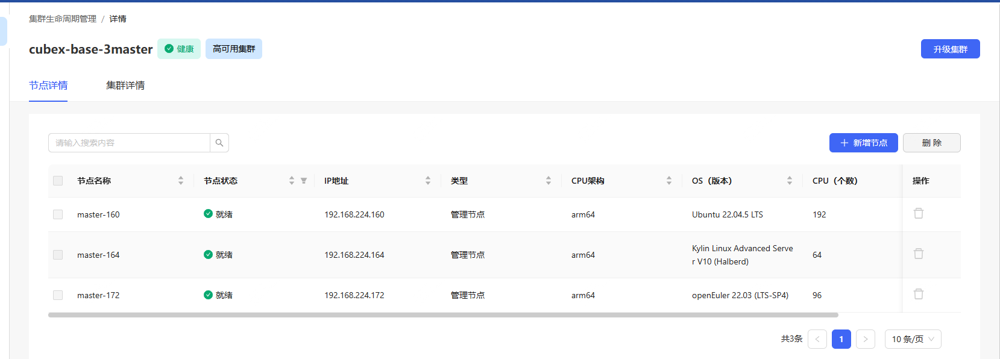
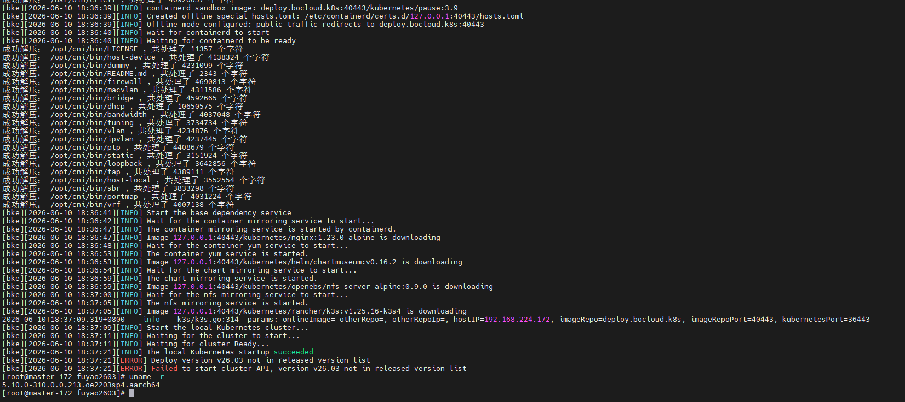
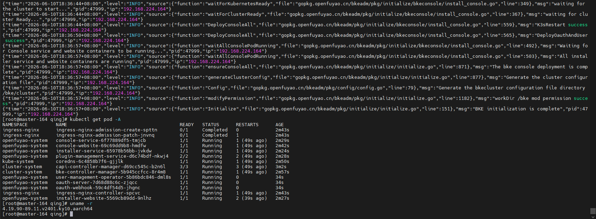
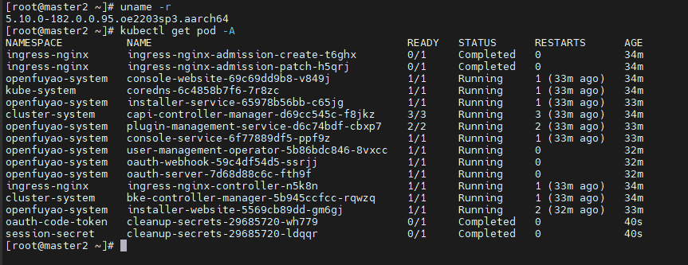
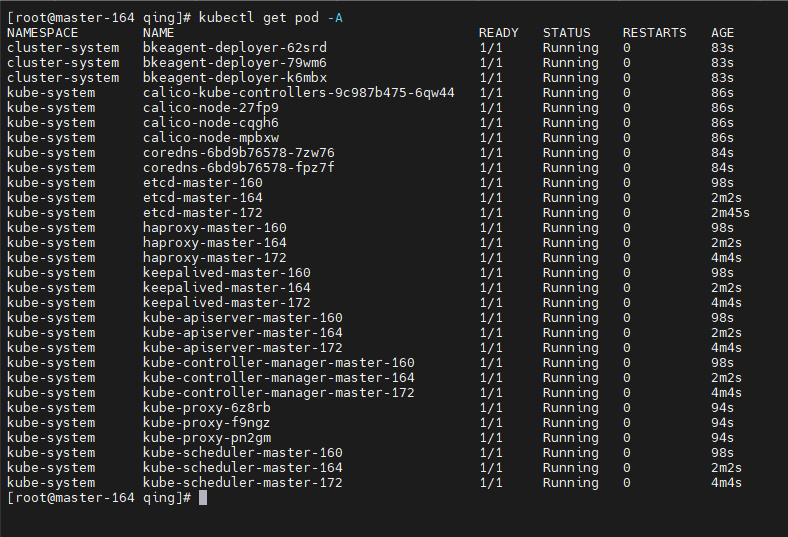
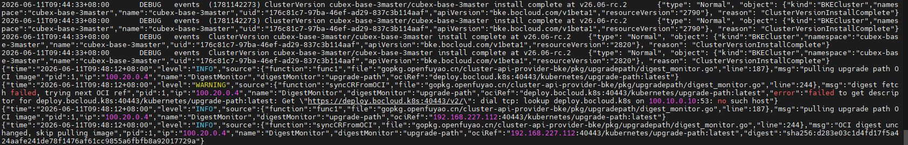
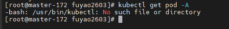
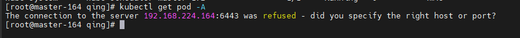
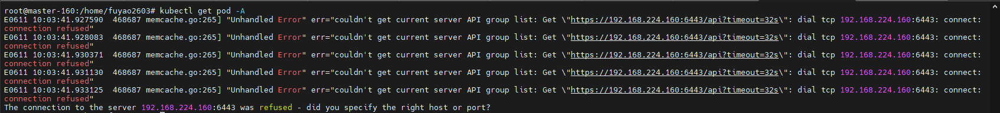

# openFuyao 2606 rc2 安装部署测试报告

>  Author: 华鲲振宇 - 刘青青

# 1     特性概述

安装部署特性是 openFuyao 集群交付和后续能力验证的基础。本次测试主要围绕华鲲 Fuyao2606 环境下的 bke 安装部署能力进行验证，覆盖引导节点安装、不同操作系统节点适配、三 master 负载均衡业务集群部署、平台组件安装以及集群删除等场景。

本次测试重点关注 v26.06-rc.2 对应的 bke 工具部署表现，核心验证工具为：

```bash
curl -fL https://openfuyao.obs.cn-north-4.myhuaweicloud.com/openFuyao/bkeadm/releases/download/26.6.0-rc.2/bkeadm_linux_arm64 -o /usr/local/bin/bke
```

测试过程中前期曾使用 `bke 1.2.2` 进行初始验证，openEuler、Ubuntu 引导节点存在安装失败现象；中途替换为 `26.6.0-rc.2` 对应 bke 工具后继续测试。本报告主要记录替换工具后的引导节点安装、三 master 负载均衡业务集群部署、平台组件安装以及集群删除验证结果。

# 2     特性测试信息

本节描述被测对象的版本信息、测试时间及依赖环境。部分环境信息依据测试反馈记录整理，后续如需补充服务器型号、CPU、内存、磁盘、网络等信息，可在本章节继续完善。

| 版本名称 | 测试起始时间 | 测试结束时间 |
| -------- | ------------ | ------------ |
| v26.06-rc2 | 2026-06-11 | 2026-06-12 |

软件及版本信息：

- bke 初始版本：`1.2.2`，测试中途替换为 `26.6.0-rc.2`
- openFuyao Version：`v26.06-rc.2`
- Kubernetes Version：`v1.34.3-of.1`
- containerd Version：`v2.1.1`
- etcd Version：`v3.6.7-of.1`
- arm64 bke 工具下载地址：`https://openfuyao.obs.cn-north-4.myhuaweicloud.com/openFuyao/bkeadm/releases/download/26.6.0-rc.2/bkeadm_linux_arm64`
- 系统内核记录：`1.5.10.0-182.0.0.95.oe2203sp3.aarch64`

测试环境：

| `节点/用途` | `OS` | `IP/标识` | `测试结论/说明` |
|:-----------:|:----:|:---------:|:---------------:|
| 引导节点 | Kylin | 待补充 | 初测通过 |
| 引导节点 | openEuler | 待补充 | 初测失败，替换 bke 工具后继续验证 |
| 引导节点 | Ubuntu | 待补充 | 初测失败，现象同 openEuler |
| 引导节点 | 待补充 | `192.168.227.112` | 替换 bke 工具后通过 |
| master-172 | openEuler | `192.168.224.172` | 参与 3 master 负载均衡集群 |
| master-164 | Kylin | `192.168.224.164` | 参与 3 master 负载均衡集群 |
| master-160 | Ubuntu | `192.168.224.160` | 参与 3 master 负载均衡集群 |
| 负载均衡 VIP | / | `192.168.224.223:36443` | 业务集群控制面入口 |

相关截图：



# 3     测试结论概述

## 3.1   测试整体结论

本轮验证主要针对 v26.06-rc.2 对应 bke 工具进行。测试前期使用 `bke 1.2.2` 时，Kylin 引导节点安装通过，openEuler 与 Ubuntu 引导节点失败，Ubuntu 失败现象与 openEuler 一致。中途替换为 `26.6.0-rc.2` 对应 bke 工具后，引导节点 `192.168.227.112` 安装通过，并继续完成后续业务集群部署验证。

基于引导节点继续部署 3 master 负载均衡业务集群，节点组合为 `172 openEuler + 164 Kylin + 160 Ubuntu`。测试发现，如果安装模板或页面参数仅创建基础 Kubernetes 集群，未选择或注入平台组件 addon，则业务集群只包含基础组件，未安装管理界面、monitoring 等平台能力，实际可用范围不足，需要明确“不安装管理界面”场景下基础组件的范围定义。

删除集群场景整体耗时可接受，反馈记录显示删除速度在 10 分钟以内，但存在部分节点清理不完整的现象，需要继续确认复现条件及清理逻辑。

## 3.2   约束说明

本轮测试结论受安装模板、页面参数和 addon 选择影响较大。若仅创建基础 Kubernetes 集群，默认只安装 kubeproxy、calico、coredns、bkeagent-deployer 等基础组件，不会自动安装管理界面、monitoring 等平台组件。

添加管理页面相关安装项后，monitoring 等平台组件可以被安装。后续测试需要在用例中明确区分“基础 K8s 集群安装”和“包含平台组件的完整业务集群安装”两类场景。

## 3.3   遗留问题分析

### 3.3.1 遗留问题影响以及规避措施

| 问题单号 | 问题描述 | 问题级别 | 问题影响和规避措施 | 当前状态 |
| -------- | -------- | -------- | ------------------ | -------- |
| 待补充 | 初始 `bke 1.2.2` 下 openEuler、Ubuntu 引导节点安装失败 | 主要 | 影响多 OS 引导节点部署验证；当前测试中途已替换为 `26.6.0-rc.2` 对应 bke 工具并继续验证 | 待确认 |
| 待补充 | 未选择/注入平台组件 addon 时，仅创建基础 K8s 集群，管理界面、monitoring 等组件缺失 | 主要 | 影响业务集群可用性和平台功能验证；需要明确安装模板默认组件范围，并在页面参数中显式选择平台组件 | 待确认 |
| 待补充 | 删除业务集群时部分节点清理不完整 | 次要 | 删除速度整体可接受，但残留节点需要人工检查或二次清理；需继续补充日志定位 | 待确认 |

### 3.3.2 问题统计

|        | 问题总数 | 严重 | 主要 | 次要 | 不重要 |
| ------ | -------- | ---- | ---- | ---- | ------ |
| 数目   | 3        | 0    | 2    | 1    | 0      |

# 4     测试执行

- [x] `bke 1.2.2` 初始安装部署验证及工具替换说明
- [x] Kylin 引导节点安装验证
- [x] openEuler 引导节点安装验证
- [x] Ubuntu 引导节点安装验证
- [x] 使用 `26.6.0-rc.2` 对应 bke 工具重新验证
- [x] 引导节点 `192.168.227.112` 安装验证
- [x] 3 master 负载均衡业务集群部署验证
- [x] 基础 K8s 集群组件安装范围验证
- [x] 添加管理页面后 platform addon 安装验证
- [x] 业务集群删除验证

基础命令记录：

```bash
# 下载 v26.06-rc.2 arm64 bke 工具
curl -fL https://openfuyao.obs.cn-north-4.myhuaweicloud.com/openFuyao/bkeadm/releases/download/26.6.0-rc.2/bkeadm_linux_arm64 -o /usr/local/bin/bke

# 查看 bke-controller-manager 日志
kubectl logs -n cluster-system bke-controller-manager-5b945ccfcc-rqwzq -c manager --tail=500
```

## 4.1 bke 工具版本替换说明

测试前期曾使用 `bke 1.2.2` 进行引导节点部署验证，结果如下：

- Kylin 引导节点通过；
- openEuler 引导节点失败；
- Ubuntu 引导节点失败，失败现象同 openEuler。

随后将测试工具替换为 `26.6.0-rc.2` 对应 bke 工具，本轮报告后续结论主要以替换后的工具验证结果为准。

相关截图：



## 4.2 26.6.0-rc.2 bke 工具引导节点验证

替换为 `26.6.0-rc.2` 对应的 arm64 bke 工具后重新验证，引导节点 `192.168.227.112` 安装通过。

测试记录：

```text
curl -fL https://openfuyao.obs.cn-north-4.myhuaweicloud.com/openFuyao/bkeadm/releases/download/26.6.0-rc.2/bkeadm_linux_arm64 -o /usr/local/bin/bke

1.5.10.0-182.0.0.95.oe2203sp3.aarch64
引导节点 112 通过
```

相关截图：





## 4.3 3 master 负载均衡业务集群部署

基于引导节点继续部署 3 master 负载均衡业务集群，节点组合如下：

- `192.168.224.172`：openEuler
- `192.168.224.164`：Kylin
- `192.168.224.160`：Ubuntu
- 控制面负载均衡入口：`192.168.224.223:36443`

部署过程中发现集群组件缺失，未安装管理界面。经日志和配置确认，原因是安装模板或页面参数只创建了基础 Kubernetes 集群，没有选择或注入平台组件 addon。

BKECluster 中实际包含的 addon 如下：

```yaml
addons:
  - name: kubeproxy
    version: v1.34.3-of.1
  - name: calico
    version: v3.31.3
  - name: coredns
    version: v1.12.2-of.1
  - name: bkeagent-deployer
    version: v26.6.0-rc.2
```

集群状态最终达到 Ready：

```yaml
status:
  agentStatus:
    replies: 3
    status: 3/3
    unavailableReplies: 0
  clusterHealthState: Healthy
  clusterStatus: Ready
  phase: EnsureCluster
  ready: true
```

部署过程中曾出现短暂健康检查失败，主要表现为 `master-172` 未就绪以及 calico、coredns 相关 pod 处于 Pending。后续 `EnsureCluster` 阶段成功，集群进入 Ready 状态。

相关截图：




## 4.4 平台组件安装范围验证

未添加管理页面相关安装项时，集群只创建基础 Kubernetes 能力，未安装管理界面，monitoring 等组件也未安装。该结果对实际使用影响较大，需要明确基础组件范围。

添加管理页面安装项后，monitoring 等平台组件可以被安装，说明组件缺失与安装模板或页面参数选择有关。日志中可以看到业务集群安装完成，但仍存在部分与升级路径相关的告警信息，后续可继续跟踪其对功能面的实际影响。

建议后续在测试用例中明确以下两种场景：

- 基础 Kubernetes 集群安装：仅验证 kubeproxy、calico、coredns、bkeagent-deployer 等基础 addon；
- 完整平台集群安装：验证管理界面、monitoring 及其他平台组件是否随模板正常安装。

相关截图：



## 4.5 集群删除验证

测试记录显示，删除集群在未安装管理集群 `31616` 的情况下速度较快，整体耗时在 10 分钟以内。

但删除过程中出现节点清理不一致问题：一个节点删除干净，其他节点存在未清理完成的情况。该问题需要继续补充日志，确认是否与节点 OS、agent 状态、网络连通性或 finalizer 清理逻辑有关。

相关截图：







## 4.6 建议优化项

- 明确“不安装管理界面”场景下基础组件范围，避免测试和交付理解不一致；
- 页面或安装模板中建议明确展示将要安装的 addon 列表，便于测试人员提前确认；
- 对 `bke 1.2.2` 阶段 openEuler、Ubuntu 引导节点失败问题补充失败日志，并确认与 `26.6.0-rc.2` 工具的差异；
- 集群删除完成后建议增加节点清理结果汇总，标明每个节点的清理状态；
- 对 EnsureCluster 过程中短暂 Pending 的 calico、coredns 等组件，建议增加更明确的等待和诊断提示。
