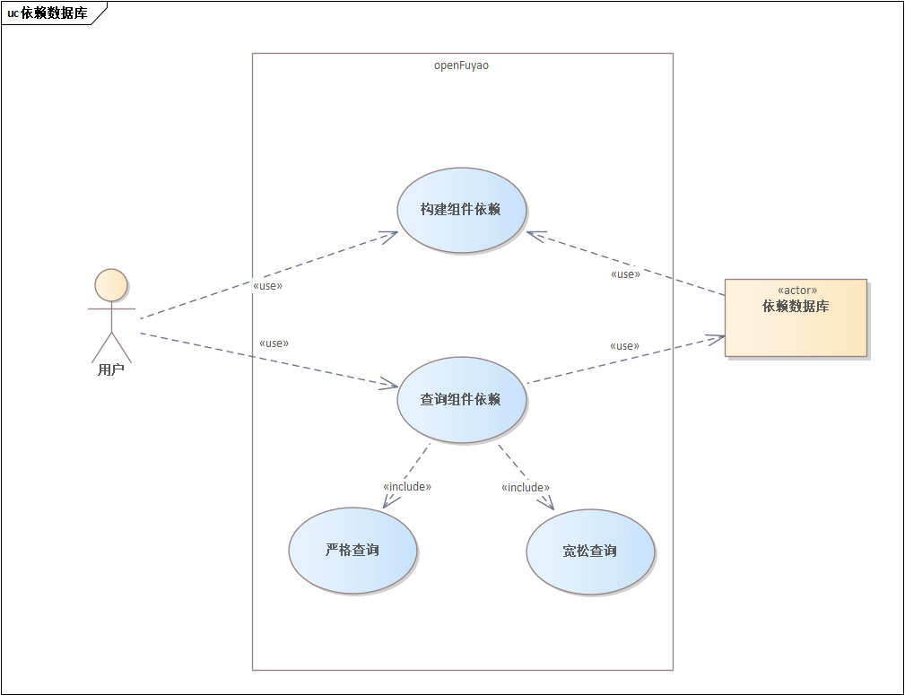
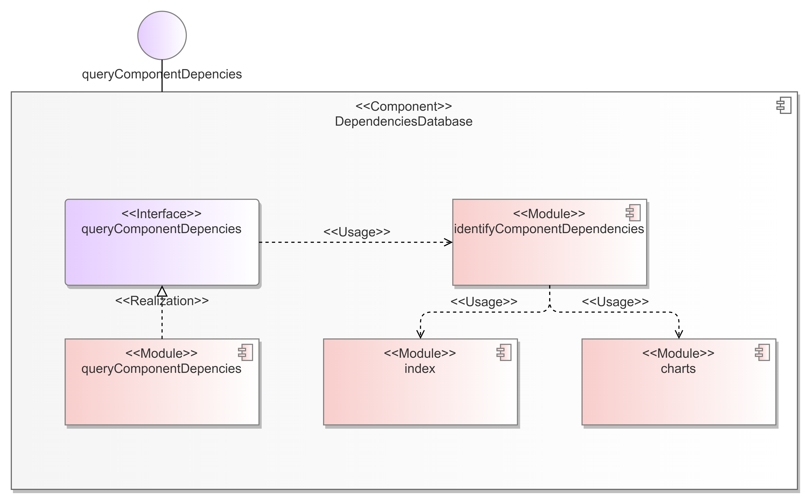

# 依赖数据库设计文档

## 概括

本项目计划设计一个**依赖数据库**，用于记录openFuyao社区各组件被依赖情况，并为用户提供依赖组件版本查询接口，以便于用户在开发时调整自己组件的配置，并在冲突发生后缩减排查组件版本范围。

## 动机

随着openFuyao社区项目规模逐渐扩大，其内部组件数量及组件间的依赖关系日趋复杂。用户在进行组件开发或部署时，缺乏全局的依赖视角，常因依赖组件间版本不兼容而引发构建失败或运行时冲突。目前依赖版本冲突问题的排查主要依赖人工经验，且效率低下，严重影响了用户体验和项目开发推进效率。针对这一问题，本项目设计一个依赖数据库，以提供**依赖组件全局视角查询**，依靠流水线数据，形成数据识别、存储与查询的完整解决方案。

### 目标

- 完成**依赖数据库日构建**：每日定时更新依赖存储情况，保证时效性

- 提供一个**依赖查询接口**：
    - 严格查询：用户提供组件名+版本名，返回该组件该版本在openFuyao社区上被哪些组件所依赖
    - 宽松查询：用户提供组件名，返回该组件所有版本在openFuyao社区上被哪些组件所依赖
    - 可配置参数：是否需要开发者版本（0.0.0-latest），以满足不同类型用户的需求

### 非目标

彻底识别或解决依赖组件版本冲突问题

## 提案

### 用户故事

- **构建组件依赖**：完成依赖数据库日构建，返回json文件
- **查询组件依赖**：提供查询服务
    - 严格查询：查找特定组件的特定版本，提供精细化的查询服务
    - 宽松查询：查找特定组件的所有版本，提供宏观视角的查询服务

#### 故事1

当用户开发自己的组件时，可以通过该查询接口进行**依赖组件自查**，来判断自己的组件是否依赖了openFuyao社区已经提供的组件，并据此判断这个依赖是否可能会发生冲突，或是否直接使用openFuyao社区提供的组件。

#### 故事2

当有冲突发生时，可以通过该查询接口**定位**到哪些openFuyao组件和用户部署的组件有同样组件的依赖，以**缩小冲突排查范围**

## 设计细节

### 逻辑视图

### 设计步骤

#### 1、识别依赖
1）读取helm包（https://helm.openfuyao.cn/_dev/index.yaml），识别其中的name，version和url，通过helm pull url来获得该版本组件的helm包

2）读取该chart包，所有依赖均在charts文件夹中，进入第一个文件夹（文件夹名即依赖的第一个组件名），读取chart.yaml中的version，和文件夹名拼装成组件名+版本号，然后再读取charts包（即该组件依赖的组件，子chart包），进行递归，直至某组件没有子charts依赖

3）在读取的过程中，构造依赖树，并在识别到a依赖b的同时，维护一个b的列表，每次同步执行append a，记录下b被a所依赖

4）这个各组件被依赖的存储可以用map<Name, map<Version, [] ComponentName>>来维护，碰到组件+版本就去看有没有这个列表，即是否有组件已经依赖该版本组件

5）全map扫描，将依赖该版本组件的所有组件都加到集合中

#### 2、构造json文件
将得到的被依赖列表转化为json文件，格式为：

{"x":

​      "v0.0.1": []

​      "v0.0.2": []

}

将其存储到指定位置，后续实现的查询接口将到这个文件中查询组件版本被依赖情况

#### 3、日构建脚本
将上述程序打包为可执行文件，每日构建一次，获得最新依赖组件版本数据（需标注更新时间，以保证时效性）

#### 4、后端查询接口
参数：componentName string, version string, needDevelopmentVersion bool

- componentName string：组件名，必填
- version string：版本号，若为空则显示当前组件所有版本（须结合needDevelopmentVersion判断是否显示开发者版本-latest）
- needDevelopmentVersion bool：是否需要显示开发者（latest）版本，必填，默认为false
- filePath string：查询文件路径，默认为 ../json/componentDependencyFile.json

注：若 `needDevelopmentVersion` 设定为 `false` ，则开发者版本对应的被依赖组件不管是否为开发者版本，都将不再显示在查询结果当中

#### 5、封装为命令行二进制形式

- dependency —— 根命令
    - -h / --help —— 获取帮助
- dependency build —— 构建组件被依赖情况
    - -u / --url：index.yaml所在的网址，不填写默认为 [helm.openfuyao.cn/_dev/index.yaml](https://helm.openfuyao.cn/_dev/index.yaml)
    - -p / --path：最终识别结果存储的目录，不填写默认为 ../json
- -h / --help：获取帮助
- dependency check —— 检查组件被依赖情况
    - -n / --name：组件名称（必填）
    - -v / --version：组件版本，填写为严格查询，不填写为宽松查询
    - -d / --dev：是否包含开发版本，默认为false
    - -p / --path：读取json文件的路径，不填写默认为 ../json/componentDependencyFile.json
- -h / --help：获取帮助
