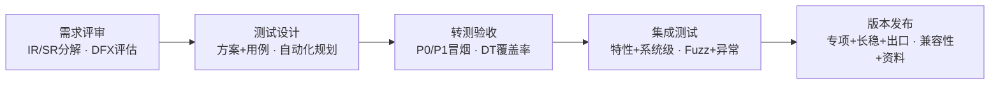
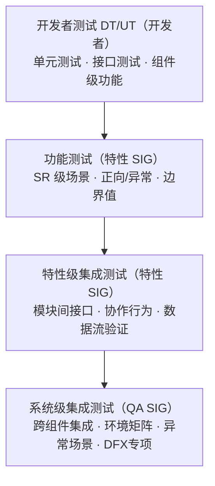

# openFuyao 社区测试设计指南

本文档是 openFuyao 社区测试设计的系统性指南，面向特性 SIG、QA SIG 及社区伙伴，覆盖从需求分析到测试闭环的全流程，整合社区已有规范并给出可操作的设计方法。

> **相关规范**（本指南引用以下文档，使用时以最新版本为准）：
> - [社区质量标准](社区质量标准.md) — 版本出口标准、质量指标基准
> - [版本转测试质量要求](版本转测试质量要求.md) — 转测 checklist
> - [转测验收checklist](转测验收checklist.md) — 验收检查项
> - [测试用例评审checklist](测试用例评审checklist.md) — 用例评审标准
> - [社区测试术语定义表](社区测试术语定义表.md) — 术语统一定义
> - [社区版本issue创建处理流程与规范](社区版本issue创建处理流程与规范/社区版本issue创建处理流程与规范.md) — issue 提单与定级
> - [社区协同测试指南](社区协同测试指南.md) — 协同测试流程
> - [测试方案模板](../Test_Template/v26.06-SIGXX-XX组件-XX特性测试方案模板.md) — 特性测试方案结构
> - [测试报告模板](../Test_Template/XX版本XX特性测试报告模板.md) — 特性测试报告结构

## 1. 测试设计全流程

测试设计贯穿特性生命周期，分为五个阶段：



| 阶段 | 特性 SIG | QA SIG | 社区伙伴 | Infra SIG |
|------|---------|--------|---------|-----------|
| **需求评审** | IR/SR 分解、DFX 评估 | 测试策略评审 | — | — |
| **测试设计** | 方案编写、用例设计、自动化规划、Fuzz 用例 | 评审用例、专项方案 | — | 门禁配置 |
| **转测验收** | 提交转测、P0/P1 冒烟 | 转测验收、DT 覆盖率检查 | — | CI 流水线维护 |
| **集成测试** | 特性级集成、Fuzz/性能 | 系统级集成、异常场景 | 协同测试、场景验证 | 日构建、环境供给 |
| **版本发布** | 测试报告输出 | 专项测试、版本出口 | 兼容性/易迁移验证 | 日构建环境保障 |

## 2. 需求分析与测试范围确定

### 2.1 需求分解结构

openFuyao 社区采用三级需求分解：

| 层级 | 含义 | 示例 |
|------|------|------|
| **IR**（集成需求） | 特性级别的需求编号 | AI 推理智能路由 |
| **SR**（子需求） | IR 下细分的需求项 | 智能路由策略管理 |
| **AR**（原子需求） | SR 下进一步拆分的最小需求单元 | 支持基于权重的路由策略 |

测试设计从 **SR 粒度**出发，每个 SR 至少有一条对应测试用例，确保需求 E2E 可追溯。

### 2.2 DFX 需求评估

测试设计前，必须逐项评估以下 DFX 属性的适用性。即使暂无要求也需明确讨论结论，非新增组件的性能基线要求为"较上一版本不劣化"。

| DFX 属性 | 缩写 | 测试要点 | 评估问题 |
|---------|------|---------|---------|
| 可测试性设计 | DFT | 健康探测、可观测输出、动态配置、可自动化断言 | 是否提供标准化健康探测接口/探针？输出是否结构化可机器解析？ |
| 可诊断性设计 | DFD | 日志分级、错误上下文、无静默失败、MTTR 可量化 | 异常场景是否有明确错误日志和上下文？是否存在静默失败？ |
| 可运维性设计 | DFS | K8s 标准部署、滚动升级、配置外置、回滚、扩缩容 | 是否支持滚动升级无中断？配置是否外置？是否支持回滚和扩缩容？ |
| 可靠性设计 | DFR | 故障自愈、故障隔离、熔断降级、重试、长稳测试 | 故障发生后能否自动恢复？恢复时间多久？单点异常是否影响整体？ |
| 性能设计 | DFP | 资源泄漏、并发、毛刺、资源上限、基线对比 | 时延/吞吐/资源占用的规格是多少？长期运行是否有泄漏？非新增组件较上一版本不劣化 |
| 安全性设计 | DFNS | 需参考安全sig要求，镜像扫描、Pod 安全策略、安全编码检查、CVE 修复 | 是否涉及敏感数据？参照安全红线哪些适用？镜像是否有高危漏洞？ |
| 兼容性设计 | DFC | 环境矩阵覆盖、升级验证 | 需要覆盖哪些 OS/架构/K8s 版本/硬件？从上一版本升级是否兼容？ |

### 2.3 影响范围分析

明确特性变更对现有功能的影响：
- 是否对组件的其他特性功能产生影响？
- 如有影响，需对影响范围内的特性执行回归测试并补充用例
- 在测试方案"影响范围"章节明确说明

## 3. 测试方案设计

### 3.1 分层测试架构

openFuyao 社区采用分层测试策略，从开发自测到系统级验证逐层递进：



### 3.2 测试方案内容结构

特性测试方案遵循社区模板，核心内容如下：

| 章节 | 内容要点 | 设计依据 |
|------|---------|---------|
| 特性描述 | IR/SR 清单、DFX 评估、交付件、影响范围 | 需求文档 |
| 测试环境 | 硬件/软件环境、环境矩阵、前置条件 | 兼容性要求 |
| 功能测试方案 | 按 SR 设计场景，标注设计方法和优先级 | SR 分解 |
| 特性级集成测试 | 模块交互关系、接口测试点 | 架构设计 |
| 系统级集成测试 | 跨组件集成、环境矩阵、异常场景 | 系统架构 |
| 专项测试方案 | 安全/性能/可靠性/兼容性/资料/DFX 补充 | DFX 评估 |
| 需求-用例追踪矩阵 | SR → 用例编号映射 | E2E 可追溯 |

### 3.3 入口标准与出口标准

**入口标准（转测条件）：**

| 条件 | 成熟特性 | 孵化期特性 |
|------|---------|-----------|
| DT 覆盖率 | 必须 >80% | 必须 >40%，建议 >80% |
| 冒烟测试通过率 | 必须 100%（P0 全通过） | 建议 100% |
| 静态检查 | 提示级别以上问题清零 | 提示级别以上问题清零 |
| 编译错误 | 清零 | 清零 |
| 开源义务 | NOTICE 文件、SCA 合规 | 建议 |
| 安装部署 | 基于社区安装部署要求通过验证 | 必须 |
| issue 解决 | 上版本遗留 100% 按计划解决；严重/致命 100% 解决 | 建议 |
| 需求管理 | 继承+新增需求清单、软件变化清单 | 必须 |
| 转测范围 | 交付件清单（含未交付件说明） | 必须 |

**出口标准（版本发布条件）：**

| 条件 | Beta 版本 | 正式版本 |
|------|----------|---------|
| 测试用例通过率 | >95% | 100% |
| 自动化测试比例 | 牵引 80%但不阻塞 | ≥80% |
| 安装部署 | 通过 | 通过 |
| 升级 | 通过 | 通过 |
| 性能 | 满足 Beta 基线 | 满足基线 |
| 安全 | 通过 | 通过 |
| 稳定性 | 满足 Beta 基线 | 满足基线（成熟特性 7×24h） |
| 兼容性 | 满足基线 | 满足基线 |
| 遗留问题 | 无安全红线、无关键阻塞 | 无安全红线、无关键阻塞 |
| 资料 | 通过（Beta 配套） | 通过（正式版） |

## 4. 测试用例设计方法

### 4.1 方法概览

测试用例设计应运用以下方法，并在用例"测试设计方法"字段中标注。不同方法适用于不同场景，通常需要组合使用。

| 设计方法 | 适用场景 | 覆盖目标 |
|----------|---------|---------|
| 等价类划分 | 输入参数有明确的有效/无效范围 | 用最少用例覆盖所有输入分类 |
| 边界值分析 | 输入存在数值范围或长度限制 | 覆盖边界上、边界内、边界外的值 |
| 正交试验法 | 多个独立因子、每个因子有多个取值 | 用较少组合覆盖因子间的交互效应 |
| 状态迁移法 | 被测对象存在多个状态及状态间转换 | 覆盖所有合法和关键非法状态迁移路径 |
| 判定表法 | 多个条件组合产生不同动作 | 覆盖所有条件组合及对应的动作 |
| 错误推测法 | 基于经验推测易出错的场景 | 补充其他方法未覆盖的异常场景 |
| 场景法 | 业务流程包含多个步骤和分支 | 覆盖主流程和关键异常流程 |

### 4.2 方法选择指引

| 场景特征 | 推荐方法 | 补充方法 |
|----------|---------|---------|
| 接口参数验证 | 等价类划分 + 边界值分析 | 错误推测 |
| 多因子环境组合（OS/架构/版本） | 正交试验法 | 覆盖 |
| 状态变化流程（生命周期、工作负载状态） | 状态迁移法 | 错误推测 |
| 业务端到端流程 | 场景法 | 等价类 |
| 复杂条件判断逻辑 | 判定表法 | 边界值 |
| 已知高风险模块 | 错误推测法 | 历史缺陷分析 |

### 4.3 等价类划分

将输入数据划分为有效等价类和无效等价类，从每个等价类中选取代表值。

**应用规则：**
1. 每个有效等价类至少一条用例
2. 每个无效等价类单独一条用例（避免多个无效输入相互掩盖）

**示例——混部规则创建，规则名称参数：**

| 等价类 | 类别 | 代表值 | 对应用例 |
|--------|------|--------|---------|
| 合法名称（英文字母+数字） | 有效 | `rule-test-01` | 验证合法名称创建成功 |
| 合法名称（最大长度） | 有效 | 63 字符字符串 | 验证最大长度名称创建成功 |
| 空字符串 | 无效 | `""` | 验证空名称时提示错误 |
| 含特殊字符 | 无效 | `rule@#$` | 验证特殊字符时提示错误 |
| 超长名称 | 无效 | 64 字符以上 | 验证超长名称时提示错误 |

### 4.4 边界值分析

在等价类划分基础上，重点测试边界上和边界附近的值。

**应用规则：**
1. 取边界值本身、刚好在边界内（边界-1）、刚好在边界外（边界+1）
2. 上下边界均需覆盖

**示例——混部规则条数限制（上限 100 条）：**

| 边界 | 测试值 | 预期结果 |
|------|--------|---------|
| 下边界 | 0 条（无规则） | 系统正常运行 |
| 下边界+1 | 1 条 | 创建成功 |
| 上边界-1 | 99 条 | 创建成功 |
| 上边界 | 100 条 | 创建成功 |
| 上边界+1 | 101 条 | 提示超过上限 |

### 4.5 正交试验法

当存在多个独立因子时，使用正交表选择代表性组合，避免穷举。

**应用规则：**
1. 识别所有正交因子及其取值
2. 标注因子间的交互策略：
   - **正交**：因子间存在交互影响，需要覆盖两两组合
   - **覆盖**：因子独立，仅需保证每个取值至少出现一次
3. 使用正交表或工具生成用例组合

**正交因子表格式（社区标准格式）：**

| 正交因子 | 取值 | 交互策略 | 备注 |
|---------|------|---------|------|
| 操作系统 | openEuler22.03 / Ubuntu22.04 | 正交 | |
| 架构 | X86 / ARM64 | 正交 | |
| 部署模式 | HA / 非HA | 覆盖 | |

### 4.6 状态迁移法

针对存在明确状态变化的场景，梳理状态迁移图，覆盖所有合法和关键非法迁移路径。

**应用规则：**
1. 绘制状态迁移图：列出所有状态和触发迁移的事件
2. 覆盖所有合法迁移路径
3. 覆盖关键非法迁移路径（验证系统拒绝非法迁移）

**示例——工作负载混部状态管理：**

需覆盖的迁移：
- 6 条合法迁移：非混部→在线、非混部→离线、在线→非混部、离线→非混部、在线→离线、离线→在线
- 非法迁移验证：子 Pod 在父工作负载未变更时不能独立切换状态

### 4.7 错误推测法

基于经验、历史缺陷、常见错误模式推测可能出错的场景。

**常见错误推测方向：**
- 空值/null 输入
- 并发操作（同时操作同一资源）
- 依赖组件缺失或异常
- 资源不足（磁盘满、内存不足、无可用节点）
- 网络异常（超时、断连、DNS 故障）
- 权限不足
- 环境重启后的状态恢复
- 大数据量/极端规模

## 5. 测试用例编写规范

### 5.1 用例字段定义

测试用例以 CSV 文件形式交付，字段以 [测试用例模板](测试用例模板.md) 为准，包含以下字段：

| 字段 | 是否必填 | 说明 |
|------|---------|------|
| 里程碑 | 必填 | 与发布版本保持一致，如 `v26.06` |
| 用例名称 | 必填 | 说明测试目的或测试意图，语言简洁、明确、无二义，标题控制在 50 个中文字符内；语法要求动宾（补）短语，可通过 `_` 追加条件或原因。示例：`在xx场景下，验证XX安装是否为xx` |
| 用例编号 | 必填 | 产品范围内唯一；为中/英文、数字、下划线、`-` 组合，不存在特殊字符、空格；推荐使用下划线串起特性名称、用例类型、序号；专项用例增加前缀（见 5.4） |
| 特性名称（IR/SR名称） | 必填 | 能被确认对应 IR/SR，存在 SR 时以 SR 为准，尽量与 IR/SR 保持一致 |
| 用例类型 | 必填 | 类型填写准确，见 5.3 |
| 优先级 | 必填 | P0/P1/P2/P3/P4，定义见 5.2 |
| 前置条件 | 必填 | 描述预先配置的测试环境、数据配置、当前系统状态（软件/硬件/网络环境）；环境要素明确化（如明确自定义仓库包含哪些镜像）；每步表述前使用"序号+分隔符"标识；不应包含测试步骤（如登录、打开等操作）；步骤数不超过 10 步 |
| 步骤描述 | 必填 | 每条步骤使用"序号+分隔符"标识；每步操作可执行、无歧义；需检查结果的步骤结束后加"见结果 xx"；连续多个独立步骤不能放在同一标号中；写明输入数据、操作入口和测试参数；步骤数不超过 10 步 |
| 预期结果 | 必填 | 每条预期结果使用"序号+分隔符"标识；禁止含二义性、模糊的描述（须为明确的数据、响应消息、界面变化）；预期结果编号与对应测试步骤编号保持一致；描述准确、具体，不出现难以观察和判断的结果 |
| 可自动化 | 必填 | 评估是否可以完成自动化；可自动化用例尽量 100% 完成，不可自动化的写明原因由测试手工保障 |
| 对应自动化用例 | 必填 | 完成自动化代码后必须填写，由开发标注、测试检查（检查代码 label） |
| 开发负责人 | 必填 | 如果自动化非特性负责人完成，需特殊标注 |
| 测试负责人 | 必填 | — |
| 备注 | 选填 | 补充说明、约束条件、关联用例等 |

### 5.2 用例优先级标准

| 等级 | 定义 | 典型场景 | 占比参考 |
|------|------|---------|---------|
| P0 | 特性验收用例 | 安装/卸载成功、核心功能正向主流程 | ~5% |
| P1 | 特性基本功能用例 | 继承特性基本功能、需求绝大部分规格覆盖 | P0+P1 合计 15%~20% |
| P2 | 特性复杂 & 异常场景用例 & DFX 用例 | 复杂场景、异常输入、DFX 属性（兼容性/可靠性/安全等） | 主体占比，按场景细化分配 |
| P3 | P2 级别如有细化诉求时可拆分 | 一般异常、边界条件 | 按需拆分，不作强制占比约束 |
| P4 | P2 级别如有细化诉求时可拆分 | 极端条件下的测试 | 按需拆分，不作强制占比约束 |

等级划分需满足一般比例要求，整体审视级别占比是否合理。

### 5.3 用例类型

用例类型字段填写需准确，开发主要考虑功能测试和特性级集成测试（需给出明确规格，规格内的功能必须有用例保障）。特性级集成测试优先级高于功能测试，需要实际环境的填特性级集成测试。

可选类型：功能测试、特性级集成测试、性能测试、兼容性测试、可靠性测试、安全测试、韧性测试、可扩展性测试、易用性测试。

### 5.4 用例编号规范

- **基本格式**：使用下划线串起特性名称、用例类型、序号，如 `特性名_用例类型_001`
- **字符限制**：中/英文、数字、下划线、`-` 组合，不存在特殊字符、空格
- **专项用例前缀**：
  - 性能：`Performance`
  - 资料：`Information`
  - 兼容性：`Compatibility`
  - 可靠性：`Reliability`
  - 韧性：`Resilience`
  - 安全：`Security`

### 5.5 用例文件命名规范

规范名称格式：

```
{版本}_{SIG}_{组件}_{特性}测试用例
{版本}_{SIG}_{特性}测试用例
{版本}_{SIG}_{组件}_{DFX类型}测试用例
```

要求：明确版本、SIG 组、组件、特性；组件和特性类似时可不填组件；特性与 IR/SR 相关。上传 QA-SIG 时目录层级清晰、命名准确。

示例：
- `v26.03_Installation_老架构升级至新架构特性测试用例`
- `v26.03_AI-inference_AI推理可观测_硬件健康检查特性测试用例`

## 6. 集成测试设计

### 6.1 特性级集成测试

关注特性内部模块间的接口正确性和协作行为。

**设计要点：**
1. 基于模块交互关系图，识别所有内部接口
2. 覆盖正常数据流和关键异常数据流
3. 重点验证模块间的数据传递、格式转换、异常传播

**接口测试点表格式：**

| 接口/交互 | 上游模块 | 下游模块 | 正常场景 | 异常场景 | 优先级 |
|----------|---------|---------|---------|---------|--------|
| 示例：准入控制器→CRD Operator | 准入控制器 | Operator | 工作负载匹配规则后正确分发 | CRD 规则不存在时的处理 | P1 |

### 6.2 系统级集成测试

关注组件在不同场景下的集成能力，包括四个子维度：

**6.2.1 跨组件集成测试**

验证当前特性与其他特性/组件之间的集成能力。需标注测试特性及版本、关联特性及版本。

**6.2.2 环境矩阵集成测试**

验证特性在不同 OS/架构/K8s 版本/硬件上的集成能力。环境矩阵引用测试方案第 2.3 节。

**6.2.3 异常场景测试**

验证特性在异常条件下的表现：
- 依赖组件缺失或异常
- 环境资源不足
- 非预期输入
- 环境重启/故障恢复

**6.2.4 DFX 测试**

DFX（Design for X）面向全生命周期的非功能维度设计验证，区别于功能测试（只校验业务逻辑是否走通），专门校验系统是否满足可测试、可诊断、可运维、可靠、高性能、安全、兼容等非功能能力。DFX 测试用例属于非功能专项集成/稳定性测试用例。

社区统一采用以下 7 类 DFX 分类：

| DFX 类型 | 缩写 | 核心验证目标 |
|---------|------|-------------|
| 可测试性设计 | DFT | 组件易于自动化测试、易于外部探测、无需侵入改造即可验证状态 |
| 可诊断性设计 | DFD | 正常/异常场景输出足够观测信息，支撑快速定位根因，降低 MTTR |
| 可运维性设计 | DFS | 适配云原生标准运维流程：部署、升级、回滚、配置变更、扩缩容 |
| 可靠性设计 | DFR | 异常环境、资源波动、进程异常、网络异常下具备容错、自愈、隔离能力 |
| 性能设计 | DFP | 资源开销可控、长期运行稳定、高负载不雪崩、无资源泄漏 |
| 安全性设计 | DFNS | 镜像扫描、Pod 安全策略、零信任、CVE 修复 |
| 兼容性设计 | DFC | OS/架构/K8s 版本/硬件矩阵兼容性 |

> **说明**：DFP/DFNS/DFC 的详细测试方法见第 7 章专项测试设计，本节给出 DFX 视角的校验点与用例方向。

### 6.2.4.1 DFT 可测试性设计

**通用校验点**：
- 提供标准化健康探测接口/存活探针/就绪探针
- 提供标准化观测输出（日志/指标/状态接口）
- 支持动态配置生效，无需重启服务
- 输出内容结构化、可机器解析、可自动化断言
- 启动、运行、退出状态可外部识别

**标准用例示例**：
- 名称：`DFT-验证组件暴露标准化健康探测接口`
- 前置条件：组件 Pod 正常运行就绪
- 步骤：调用组件健康检查接口/探针路径
- 预期结果：接口返回标准成功状态码；组件运行状态可被外部自动化识别；满足云原生可探测、可自动化测试设计要求

### 6.2.4.2 DFD 可诊断性设计

**通用校验点**：
- 日志分级规范：INFO/WARN/ERROR
- 异常场景有独立错误日志、错误标识、错误上下文
- 关键行为可观测：启动、加载配置、请求、异常、退出
- 具备异常计数、错误统计、状态指标
- 不出现静默失败、不出现无日志报错

**标准用例示例**：
- 名称：`DFD-验证组件异常场景可观测可追溯`
- 前置条件：组件正常运行
- 步骤：构造一次非法入参/异常触发条件，查看日志与状态输出
- 预期结果：异常行为有明确 ERROR 日志记录；日志包含错误原因、触发位置、关键上下文；无静默失败、无黑盒异常

### 6.2.4.3 DFS 可运维性设计

**通用校验点**：
- 完全基于 K8s 标准资源部署（Deployment/DaemonSet/ConfigMap）
- 支持滚动升级，升级过程无中断、无脏数据
- 配置文件外置，不固化在镜像内
- 支持配置热更新或平滑重启生效
- 支持版本回滚、快速恢复
- 支持水平扩缩容，无状态冲突

**标准用例示例**：
- 名称：`DFS-验证组件滚动升级无服务中断`
- 前置条件：组件稳定运行
- 步骤：执行镜像滚动更新，持续观测组件运行状态
- 预期结果：新旧 Pod 平滑替换，无业务中断、无重启风暴；升级完成后服务状态正常；符合云原生滚动发布运维规范

### 6.2.4.4 DFR 可靠性设计

**通用校验点**：
- 进程崩溃、异常退出后可自动重启恢复
- 单任务异常不影响整体服务（故障隔离）
- 网络抖动、超时具备重试/熔断保护
- 资源不足时不雪崩、具备降级保护
- 启动失败可重试、不卡死集群状态

**标准用例示例**：
- 名称：`DFR-验证组件异常退出后可自愈恢复`
- 前置条件：组件正常运行
- 步骤：手动 kill 组件 Pod，观察重建与恢复状态
- 预期结果：K8s 控制器自动重建 Pod；组件自动恢复运行状态；单实例故障不影响整体集群能力

### 6.2.4.5 DFP 性能设计

详细测试方法见 [7.1 性能测试](#71-性能测试)。

**通用校验点**：
- CPU/内存占用平稳，无持续递增泄漏
- 高并发/高任务量下不阻塞、不卡死
- 连接、句柄、协程无泄漏
- 处理耗时稳定，无严重性能毛刺
- 支持资源上限控制（requests/limits），不抢占集群资源

**标准用例示例**：
- 名称：`DFP-验证组件长期运行资源无泄漏`
- 前置条件：组件正常运行
- 步骤：持续运行一段时间，观测 Pod CPU、内存变化趋势
- 预期结果：内存无持续上涨、无泄漏现象；CPU 占用平稳，无异常高负载；长期运行稳定不重启、不 OOM

### 6.2.4.6 DFNS 安全性设计

详细测试方法见 [7.2 安全测试](#72-安全测试)。

**通用校验点**：
- 镜像扫描无高危漏洞
- Pod 安全策略符合基线（非特权、只读根文件系统、capability 最小化）
- 遵循零信任原则，服务间通信启用 mTLS
- 高危 CVE 按版本出口标准及时修复
- 敏感配置加密存储，不硬编码

**标准用例示例**：
- 名称：`DFNS-验证组件镜像无高危漏洞`
- 前置条件：组件镜像已构建
- 步骤：使用 Trivy/Grype 扫描组件镜像
- 预期结果：无 Critical/High 级别漏洞；存在漏洞已修复或有豁免说明

### 6.2.4.7 DFC 兼容性设计

详细测试方法见 [7.3 兼容性测试](#73-兼容性测试)。

**通用校验点**：
- 覆盖目标 OS 矩阵（openEuler/Ubuntu/Kylin 等）
- 覆盖目标架构矩阵（X86/ARM64）
- 覆盖目标 K8s 版本矩阵
- 覆盖目标硬件矩阵（NPU 型号/驱动/固件版本）
- 升级路径兼容（从上一个版本升级不中断业务）

**标准用例示例**：
- 名称：`DFC-验证组件在 ARM64 架构下功能正常`
- 前置条件：ARM64 环境就绪
- 步骤：在 ARM64 集群部署组件，执行核心功能用例
- 预期结果：部署成功；核心功能用例全部通过；与 X86 环境行为一致

### 6.2.4.8 DFX 用例编号建议

DFX 用例编号需增加专项前缀，便于筛选与统计：

| DFX 类型 | 编号前缀 |
|---------|---------|
| DFT 可测试性 | `DFT-` |
| DFD 可诊断性 | `DFD-` |
| DFS 可运维性 | `DFS-` |
| DFR 可靠性 | `DFR-` |
| DFP 性能 | `DFP-` |
| DFNS 安全性 | `DFNS-` |
| DFC 兼容性 | `DFC-` |

### 6.2.4.9 参考：云原生合规性测试（CNCF CNF Test Suite）

> 本节为 DFX 测试的额外参考内容，不属于 DFX 类型分类，可作为云原生合规性设计的补充校验清单。

参考 [CNCF CNF Test Suite](https://www.cncf.io/blog/2022/03/24/testing-cloud-native-best-practices-with-the-cnf-test-suite/) 七大维度，作为云原生合规性校验清单：

| 维度 | 校验要点 | 用例设计方向 |
|------|---------|-------------|
| **兼容性、可安装性与可升级性** | 兼容 Certified Kubernetes、Helm 部署、滚动升级、水平/垂直伸缩 | 验证组件通过 kubectl scale 伸缩、通过 helm upgrade 升级 |
| **微服务** | 以微服务形式独立交付、独立部署 | 验证组件可独立部署、独立升级，不依赖单体应用 |
| **状态管理** | 有状态/无状态组件分离、持久化正确性 | 验证无状态组件可任意删除重建；有状态组件数据持久化不丢失 |
| **可观测性** | 暴露 Prometheus 指标、日志规范 | 验证组件 /metrics 端点可被 Prometheus 抓取；日志结构化输出 |
| **韧性** | 混沌工程、故障注入、自愈 | 验证网络分区、磁盘 IO 故障下组件自愈能力（推荐 LitmusChaos） |
| **安全** | 镜像扫描、Pod 安全策略、零信任 | 验证 Pod Security Standards 级别；服务间 mTLS 启用情况 |
| **配置** | 配置外置、ConfigMap、动态生效 | 验证配置通过 ConfigMap 注入；配置变更后组件热加载不重启 |

**参考用例示例**：
- 名称：`验证组件可通过 kubectl 水平伸缩`
- 前置条件：组件稳定运行
- 步骤：执行 `kubectl scale deployment/<组件> --replicas=3`，观察 Pod 数量与服务可用性
- 预期结果：Pod 平滑扩容到 3 个；扩容过程无业务中断；新 Pod 就绪后自动加入服务

## 7. 专项测试设计

### 7.1 性能测试

| 维度 | 负责方 | 内容 |
|------|--------|------|
| 业务性能指标 | 特性 SIG | 特性自身的时延、吞吐、资源占用 |
| 系统通用指标 | QA SIG | 安装部署时间、接口时延、资源占用 |

**关键原则：**
- 非新增组件的特性，基线要求为"较上一版本不劣化"
- 需明确性能基线值和测试方法
- 长稳测试中关注性能下降趋势（下降幅度 ≥5% 定为主要问题）

### 7.2 安全测试

按安全 SIG 规范执行，包括：
- 端口扫描、病毒扫描、漏洞扫描、代码扫描、SCA 扫描
- 参照《产品网络安全红线》执行
- CVE 漏洞按 CVSS 评分定级：

| CVSS 评分 | 严重级别 | issue 定级 |
|-----------|---------|-----------|
| [9, 10] | Critical | 严重 |
| [7, 9) | High | 主要 |
| [4, 7) | Medium | 次要 |
| [0, 4) | Low | 不重要 |

### 7.3 兼容性测试

覆盖以下维度：
- **操作系统**：openEuler、Ubuntu、Kylin 等
- **架构**：X86、ARM64
- **K8s 版本**：社区发行版支持的版本范围
- **硬件设备**：kunpeng920 等社区已验证硬件

使用正交试验法设计环境矩阵，标注因子交互策略。

### 7.4 可靠性/长稳测试

| 特性类型 | 长稳要求 |
|---------|---------|
| 成熟特性 | 必须 7×24h 长稳测试 |
| 孵化期特性 | 报名参与 |

关注指标：运行时长、性能劣化趋势、资源泄漏。

### 7.5 资料测试

以陌生用户视角对文档内容进行准确性审视，严格按照文档步骤执行操作。
- 用户指南：软件介绍、安装、部署等使用指导
- 开发指南：源码编译构建指导、ChangeLog、API 接口参考

## 8. 测试环境设计

### 8.1 环境要素

| 要素 | 说明 |
|------|------|
| 硬件环境 | 硬件型号、配置、数量、角色（Master/Worker） |
| 软件环境 | OS 版本、K8s 版本、依赖组件及版本 |
| 环境矩阵 | OS × 架构 × K8s 版本 × 硬件的组合覆盖 |
| 前置条件 | 集群状态、组件安装、数据准备、账号权限 |

### 8.2 环境矩阵设计原则

1. 识别所有正交因子（OS、架构、K8s 版本、硬件等）
2. 标注因子间的交互策略（正交/覆盖）
3. 使用正交表生成代表性组合，避免穷举
4. 至少覆盖社区基准环境

## 9. 测试自动化设计

### 9.1 自动化框架

| 框架 | 适用场景 | 仓库 |
|------|---------|------|
| Ginkgo | 后端 API 测试、E2E 测试 | e2e-auto-test / api-auto-test |
| Playwright | 前端 UI 自动化测试 | — |

### 9.2 自动化策略

- 转测一周内要求自动化率 >80%
- P0 用例自动化完成 100%，P1 用例完成 70%（建议 100%）
- 不适合自动化的典型场景：硬件相关操作、主观 UI 体验评估、一次性验证
- 用例设计时在"自动化标识"字段标注可行性

### 9.3 自动化用例命名

推荐 `Given_When_Then` 或 `should_When` 格式，与手工用例通过编号关联。

## 10. 测试度量与质量标准

### 10.1 用例度量指标

| 指标 | 目标 | 下限 | 上限 | 说明 |
|------|------|------|------|------|
| 用例密度（个/KLOC） | 26.3 | 15.7 | 36.8 | 每千行代码对应的用例数 |
| 缺陷密度（个用例/缺陷） | 4.3 | 2.6 | 6.1 | 平均多少用例发现一个缺陷 |
| P0 用例占比 | ~5% | — | — | |
| P0+P1 用例占比 | 15%~20% | 15% | 20% | |

### 10.2 版本级度量指标

| 指标 | Beta 版本 | 正式版本 |
|------|----------|---------|
| 冒烟测试通过率 | 100% | 100% |
| 测试用例通过率 | >95% | 100% |
| 自动化测试比例 | 牵引 80% | ≥80% |
| DT 覆盖率（成熟） | >80% | >80% |
| DT 覆盖率（孵化） | >40% | >80% |

### 10.3 问题分级标准

| 级别 | 功能维度 | 性能维度 | 安全维度 |
|------|---------|---------|---------|
| **严重** | 阻塞基础测试，导致核心/扩展组件不能正常服务 | 低于规格 ≥30% | CVSS ≥9 未修复 |
| **主要** | 需求未实现或不正确，特性无法满足需求；阻塞组件基础测试 | 低于规格 [20%,30%)；长测下降 ≥5% | CVSS [7,9) 未修复；病毒木马；安全基线未通过；License 不合规 |
| **次要** | 规格实现有问题但未造成特性整体失效 | 低于规格 [10%,20%)；长测下降 [0%,5%) | CVSS [4,7) 未修复；安全编译选项未使用；安全编码问题 |
| **不重要** | 拼写/UCD 错误；易用性问题；优化建议 | 低于规格 [0%,10%) | CVSS [0,4) 未修复 |

### 10.4 转测验收打回规则

| 条件 | 处理 |
|------|------|
| P0/P1 用例不通过 | 直接打回 |
| 验出严重问题，阻塞测试 | 直接打回 |
| 验出严重问题，未阻塞，但验收期内（3 工作日）未闭环 | 打回 |
| DT 覆盖率不达标 | v26.03 视情况打回，v26.06 起直接打回 |

## 11. 测试用例自检与评审

### 11.1 用例设计自检清单

用例设计完成后，按以下清单自检：

- [ ] **需求覆盖**：每个 SR 至少有对应的测试用例
- [ ] **全量输入覆盖**：所有可能的输入都能被用例归类
- [ ] **全量输出覆盖**：所有可能的输出都存在于某条用例的预期结果中
- [ ] **优先级分布合理**：P0 约 5%，P0+P1 约 15%~20%
- [ ] **密度达标**：用例密度落在 [8.2, 36.8] 区间
- [ ] **DFX 覆盖**：逐项评估 DFX 属性的适用性并补充用例
- [ ] **异常场景覆盖**：不仅有正向用例，还有异常输入、异常环境、并发场景
- [ ] **设计方法标注**：每条用例均标注了所采用的设计方法
- [ ] **自动化标注**：每条用例均标注了自动化可行性
- [ ] **可独立执行**：用例间无隐含依赖，可独立运行
- [ ] **可客观判定**：预期结果不依赖人工主观判断

### 11.2 用例评审标准

用例评审通过应满足：

1. **需求覆盖率 100%**：每个 SR 都有对应用例，需求-用例追踪矩阵完整
2. **设计方法合理**：使用的设计方法与场景匹配，非简单罗列
3. **优先级分布合理**：P0/P1 占比在参考范围内
4. **用例密度达标**：落在社区参考区间内，或有合理说明
5. **DFX 覆盖完整**：所有适用的 DFX 维度均有对应用例
6. **格式规范**：字段完整、步骤清晰、预期结果可判定
7. **自动化标注**：全部用例标注自动化可行性，可自动化用例比例满足要求

### 11.3 评审流程

1. 开发提前将用例发给测试，测试初期审视后约评审
2. 测试约评审，开发讲解，建议开 AI 会议
3. 输出并归档评审结果、会议纪要、遗留问题

## 12. Issue 管理规范

### 12.1 Issue 属性

| 属性 | 是否必须 | 规范内容 |
|------|---------|---------|
| 类型 | 是 | 问题类选择`缺陷`；需求类选择`需求` |
| 负责人 | 是 | 根据 sig-info.yaml 中的 committer/maintainer 填写 |
| 里程碑 | 是 | 选择对应版本的里程碑 |
| 优先级 | 是 | 基于问题严重级别：严重/主要/次要/不重要 |
| 标签 | 是 | 版本标签/转测验收/集成测试/性能测试/安全测试/资料测试/长稳测试/一致性校验 |

### 12.2 开发者结论性评论模板

**问题有效场景：**
```
【问题定性】问题
【问题根因】xxxxxx（根因描述）
【解决方案】xxxxxx（阐述计划修复此问题的大致思路）
```

**问题无效场景：**
```
【问题定性】非问题
【定性理由】xxxxxx（至少需要给出对应于当前问题单场景的结论，存在明确逻辑链以及辅助理解的截图或者跳转链接）
```

### 12.3 Issue 生命周期

```
待办 → 进行中 → 已完成 → 已验收
                ↓
             已挂起（需 CCB 例会评审）
```

- `已完成`：开发者修复或给出闭环结论，不等于`已验收`
- `已验收`：测试人员（问题创建人）/QA committer/maintainer 确认回归通过
- `已挂起`：需在后续版本持续跟踪

## 13. 测试文档归档

### 13.1 文档类型与归档路径

| 文档类型 | 归档路径 | 时机 |
|---------|---------|------|
| 特性测试方案 | `Test_Strategy/{版本}特性测试方案/` | 测试设计阶段 |
| 测试用例文件 | `Test_Strategy/{版本}特性测试方案/测试用例/` | 测试设计阶段 |
| 特性测试报告 | `Test_Result/{版本}/` | 测试完成后 |
| 测试方案模板 | `Test_Template/` | 参考 |
| 测试报告模板 | `Test_Template/` | 参考 |

### 13.2 测试方案文件命名

```
v{版本}-{SIG}-{组件}-{特性}测试方案
```

示例：`v26.06-AI-inference-InferNex-智能路由测试方案`

### 13.3 测试报告核心内容

1. 特性概述（IR 清单、SIG 组、特性描述）
2. 测试信息（版本、时间、轮次、硬件环境）
3. 测试结论（整体结论、活动评价表）
4. 约束说明
5. 遗留问题分析（问题单号、描述、级别、影响和规避措施、状态）
6. 测试执行情况（用例数、通过率、自动化率）
7. 专项测试结论

## 14. 社区协同测试

### 14.1 协同测试定位

社区协同测试是针对 RC 版本的测试，各社区伙伴在 QA-SIG 基础测试工作基础上，针对自身使用特性与场景进行的测试。

### 14.2 协同测试目标

- 保障功能可用性：增加系统级集成测试场景
- 明确特性兼容性：针对伙伴重点关注环境开展兼容性测试
- 增强 DFX 保障能力：收集特性优化需求
- 提前体验：RC 版本阶段提前体验特性，代表客户验收

### 14.3 协同测试输出件

1. 协同测试报告
2. 测试 Issue

## 15. 附录

### 15.1 测试角色职责速查

| 角色 | 职责 |
|------|------|
| 特性 SIG | UT、DT、功能测试、特性级集成测试、部分专项测试（性能业务指标） |
| QA SIG | 系统级集成测试、专项测试（性能通用指标/安全/兼容性/长稳/资料/一致性）、转测验收、版本出口把关 |
| Infra SIG | 门禁类测试配置、CI/CD 流水线维护、日构建环境管理 |
| 社区伙伴 | 协同测试、场景扩展验证、兼容性验证 |
| 测试 Owner | 对特性质量负责；质量对时间的妥协不可由测试 Owner 自己提出 |
| QA 接口人 | SIG 与 QA SIG 沟通联络；看护测试任务规划与进度；定期汇报 |

### 15.2 测试类型速查

| 测试类型 | 定义 | 职责方 |
|---------|------|--------|
| 单元测试（UT） | 最小可测试单元的测试 | 开发者 |
| 开发者测试（DT） | 开发阶段测试活动统称，含 UT 和接口测试 | 开发者 |
| 功能测试 | 黑盒测试，验证特性是否满足功能需求规格 | 特性 SIG / QA SIG |
| 冒烟测试 | 最基本功能快速验证，执行 P0 用例 | 特性 SIG / QA SIG |
| 特性级集成测试 | 特性内部各模块间的集成测试 | 特性 SIG / 社区伙伴 |
| 系统级集成测试 | 系统整体集成验证 | QA SIG / 社区伙伴 |
| 专项测试 | DFX 属性测试（性能/安全/兼容性/可靠性/长稳/资料/一致性） | QA SIG / 特性 SIG |
| 门禁测试 | PR 提交后 CI 自动触发的检查 | Infra SIG / 特性 SIG |

### 15.3 版本阶段说明

| 分类 | 每日构建版本 | Beta 版本 | 正式版本 |
|------|------------|----------|---------|
| 能力目标 | 尝鲜版本，支持社区伙伴联调 | 基本功能稳定，支持伙伴联调 | 功能稳定，通过专项测试，符合质量要求 |
| 发布周期 | PR 合入触发 | 3 个月 | 3 个月 |
| 获取渠道 | harbor 仓 | Release SIG 宣布 | 社区正式公告 |
